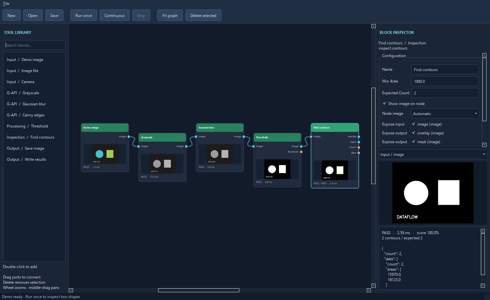

# OpenCVDataflowGUI

Develop and run vision applications by connecting extensible Python blocks in a
desktop node editor. Built with OpenCV, NumPy, and PySide6.

## Table of Contents

- [Background](#background)
- [Install](#install)
- [Usage](#usage)
- [Architecture](#architecture)
- [Maintainers](#maintainers)
- [Contributing](#contributing)
- [License](#license)

## Background

The goal is quick, visual development of OpenCV inspection applications without
writing code for each pipeline. Custom Python blocks extend the same contracts as
built-in tools. Workflow references include Cognex QuickBuild's tool blocks and
MVTec MERLIC's connected tool flow; this is an independent early-stage project.

## Install

Requires Python 3.11 or newer and a desktop OS supported by PySide6 and OpenCV.
Python 3.13 is the initial Windows development environment.

```powershell
python -m venv .venv
.\.venv\Scripts\python -m pip install -e ".[dev]"
```

On Linux/macOS use `.venv/bin/python` instead of `.venv\Scripts\python`.

OpenCV 5's **contrib** distribution is required. When upgrading an existing
environment, remove the old OpenCV distributions before reinstalling; they share
the `cv2` namespace and must not coexist:

```powershell
.\.venv\Scripts\python -m pip uninstall -y opencv-python opencv-python-headless opencv-contrib-python opencv-contrib-python-headless
.\.venv\Scripts\python -m pip install -e ".[dev]"
```

## Usage

**3D vision** includes camera and pose geometry, stereo calibration/rectification,
disparity, RGB-D projection and registration, point clouds, ICP/PPF, ArUco,
structured light, odometry, and posed TSDF fusion. Try **File > Load stereo cloud
example**, press **Run once**, and open **Results > 3D point-cloud viewer…**.
The example reconstructs a synthetic 3 m plane; no hardware or extra packages
are needed. See [3D workflows and conventions](docs/vision-3d.md).

**DNN/ML tools** are available under **ML** in the toolbox (model writers under **Output**): ONNX inference,
classification, embedding conversion, SIFT + LightGlue matching, and Annoy vector
index building/search/save/load. Try **File > Load DNN embedding example** with the
included tiny synthetic ONNX model. **Load Annoy search example** and **Load
LightGlue matcher example** use optional libraries. See [ML setup and workflows](docs/ml.md)
for installation, local weights and runnable examples. Graph execution never downloads
learned weights or imports optional ML libraries until their blocks need them.

Use [OCR and text verification](docs/ocr.md) to detect text regions, read
cropped lines with a local CTC model, and check OCR or barcode results.

The optional `barcodes` extra adds [Data Matrix and multi-format barcode reading](docs/barcode-reading.md).

Start the editor from the repository's virtual environment:

```powershell
.\.venv\Scripts\opencv-dataflow
```

Alternatively, run `python -m opencv_dataflow.app` from an environment with the
package installed. The editor opens a synthetic inspection demo; press **Run once**
(F5) to see two detected contours and a passing result. No camera is needed.



1. Expand a type and subtype in the left toolbox tree, then double-click a tool to add a block.
2. Drag between an output socket and an input socket in either direction. Image
   ports and wires are gold for images, purple for regions/masks, blue for poses/transforms,
   pale gold for pyramids, turquoise for depth, green for numbers, and slate for other data.
   The editor checks the declared kinds and accepts supported conversions. For example,
   a numeric count can feed a structured writer, and a pyramid can feed an image input.
   Hover over a converted wire to see its rule. See [connection compatibility](docs/architecture.md#connection-compatibility).
   Hover over a socket to see its full port name and any captured number, boolean, or text value.
   The **Debug** run profile captures input values.
3. Select a block, edit parameters in the right inspector, and click **Apply
   configuration**. Choose exposed ports and the optional node thumbnail there.
   The inspector highlights invalid entries and shows the applicable limit or rule.
   **Run block** previews eligible tools with their last captured inputs, including text and
   other structured data. The [parameter reference](docs/block-parameters.md) lists declared limits.
   On the canvas, **!** marks invalid configuration or input and **×** marks an
   execution exception. Hover over the node for details.
   Add a plain-text **Description** to explain the block in its hover tooltip.
   Use **Edit documentation…** for longer, formatted notes stored with the block.
   OpenCV enum controls use dropdowns; booleans use checkboxes. Hover over controls
   with help text for method-specific guidance.
4. Run once or continuously. Inspect retained input, output, and graphic images
   with the preview selector. Nodes show pass/fail/error state, timing, and score
   intensity where provided. A failed inspection still supplies results downstream;
   execution errors skip dependent blocks.
   Choose an output or graphic and click **Pop out…** to watch it in a separate
   window with a status-colored border and the ticket in its title.
   In the **Debug** run profile, pattern matching, template instances, oriented
   edges, and collection filtering include review graphics with accepted items
   in green and rejected candidates in red.

To combine annotations on a final image, expose **Result graphics** on each
source block and connect those outputs to **Overlay result graphics**. Connect
the final image to its **image** input, then run in **Debug**. Use **Choose
graphics…** on the overlay block to check individual layers, then **Apply
configuration** and run again. Image-aligned layers follow crop, resize, and
other recorded transforms in the same coordinate frame. Result graphics are
drawing objects. The overlay block draws them onto the final image to produce
the result image. Standalone previews such as histograms remain available for
inspection. [Try the overlay example](examples/overlay_result_graphics/README.md).

The overlay block starts with two visible graphics inputs. Expose more in the
inspector to connect up to eight sources. A ToolBlock's **Result graphics**
collects drawings from its internal blocks. You can also map an internal block's
exposed graphics to a separate public terminal.
5. Save/load JSON projects from File. Select a wire or block and press Delete to
   remove it. Use the wheel to zoom, middle-drag to pan, and **Fit graph** to frame it.

Use **File → Export project XML…** to snapshot the open project's saved fields and
values, including in-memory edits that have been applied. The export includes
nested ToolBlocks, recipes, saved training data, descriptions, and layout. External
assets are recorded by their saved references. Use **File → Compare project XML…**
to inspect added, removed, and changed values alongside changes to block order.
The comparison matches blocks by their saved IDs and shows before and after
values. JSON remains the editable project format.

Select a block and use **Save block XML…** to export its applied configuration
with a type-specific suffix such as `.cv.morphology.xml`. **Load block XML…**
applies the file to a selected block of the same type, retaining the destination
node's ID, position, and compatible connections. If loading would remove wires,
the inspector lists them and asks before proceeding. The XML includes saved
training data, documentation, port settings, and any nested block definitions.

After **Run once** captures inputs, click **Run block** in the inspector to preview
a supported block once with its current parameter edits. Enable **Live results**
to preview automatically. Edits within 300 ms of one another produce a single
preview, and **Run block** can run that preview immediately. The checkbox starts
off and resets when you leave the block. Previews stay in the inspector. Use
**Apply configuration** to save the edits to the graph.

In a **Morphology** block, choose **Edit kernel…** to preview a rectangle,
ellipse, cross, or diamond, or toggle individual cells in a custom kernel.
**Use kernel** stages the edit for live preview and **Apply configuration**
keeps it in the graph.

Node rearrangements mark the project as modified. **Save/Ctrl+S remembers node
positions even when connections are unchanged**, including layouts inside nested
ToolBlocks. Layout-only moves retain existing results. Positions are saved in the
project; there is no automatic save on movement.
Choose **Small**, **Medium**, or **Large** under **Block size** in the inspector.
The canvas applies the size immediately and keeps room for every exposed port.
Small hides the thumbnail, and Large gives it more room. Save the project to keep
the size, including for nodes inside ToolBlocks.
Use **Workspace → Auto arrange blocks** to organize the current canvas from
inputs on the left to outputs on the right. Groups and independent flows get
separate lanes. Save the project to keep the new positions.

Node borders indicate tool category (including purple region tools and blue pose
tools); node headers keep their pass/fail/error status colors and score intensity.
Selection adds a white outline. **Workspace > Color legend…** explains the palette;
see [canvas colors](docs/canvas-colors.md) for typing and custom-block details.

For larger workspaces, select nodes and use **Workspace > Group selected nodes**
(Ctrl+G). Drag the group's dashed header/border to move its members together;
**Ungroup selection** (Ctrl+Shift+G) removes the container. The upper-right overview
shows the visible region; click or drag there to navigate. Save remembers groups,
zoom and viewport position, including inside ToolBlocks.

**File > Load image-set workspace example** opens a grouped, three-image inspection.
Press **Continuous** to run the complete set and see filename tickets and verdict
borders in **Results > Image results filmstrip**. In an **Image file** block, use
**Select images…** or **Select directory…**, then **Apply configuration**. Run once
advances one image; Continuous stops at the end unless `repeat=loop`.
**File > Reset flow state** restarts the sequence. Filmstrips also appear in the
validation-set window. [Workspace and image-set details](docs/workspaces-image-sets.md)
cover ordering, queue behavior, filename identity, retention and Lean mode.

Train geometric and texture patterns with **Match shape pattern** and **Match
texture pattern**. Select a matcher, run once to capture its input, then click
**Train from input** in the inspector. Models are retained in saved projects and
can also be imported/exported as JSON. Separate **Train shape pattern** and
**Train texture pattern** blocks provide reusable wired models. Geometric features
include edges, corners, lines and circles; texture detection supports ORB and SIFT.
**Find oriented edges** selects vertical, horizontal or angled edges and filters
thickness, continuous length, strength, intensity, contrast and coverage.

Open **File > Load trained patterns and edges example**, or
[`examples/trained_patterns/trained_patterns.json`](examples/trained_patterns/trained_patterns.json), and press F5.
It needs no external assets: expected results are one geometric match, one texture
match and two vertical edges. See [training and edge workflows](docs/patterns-edges.md)
for training regions, pose coordinates, controls and current algorithm limits.

Pattern matchers also return a configurable **pose**: set local x/y/angular offsets
to locate an inspection origin on the part. **Pose from feature** creates a frame
from a ranked blob, line, contour or pattern match, and **Offset pose** composes
another local offset. Connect a pose to **Region relative to pose** to position a
rectangle, circle or polygon for downstream masked inspections. Try **File > Load
pose-relative inspection example** or `examples/pose_inspection/pose_inspection.json`; see
[pose-relative inspection](docs/poses.md) for coordinates and a complete workflow.

**Shape region**, **Region relative to pose** and **Shape mask** have visual
rectangle/circle/polygon editors in their inspectors. Relative-region and mask
editors map drawing and handle movements into the supplied pose's local frame.
Shape mask can also operate in ordinary image pixels with its pose disconnected.

Input sources carry numeric, string or timestamp tickets, generated automatically
or supplied through an external data input. **Control flow** tools split/join
parallel branches, batch/unbatch entries, select cases and restore FIFO by ticket.
Try **File > Load ticketed control flow example**. See
[tickets and control flow](docs/control-flow.md) for external/PLC ticket inputs,
buffer limits and stream execution semantics.

Ticketed connections carry each tool's pass/fail, score and accumulated failure
status. Every input has a **continue / reject_failed** policy; rejection emits no
data and retains the last processed previews. **Final ticket judgment** assigns an
explicit decision separately from intermediate tool results. Open **Results >
Ticket results…** to search tickets and inspect their status and event timelines.
Try **File > Load ticket results example**. See [ticket results](docs/ticket-results.md)
for status propagation, final decisions, retention limits and plugin event data.

**Coordinate inputs** offers ticket-matched waiting with timeouts, latest snapshots,
triggered latest snapshots, and first-arrival-per-ticket selection. Freshness,
duplicate and late-arrival controls make reuse explicit. Try **File > Load input
coordination example**. See [input coordination](docs/input-coordination.md) for
recommended policies and cooperative timing limits.

**Recipes > Manage recipes…** stores versioned settings and trained pattern models.
Use **Select recipe** / **Recipe value or model** blocks, or bind tool parameters
and matcher models in **Recipe overrides**. Images retain their recipe revision
across queues and global changes. Try **File > Load recipes example**; see
[recipes and model swaps](docs/recipes.md) for activation and persistence rules.

**Inspect each pose in parallel** runs a reusable inspection ToolBlock for every
pattern match, measured feature or supplied pose, then returns one aggregate. Set
worker count and optional N-pass/N-failure stop thresholds; results explicitly
identify uninspected parts. **File > Load parallel part inspection example** finds
and inspects 25 parts. See [parallel part inspection](docs/parallel-inspection.md)
for editing the inspection, acceptance policies and cancellation behavior.

Insert **Queue input images** after a source to retain frames and release them
one at a time. It supports bounded FIFO storage, explicit overflow policies and
optional background acquisition during inspection. Try **File > Load queued input
example**, then Continuous. See [input queues](docs/input-queues.md) for capacity,
metadata pairing and Stop/Resume behavior.

The supported dependency is OpenCV 5 contrib (development checks use 5.0.0.93).
This desktop application uses native Python bindings. Ordinary OpenCV blocks are
the defaults; legacy G-API blocks remain under **Advanced > G-API**.
Migration details and a possible browser/WebAssembly backend are covered in the
[backend notes](docs/opencv-backend.md).

Load trusted custom blocks via **File > Load Python plugin**. Start with
[`examples/custom_invert/custom_invert.py`](examples/custom_invert/custom_invert.py). Plugins run arbitrary Python;
project files never automatically import them. Load the same plugins before opening
projects that use their types. No code is needed for built-in pipelines.

If a block raises a Python exception during processing, the app records an error
and traceback in **Diagnostics**. The block emits no outputs, dependent blocks
that require its output are skipped, and independent branches can finish. Plugins
run in the app's process, so native crashes and forced process termination still
end the app.

Custom blocks can supply named `GraphicDrawing` objects through
`Result.drawings`. Each drawing identifies its source image input and contains
objects such as outlines, markers, and labels. The block's existing raster
previews remain available separately.

Built-in tools include demo/image/camera inputs; ordinary grayscale, Gaussian blur,
and Canny; threshold; contour inspection with overlay and mask images; image saving;
and structured result output to CSV, XML, or SQLite. Set a Write results block's
`format` to `csv`, `xml`, or `sqlite` and connect a `data` output to it. CSV and
SQLite append; XML and image writers reject existing files. Output blocks write
on every run, including continuous runs. Relative paths resolve from the process's
working directory; use absolute paths for portable local execution expectations.

Additional tools include monochrome/per-channel color histograms, grid-based planar
pixel-to-physical mapping, offline multi-view lens calibration, undistortion, white/
color balance, reusable calibration ToolBlocks, and typed depth-image loading,
RGB-D pairing and depth sampling. Calibration profiles can be saved and loaded as
JSON for subsequent measurement jobs without a grid in every image. See
[calibration and depth workflows](docs/calibration-depth.md) for units, origin and
coordinate-space contracts. These are offline tools; no live robot calibration or
point-cloud processing is implemented.

### Build and test a starter project

For the real-image Lena review example, run `python scripts/prepare_lena.py` once,
then open `examples/lena/lena.json`. The optional, hash-checked image is not committed
or included under this project's MIT license; see [asset provenance](examples/assets/README.md).
This example includes grayscale/blur, Canny, color/grayscale histograms and template
matching, including an editable nested ToolBlock. Its image input uses a
project-relative path, so move its `assets` folder together with its JSON file.

Open **File > Load starter inspection**, or launch it directly:

```powershell
.\.venv\Scripts\opencv-dataflow --starter
```

The project uses nine blocks: synthetic parts → crop ROI → grayscale → median
filter → Otsu threshold → morphology → connected-component measurements, with
histogram and Canny branches. Run once to detect two parts at a 100% inspection
score. Change **Measure two parts > Expected count** to 3 and apply it to exercise
an inspection failure, then restore 2. Save the graph as your own project.

The same project is saved in [`examples/starter_inspection/starter_inspection.json`](examples/starter_inspection/starter_inspection.json).
Open it through File > Open or pass its path to `opencv-dataflow`. A second project,
[`examples/template_matching/template_matching.json`](examples/template_matching/template_matching.json), locates a
reference patch at pixel `(250, 85)`; it is also available from File.

To verify a saved graph without the editor:

```powershell
.\.venv\Scripts\opencv-dataflow-run examples/starter_inspection/starter_inspection.json --repeat 3
```

Add `--report <new-file.json>` for a JSON receipt of each run, including states,
scores, timings and numeric/data outputs. Existing reports are preserved. Use
`--plugin <trusted-file.py>` to explicitly load custom Python blocks. Exit status
is 0 when all runs pass, 1 for an inspection/execution failure, and 2 for load or
configuration errors. Output blocks still perform their configured writes on every
run. `python -m opencv_dataflow.runner` is an alternative to the console command.

The expanded [base-tool catalog](docs/base-tools.md) covers conversion, crop/resize/
flip/rotate, filters, automatic/adaptive thresholds, color-range masks, morphology,
bitwise operations, blending, gradients, components and template matching. These
new wrappers use eager OpenCV calls; legacy native G-API tools live under Advanced.

Additional wrappers include histogram equalization, CLAHE, normalization, gamma,
channel split/merge, masking, absolute difference, corner detection, Hough lines/
circles and distance transform. See [additional tools](docs/additional-tools.md).
After preparing the optional Lena asset, open `examples/lena_features/lena_features.json` to try
CLAHE → corners, edges → line segments, and a histogram in one project.

The [registration and transform tools](docs/registration-tools.md) add arbitrary
rotation, affine/perspective warps, borders, pyramids, custom filtering, unsharp
masking, FAST/ORB features, descriptor matching, homography estimation and point
transforms. Open `examples/lena_registration/lena_registration.json` after preparing the Lena asset
to match the image to a known rotated copy and compare the estimated warp.

Further tools include box and separable filtering, Harris/minimum-eigenvalue
responses, subpixel corner refinement, phase correlation, full/partial affine
estimation, coordinate remapping, and Cartesian-to-polar image fields. See
[analysis tools and parameter conventions](docs/analysis-tools.md).

The [OpenCV coverage backlog](docs/opencv-coverage.md) ranks missing tools and
links to the full Python binding inventory for the pinned contrib build.

The [complete parameter reference](docs/block-parameters.md) lists defaults,
dropdown choices and input ports directly from the block definitions. Existing
wrappers also expose kernel dimensions, anchors, borders, output depths, masks,
threshold modes, contour modes, feature detector controls, matching norms, robust
solver settings, calibration flags and image encoder options where applicable.
Native buffers are managed by the runtime; hardware requests depend on the camera
backend. Existing saved projects acquire new defaults when loaded.

### Masks and regions

Add **Image processing > Regions > Shape region**, choose rectangle, circle or
polygon from its dropdown, and connect its `region` or `mask` output to supported
blocks. Regions retain input-image coordinates and include a tinted overlay.
When both a mask and region are connected, their intersection is used.

Run once, select the Shape region block, then click **Draw / edit region…** in
the inspector. Draw rectangles/circles by dragging or polygons by clicking
vertices. Drag handles to resize, or drag a shape to move it. **Apply region**
updates the block and marks the project modified; **Cancel** preserves it.
The editor uses a captured frame, with correctly scaled pixel coordinates.

Use **Combine regions** to union, intersect, subtract, XOR or invert shapes;
its output is another reusable region, so combinations can be nested. **Measure
selected region** reports pixel area, image coverage, bounds and centroid, with
configurable inspection limits. **File > Load combined regions example** opens
an 11-block project that excludes a circle's center and adds a second part region.

**Transform region** carries a selection into another image's coordinates. Connect
the target image, source region and the image operation's `geometry` output, or a
registration `transform`. Forward/inverse direction and mask sampling use dropdowns.
Try **File > Load transformed regions example** for a 12-block crop → resize →
rotation pipeline whose inspection region follows each image operation.

Open **File > Load regions example**, or `examples/regions/regions.json`, for a working
10-block project that inspects each synthetic part separately, computes a polygon
histogram and blurs only the circular selection. No image download is required.
Run it headlessly with `opencv-dataflow-run examples/regions/regions.json --repeat 3`.

Selections support filters, segmentation, gradients, image math, histogram and
contrast tools, corner/ORB detectors, contours/components and template search.
Contour/component **Region mode** chooses whole-object center filtering or clipped
measurements. See [region behavior and supported tools](docs/regions.md) for
outside-pixel policies, neighborhood behavior and coordinate rules.

### Blob, line and contour collections

**Find blobs**, **Connected components**, **Find contours**, **Hough line segments**
and **Find line segments (LSD)** expose a `collection` output. Connect it to
**Filter object collection**, **Sort object collection**, and **Draw object
collection** to select and visualize measured objects without code.

Filter/sort criteria use dropdowns: area, bounding width/height and position,
centroid, aspect ratio, principal-axis angle, line length, perimeter, fitted box
sizes, extent, solidity, circularity, distance and all seven raw/signed-log Hu moments.
Chain filters for multiple criteria, inspect rejected objects, and use stable
two-key sorting with explicit policies for undefined measurements.

Try **File > Load object collections example**, or `examples/object_collections/object_collections.json`.
This 16-block project orders two parts left-to-right, selects the round contour and
isolates two long vertical lines. See [collection tools and measurement conventions](docs/object-collections.md).

### Channels, payloads and image pyramids

Use **Split three channels / Merge three channels**, or the four-channel alpha
variants, to process planes independently. **Extract image channel** and **Replace
image channel** use channel-index dropdowns and preserve coordinate payloads.

**Gaussian image pyramid set** sends all levels together on its `images` port.
Connect it to an ordinary image input: the largest level is used by default.
Choose a smaller level using the inspector's **Pyramid level: input name** dropdown.
**Select pyramid level** provides an explicit single-image output; **Pyramid down**
and **Pyramid up** are separate toolbox entries too.

Images and other port values can carry optional JSON payloads. Built-in spatial
payloads record image dimensions, the mapping to the original image and pyramid
level provenance. Results stay in their working coordinates and show the source
level in the inspector and headless receipts. **Read port payload / coordinates**
exposes a mapping to the largest or original image for **Transform points** and
**Transform region**. **Attach port payload** adds recipe or custom data.

Try **File > Load channels and pyramids example**, or open
`examples/channels_pyramids/channels_pyramids.json`: it splits/merges channels, carries a recipe
payload through a four-level pyramid, detects blobs at level 2, and maps their
centroids back to the largest image. See [payload and pyramid contracts](docs/payloads-pyramids.md).

### Image file formats

The **Image file** input loads a file and reformats it using inspector dropdowns:

- **Color format:** unchanged, BGR, RGB, BGRA, RGBA, grayscale, HSV, or Lab.
- **Pixel depth:** unchanged, uint8, uint16, or float32 (depth is per channel).

Choose **unchanged** for both to preserve decoded channels, alpha, and depth.
Defaults remain BGR/uint8 for existing jobs. Integer depth conversion scales the
full range (8-bit 255 maps to 16-bit 65535); integer-to-float maps to [0,1]. Float
sources keep their numeric values in float outputs, and float-to-integer clips
to [0,1] before scaling and rounding. There is no per-image contrast normalization.
HSV and Lab support uint8 or float32, not uint16, and use OpenCV's native channel
ranges. See [image format details](docs/image-formats.md).

The `image` output carries the requested format. The `info` output reports size,
channel count, depth, and source/output formats; the decoded source is also available
in the graphic preview selector. Previews and built-in tools interpret the color
encoding correctly. Processing tools still have their own depth requirements:
ordinary Grayscale supports uint8/uint16/float32. Canny and Adaptive Threshold
accept color or grayscale and use an 8-bit working image for their masks. Equalize
Histogram, CLAHE, and Inpaint can preserve the source pixel depth and color encoding.
Legacy G-API Grayscale also requires uint8. For explicit conversion, choose the
color format and pixel depth in the file input or a Convert image block.

### Video file replay and recording

**Video file** emits one decoded frame per graph activation. Set a zero-based
start frame, optional exclusive end frame, stride and stop or loop mode.
The frame ticket and metadata include its filename and index. The metadata
also gives decoder time or an explicitly labeled frame-rate estimate.

Connect the result to **Write video file** to encode processed frames at a
configured playback rate. Choose a new output path and a codec supported by
the selected backend. A continuous run or a headless run with `--all-images`
writes one clip, which is finalized when execution closes.
See [video file workflows](docs/video-files.md).

### Reusable ToolBlocks

Select nodes and use **ToolBlocks > Create from selected nodes** to encapsulate
them as one reusable block. Crossing wires are preserved, unbound inputs become
public inputs, and terminal outputs become public outputs. Double-click the new
node (or use **Edit internal graph** in its inspector) to develop its contents in
the same node editor. ToolBlocks can contain other ToolBlocks. **Up one level** and
the job breadcrumb show where you are.

Use **Public terminals** to name and map the interface to internal typed ports.
Renaming a terminal preserves connected wires; disconnect a terminal before removing
its binding. Exposed-port checkboxes then choose which public ports appear on the node.
The outer block aggregates child pass/fail status, minimum available score, graphics,
and errors. Internal run records remain inspectable by opening the block after a run.

**Export ToolBlock** writes a `.toolblock.json` definition; **Import ToolBlock**
adds an instance and a session library entry. Creation and export also add reusable
library snapshots. Double-click a library entry to add another independent instance.
Editing an instance does not change other instances or a previously captured library
snapshot; export again to capture the edited version. Job files embed their ToolBlocks,
so they do not depend on the original definition file. Required Python plugins must
still be loaded explicitly.

For a ready-made nested pattern, import
[`examples/inspect_shapes/inspect_shapes.toolblock.json`](examples/inspect_shapes/inspect_shapes.toolblock.json)
and connect a Demo image or Image file output to its `image` input.

Run controls always execute the entire root job, including when viewing a nested
ToolBlock. Saving also saves the root job. See [docs/toolblocks.md](docs/toolblocks.md)
for the class model and a worked example.

The Python runtime can also execute graphs independently of the editor:

```python
from opencv_dataflow.blocks import builtin_registry, demo_graph

graph = demo_graph(builtin_registry())
graph.run()
for block in graph.blocks.values():
    print(block.name, block.state, block.error)
graph.close()
```

**Sequence** blocks retain memory for running background subtraction, Farneback optical
flow, Lucas-Kanade point tracking and first/latest/mean image references. They report
readiness and activation counts, suppress primary outputs during warmup, and support
bounded per-stream state, resets and trained references stored in projects or recipes.
Try **File > Load sequence memory example**, then run continuously. See
[sequence memory](docs/sequence-memory.md) for training, masks, ticket provenance and limits.

## Architecture

Choose **Run profile: debug / balanced / lean** in the toolbar to control observation
overhead. Lean skips routine diagnostic capture and image preview transfers, samples GUI
updates, and removes the development pacing delay while preserving processing outputs,
failure reasons, counters and private input isolation. The headless runner accepts
`--profile lean`. See [run profiles and measured performance](docs/run-profiles.md).

Use **Graphics default** in the toolbar to turn optional result graphics on or off
across the project, or set **Result graphics** on a block to override the default.
Declared image outputs remain available. Both choices are saved with the project.

Independent graph branches can run concurrently as soon as their inputs are ready.
Use **Branch workers** in the toolbar to save **Auto**, **Serial**, or a worker
limit for the current graph. The headless runner accepts `--branch-workers 1` to
run the root graph serially. See [branch scheduling](docs/control-flow.md).

The bottom status bar shows running ticket totals, pass/fail counts, pass rate and
average end-to-end time. Final judgments can attach stable failure codes and explanations.
Use **Results > Validation image sets…** to grade saved images as must/should pass,
unknown or must/should fail, optionally matching a preferred failure code. Runs produce
a score and per-image report without affecting production counts. Try **File > Load
validation image set example**; see [production counts and validation](docs/production-validation.md).

Open **Results > Block diagnostics** (**Ctrl+Shift+D**) for a bottom dock with
severity-colored logs. Selecting a block isolates its logs; clearing the selection shows
all blocks. Filter verbosity/severity, search messages, and inspect structured parameters
and chained exception tracebacks. Every block exposes `block.logger` for custom
diagnostics. See [block diagnostics](docs/diagnostics.md).

**Results > Ticket activity timeline…** displays a ticket Gantt chart, while
**Results > Block concurrency…** shows verdict-colored activity bars in a rolling
time window. Both use a common block start/finish event log with ticket identities,
exception/blocked-input/queue flags, filters, pause, zoom and JSON export. Nested and
parallel inspections share the same collector. See [activity events and timelines](docs/activity-timelines.md).

Every block retains current/last/average execution timing and an activation count.
The inspector shows these statistics, and headless reports include them. Ticketed
connections carry source-start/output-finish UTC timestamps and monotonic elapsed time,
including queue waits. **Results > Ticket results…** shows the overall observed span
and per-tool durations. See [execution and ticket timing](docs/timing.md) for measurement
boundaries, parallel work and explicit final-decision timestamps.

- `core.py`: block/result contracts, typed ports, acyclic graph scheduling, JSON projects.
- `blocks.py`: acquisition, legacy G-API processing, inspection, and output sinks.
- `basic_processing.py`: ordinary Grayscale, Gaussian blur and Canny defaults.
- `processing.py`: base OpenCV geometry, filtering, segmentation, math and inspection wrappers.
- `features.py`, `registration.py`, `analysis_tools.py`: contrast, features, registration and numerical image tools.
- `dnn_blocks.py`, `lightglue_blocks.py`, `annoy_blocks.py`: inference, learned matching and vector search.
- `geometry3d.py`, `stereo3d.py`, `ptcloud3d.py`: calibrated geometry, depth, motion and fusion.
- `pointclouds.py`, `cloud_tools.py`, `cloud_io.py`, `cloud_viewer.py`: typed clouds, surface matching, files and viewing.
- `regions.py`, `selection.py`: reusable shape regions, mask intersections and selection policies.
- `region_editor.py`: interactive image-space drawing and editing of region shapes.
- `payloads.py`, `pyramids.py`: optional wire payloads, image coordinate provenance and bundled pyramids.
- `objects.py`, `collection_tools.py`: measured blob/line/contour collections, filtering, sorting and rendering.
- `examples.py` and `runner.py`: built-in starter graphs and headless project verification.
- `plugins.py`: explicitly loaded trusted Python extensions.
- `canvas.py`: movable nodes, typed sockets, selectable wires, pan and zoom.
- `app.py`: Qt editor, inspector, worker execution, project and plugin actions.
- `toolblocks.py`: composite blocks, public terminal mappings, reusable definitions.
- `toolblock_editor.py`: public terminal configuration dialog.
- [`examples/`](examples/README.md): runnable projects, reusable ToolBlocks, and a Python plugin,
  each with its own README.
- `tests/`: local runtime and persistence checks.

Default Grayscale, Gaussian blur and Canny use ordinary OpenCV calls, retaining
per-node results for inspection. Legacy variants under **Advanced > G-API** each
cache a `cv2.GComputation`; the editor graph is not fused. An explicitly compiled
ToolBlock with selected diagnostics is [future work](docs/opencv-backend.md#compiled-toolblocks-future),
subject to demonstrated performance benefit before enablement or expansion.
Block histories retain the latest run only; projects store configuration, not
camera frames or execution histories.

See [docs/architecture.md](docs/architecture.md) for execution and extension contracts.
This is a working prototype: live camera hardware is not part of automated
validation, cancellation waits for the current native/custom operation to return,
and there is no operator interface, undo/redo, or full OpenCV tool catalog yet.

## Maintainers

[@votecoffee](https://github.com/votecoffee)

## Contributing

Use a `src/` package layout and keep reusable examples sanitized. Keep local
projects, images, device configuration, and scratch artifacts in ignored `.local/`.
Run local checks before committing:

```powershell
.\.venv\Scripts\python -m pytest
.\.venv\Scripts\python -m ruff check src tests examples
.\.venv\Scripts\python scripts/block_parameter_reference.py --check
```

See [CONTRIBUTING.md](CONTRIBUTING.md) for development conventions and
[docs/roadmap.md](docs/roadmap.md) for planned work.

## License

[MIT](LICENSE) © 2026 votecoffee.
