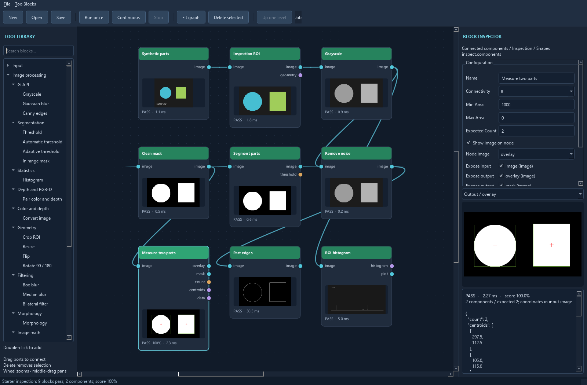

# Base OpenCV tools and starter projects



These tools are usable node blocks with typed ports, inspector parameters, latest
input/output records, native errors and previews. They use ordinary OpenCV calls;
ordinary Grayscale, Gaussian blur and Canny are the defaults. Legacy variants live
under **OpenCV > Advanced > G-API**, with their existing IDs retained for older projects.
They are not silently fused into a shared graph.

## New block catalog

Trainable geometric and ORB/SIFT patterns, plus oriented gradient-band edge
measurements, are documented in [pattern training and edges](patterns-edges.md).
The portable `examples/custom tools/trained_patterns/trained_patterns.json` job exercises all three tools.

| Toolbox subtype | Block | OpenCV operation / behavior |
| --- | --- | --- |
| Color and depth | Grayscale | `cvtColor`; tagged color input or grayscale passthrough, uint8/uint16/float32 without depth scaling |
| Filtering | Gaussian blur | `GaussianBlur`; X/Y kernels and sigmas, border policy/value, optional mask/region |
| Edges | Canny edges | `Canny`; automatic uint8 grayscale working image, low/high thresholds, aperture and L2 gradient, optional mask/region |
| Color and depth | Convert image | Color conversion and deterministic depth scaling; same choices as image-file input |
| Geometry | Crop ROI | Validated array ROI; zero width/height means remainder of image |
| Geometry | Resize | `resize`; explicit width/height and nearest, linear, area or cubic interpolation |
| Geometry | Flip | `flip`; horizontal, vertical or both |
| Geometry | Rotate 90 / 180 | `rotate`; clockwise/counterclockwise quarter turn or half turn |
| Filtering | Box blur | `blur`; odd square kernel |
| Filtering | Median blur | `medianBlur`; odd kernel of at least 3 |
| Filtering | Bilateral filter | `bilateralFilter`; diameter and color/spatial sigmas |
| Segmentation | Automatic threshold | `threshold` with Otsu or Triangle; image and selected threshold outputs |
| Segmentation | Adaptive threshold | `adaptiveThreshold`; mean/Gaussian local threshold, neighborhood, offset and inverse option |
| Segmentation | In range mask | `inRange`; scalar or per-channel inclusive lower/upper bounds |
| Morphology | Morphology | `morphologyEx`; erode, dilate, open, close, gradient, top-hat or black-hat; visual editor for rectangle, ellipse, cross, diamond, and custom binary kernels |
| Image math | Bitwise image operation | `bitwise_and/or/xor/not`; second input required except for NOT |
| Image math | Weighted blend | `addWeighted`; explicit alpha, beta and gamma |
| Edges | Sobel / Scharr / Laplacian | Signed float32 derivative and a separate uint8 absolute-magnitude preview |
| Inspection / Shapes | Connected components | `connectedComponentsWithStats`; area filtering, bounds, centroids, count, overlay and mask |
| Inspection / Matching | Match template | `matchTemplate`; normalized coefficient, correlation or squared-difference matching |

Older tools remain available: Advanced G-API grayscale/Gaussian blur/Canny, fixed
threshold, contour inspection, per-channel histogram, calibration and depth tools.
Operation dropdowns expose further native variants.

## Data and coordinate contracts

- Geometry, filtering and morphology preserve the image's tagged channel encoding.
  In range mask tests the actual channel values, so HSV masking uses H/S/V bounds.
  Use Convert image first when you want a different encoding. A single lower/upper
  value broadcasts across channels; otherwise provide one value per channel.
- Segmentation, gradients, components and matching interpret RGB/HSV/etc before
  making grayscale images. Image math canonicalizes both inputs to OpenCV channel
  order, then requires equal shape and depth. Alpha participates in per-channel
  filtering/math; it is not a depth plane.
- Geometry blocks emit `geometry` with an `output_to_input` 3×3 transform and image
  sizes. These map continuous pixel-center coordinates; they are not the discrete
  source-sample lookup used by a particular resize interpolation. For example,
  after a crop at `(35,65)`, add that offset to measured ROI centroids before using
  a calibration of the original image. Calibration mappings are not auto-adjusted.
- Components treat nonzero uint8 grayscale pixels as foreground. `min_area` and
  `max_area` use pixel counts; maximum zero means unlimited. Bounds and centroids
  refer to this block's input coordinates. The separate centroid-list output can
  feed Pixel to physical when it uses a matching calibration coordinate space.
- Template matching returns one best location with bounds and center in search-image
  pixels. It does not estimate rotation, scale, a set of multiple matches, or a
  calibrated confidence probability. Score is normalized correlation (negative
  coefficient scores clipped to zero), or `1 - normalized squared difference`,
  clipped to [0,1]. Score threshold controls inspection pass/fail. Constant references
  are rejected for coefficient matching and zero-energy references for all methods.
- Gradient data retains signed physical pixel-value derivatives. Its display image
  alone is normalized to the run's peak absolute magnitude; do not measure intensity
  from that display. The operator's signed float32 output is separate.

## Depth and validation limits

Tools with automatic working-depth conversion are listed below. These tools
reject nonfinite samples and physical `DepthArray` values. Use dedicated tools
for physical depth planes.
Geometry, box blur, morphology and blending accept uint8/uint16/float32/float64.
Some native combinations still have channel/kernel limitations:

- Median: uint8/uint16/float32; kernels above 5 require uint8.
- Bilateral: uint8 or float32, grayscale or three channels.
- Otsu: uint8/uint16; Triangle: uint8. Automatic threshold emits full-scale binary
  values for its input depth (65535 for uint16).
- Canny and Adaptive Threshold convert color to grayscale and map uint16 and
  floating-point intensity to a uint8 working image. Their masks are uint8.
- Connected components uses uint8 intensity (color inputs become grayscale).
- In range mask and gradients: uint8/uint16/float32.
- Bitwise: uint8/uint16; matching: both inputs uint8 or both float32.
- Convert image uses the [existing format/depth rules](image-formats.md). Changing
  depth while preserving HSV/Lab requires selecting an explicit color format so
  OpenCV's encoded channel ranges are converted correctly.

Invalid kernels, ROI bounds, mismatched image math inputs, incompatible templates
and invalid numeric parameters fail the block and clear stale results. Dependents
are skipped after execution errors. A valid negative inspection still supplies
measurements downstream. These are standard native operations, not all of OpenCV.

## Starter inspection

Open [starter inspection](../examples/demos/starter_inspection/starter_inspection.json)
or run `opencv-dataflow --starter`. The project contains no
device paths or output writers; repeat execution needs no camera and writes no
files. It is suitable for testing wiring, inspector edits, previews, save/load and
encapsulation into a reusable ToolBlock.

```text
Synthetic parts -> Inspection ROI -> Grayscale -> Remove noise
                                        |              |
                                        v              +-> Part edges (Canny)
                                  ROI histogram        |
                                                       v
Measure two parts <- Clean mask <- Segment parts (Otsu)
```

Expected result: two filtered components, score 1.0. Centroids in ROI pixels are
`(105,115)` and `(297.5,112.5)`, corresponding to source pixels `(140,180)` and
`(332.5,177.5)`. Histogram sample count is 88,000. Component order is not a physical
identity or a tracking contract. Set expected count to 3 to exercise a valid failure;
set the median kernel to an even number to exercise an error and descendant skips.

`examples/opencv tools/template_matching/template_matching.json` uses a synthetic reference crop and must locate
the exact patch at top-left `(250,85)`, with a score above 0.999. It is a wiring and
execution smoke example; the independent wrapper tests use a separately generated
reference at a known offset. Real matching performance needs representative images.

## Headless verification

```powershell
.\.venv\Scripts\opencv-dataflow-run examples/demos/starter_inspection/starter_inspection.json --repeat 3
.\.venv\Scripts\opencv-dataflow-run "examples/opencv tools/template_matching/template_matching.json"
```

Use `--report` with a new path to retain a JSON receipt, including nested child
records and non-image outputs. The receipt omits image buffers and project settings.
Use `--plugin` explicitly for trusted custom Python modules; project files never
load them automatically. The runner imports no Qt and can run in a console session.
Exit codes are 0 for all passes, 1 for any failed/skipped/error block, and 2 for
project/plugin/report setup errors. Existing report files are preserved before any
graph execution begins. Graphs with output writers perform I/O on every iteration;
graph execution and reports are not a transaction.

The same modules are available as `python -m opencv_dataflow.app` and
`python -m opencv_dataflow.runner` if console entry points have not been refreshed.

Native references: [filtering/morphology](https://docs.opencv.org/4.x/d4/d86/group__imgproc__filter.html),
[shape measurements](https://docs.opencv.org/4.x/d3/dc0/group__imgproc__shape.html),
[geometry](https://docs.opencv.org/4.x/da/d54/group__imgproc__transform.html).
