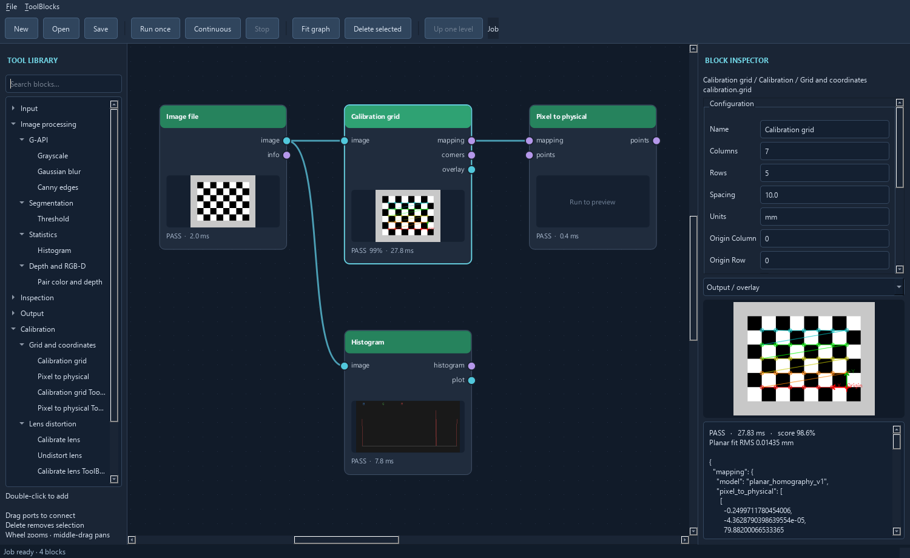

# Toolbox, histogram, calibration and depth workflows

## Block classification

The toolbox starts with **OpenCV**, **scikit-image**, **Custom**, and **User**.
OpenCV groups follow the [OpenCV 5 module reference](https://docs.opencv.org/5.0/main_modules/api_root.html)
and retain subgroups such as Filtering, Statistics and Lens distortion. Look for
Histogram under **OpenCV > Image Processing (imgproc) > Statistics** and lens
calibration under **OpenCV > Camera Calibration (calib) > Lens distortion**.
**Custom** holds built-in workflows and adapters. **User** holds plugins and
reusable ToolBlocks added in the session. Their `block_type` and `subtype` set
the group names. Search matches display labels, IDs, and common native API
names. Drag or double-click a leaf to add it.

**Custom > Calibration** includes editable ToolBlock templates. Open their internal graph
to configure primitive tools. They use the same public-port and result contracts
as other reusable ToolBlocks; category/subtype metadata survives export/import.
Their inspector allows editing type/subtype before exporting a reusable definition.

## Histogram

Connect a monochrome or color image to Histogram. It returns structured bin counts
and edges per channel, plus a plot image. Channel labels honor GRAY, BGR, RGB,
BGRA, RGBA, HSV or Lab encoding. Alpha is excluded unless enabled.

Choose 2–4096 bins. Automatic ranges use the full unsigned integer range (HSV8 hue
uses 0–180) or each float channel's finite minimum/maximum. Manual ranges use the
configured minimum/maximum for every channel. Nonfinite values are omitted; each
channel reports finite samples and samples outside the range. The upper edge is
inclusive, following NumPy histogram semantics. Plot curves are independently
scaled to their peak. Use numeric counts to compare sample totals across channels.

With **Show Statistics** enabled, the table below the curves shows the mean,
median, standard deviation, minimum, maximum, and configured percentiles for
each measured channel. **Statistics Channel** chooses the channel used for the
plot markers and scalar threshold outputs.

## Grid origin and physical coordinates

Use [Check chessboard quality](<../examples/custom tools/chessboard_quality/README.md>) to
measure blur and exposure and forward only accepted checkerboard images.

1. Load a calibration target image. For chessboards, set **columns and rows of
   inner corners**. A 10×7 square board has 9×6 inner corners. For circle grids,
   set the number of **circle centers** per row and the number of rows.
   Configure the measured spacing and units for the selected target.
2. If necessary, undistort the image first using a matching lens profile.
3. Run Calibration grid. It detects features, fits a planar homography, and anchors
   the selected `(origin_column, origin_row)` feature at physical `(0,0)`. +X follows
   increasing detected columns and +Y follows increasing detected rows. The overlay
   marks the origin. `reverse_order` reverses both axes.
4. Connect `mapping` to Pixel to physical. Supply a list of pixel `[x,y]` points
   through its optional `points` port or the JSON `pixel_points` parameter.
   Outputs include input pixels, physical coordinates, units and `plane_only`.
5. Set physical-space fit-error thresholds appropriate to the application. A grid
   fit exceeding its threshold is an inspection failure; Pixel to physical rejects
   mappings above its own configured threshold.
6. Connect a mapping to Save calibration profile, choosing a new JSON path. In a
   later job, use Load calibration profile → Pixel to physical without detecting
   the grid again. Save rejects an existing file; disconnect saving for repeated runs.

This mapping applies to the calibration **plane**, at unchanged camera pose, optics,
image size and preprocessing coordinates. It is not a 3D camera/robot extrinsic
transform. Points off that plane have parallax error; extrapolation beyond the
observed board needs independent verification. Pixel data alone does not identify
the source image resolution: the caller must use the mapping in its recorded
`image_size` coordinate space. A low fitting residual is not a held-out accuracy test.

On an unmarked target with rotational symmetry, the origin is detector-relative.
Use the overlay and orientation setting to identify the physical origin.
A marked, uniquely identifiable target is planned under the camera/robot milestone.

### Circle targets

Select `circles_symmetric` for a regular array or `circles_asymmetric` for
staggered rows. For a symmetric target, spacing is the center pitch on both
axes. For a staggered target, spacing is the vertical row pitch and half
the horizontal center pitch. The `corners` port carries the detected centers
in circle modes, so it can connect directly to Pixel to physical.

Set **Circle polarity** to match the dots. The circle controls tune candidate
size, separation, thresholds, and shape filters. Clustering is intended
for uncluttered scenes with perspective distortion. If it misses an
even-row staggered board, try detection with clustering disabled.
[Circle grid example](<../examples/opencv tools/circle_grid_calibration/README.md>) ·
[OpenCV calibration patterns](https://github.com/opencv/opencv/blob/5.x/doc/tutorials/calib3d/camera_calibration_pattern/camera_calibration_pattern.markdown)

## Lens distortion

Calibrate lens accepts a JSON `image_paths` list with at least three distinct grid
views of identical dimensions. Use substantially varied board orientations and
positions. It uses the same detector and target spacing settings as Calibration grid
and solves a standard OpenCV pinhole model. Outputs include camera matrix,
distortion coefficients, image dimensions, units, view count and reprojection
RMS in pixels. Set **Path base** to **Project** to use paths relative to the
saved graph. Duplicate detections and missed targets raise a block error.
Pose diversity beyond exact-duplicate rejection remains the user's responsibility.

**Fit report** includes per-view RMS, board-to-camera poses, and OpenCV's
estimated standard deviations. The report names each image and retains
the input order. Set **Max view RMS pixels** to apply a separate limit
to the worst view. Zero leaves that check off. The overall and worst-view
checks emit distinct failure reasons. [Lens fit report example](<../examples/custom tools/lens_fit_report/README.md>)

Connect the calibration output to Undistort lens along with the image. The tool
checks matrix validity, image dimensions and its reprojection-error limit. Save
and reload the lens profile to avoid solving the dataset on every runtime cycle.
The output retains the input dimensions and uses the original camera matrix.
For reusable correction maps, connect the lens profile to **Build lens
correction maps** and wire both map outputs to **Remap image coordinates**.
Use a source image from the camera and input pixel grid used for calibration.
Remap validates the map pair and assigns the corrected image a separate
coordinate frame. The map builder also returns the output camera matrix
in a zero-distortion profile. [Lens correction maps example](<../examples/opencv tools/lens_correction_maps/README.md>)

Wire the map pair to **Inspect lens map displacement** to see correction
strength and direction, measure displacement in source pixels, and identify
samples outside the source. [Lens map displacement example](<../examples/custom tools/lens_map_displacement/README.md>)

Connect both maps to **Save lens correction maps** to publish a versioned
`.npz` file. **Load lens correction maps** restores the pair, its coordinate
metadata, the rectified profile and any valid ROI. Use **Project** path base
for a portable saved graph. Saving requires a new file name.
[Lens map files example](<../examples/custom tools/lens_map_files/README.md>)

Fisheye fitting and calibration dataset management remain open.

## Correct measured points onto the remapped grid

**Undistort points onto lens map** accepts the original pinhole calibration,
the **Rectified calibration** output from **Build** or **Load lens correction
maps**, and ordered `[x, y]` measurements from the original image. It checks
that both profiles describe the same correction. Use the same map pair to
remap the image. Points carrying the full source image's frame receive the
same corrected frame as the remapped image, with their ticket preserved.
Points without a named source frame can still be converted for numeric use.

The block keeps point order and reports an **Inside** flag for each corrected
coordinate. It checks the maximum error after projecting the recovered rays
back into the raw image. If that error exceeds the configured limit, the block
withholds the corrected points. **Result graphics** marks up to 256 points
inside the corrected image when frame information is available.

## Validate a lens profile on another view

Connect the fixed pinhole profile and a separate image to **Validate lens
calibration**. Use the original image dimensions and camera pixel grid.
Choose the board pattern, count and spacing for the validation target.
The block fits the board pose and measures reprojection error across
every detected point. It reports overall RMS, maximum point error,
and the observed and projected coordinates in image pixels.

Set the overall and optional worst-point limits for the job. Wire
**Result graphics** to **Overlay result graphics** along with the
validation image to see the measured points and residual directions.
The bundled example uses rendered targets. [Lens validation example](<../examples/custom tools/validate_lens_calibration/README.md>)

For a partial ChArUco board, feed the same image to **Detect ChArUco board**
and **Validate lens calibration**. Wire the detected **Observation** to
the validator. It uses the board definition and visible corner IDs in the
observation. It checks capture and frame metadata when supplied and keeps
the lens profile fixed while estimating the board pose.
[ChArUco validation example](<../examples/custom tools/validate_charuco_calibration/README.md>)

## Observe a ChArUco board

**Detect ChArUco board** returns corner IDs, image coordinates, and
corresponding physical board points. Configure the number of squares
across and down, both physical side lengths, and the marker dictionary
to match the target. Use **Legacy pattern** for boards printed with the
older OpenCV layout when applicable. Custom marker IDs follow board
marker order.

The optional pinhole camera input improves interpolation of corners.
Wire **Image points** and **Object points** to **3D object pose (PnP)**
with a matching camera model and board units. The board's coordinate
origin follows the target layout even when it is outside the image.
[ChArUco board example](<../examples/opencv tools/charuco_board/README.md>)

To fit a pinhole lens profile, send **Observation** from each successful
detection to **Batch serial entries**. Connect its group to **Observations**
on **Calibrate lens** and leave **Image paths** empty. Use 3 to 64 views
of the same target at varied poses with a consistent camera pixel grid.
The fit uses the length units and identified points in the observations.
**Fit report** includes each view's point count and reprojection RMS.
[ChArUco lens calibration example](<../examples/opencv tools/charuco_lens_calibration/README.md>)

## Calibrate a camera mounted on a robot

**Calibrate hand–eye** fits a camera-to-gripper transform from paired
gripper-to-base and target-to-camera poses. The target stays stationary
in the base frame. Use 3 to 64 captures, with rotation about multiple
axes. All poses use named frames and a common length unit, either meters
or millimeters. The block pairs two lists by position or two groups by
ticket. Capture the robot and target poses at the same acquisition.

The report measures translation and rotation spread of the reconstructed
target in the base frame. The block emits camera-to-gripper and mean
target-to-base poses when the configured RMS checks pass. Compose
camera-to-gripper with the current gripper-to-base pose to locate
the camera in base coordinates.
[Hand–eye example](<../examples/opencv tools/hand_eye_calibration/README.md>)

## Planar alignment with ArUco markers

**Detect ArUco markers** in **OpenCV > Object Detection (objdetect)** reports
marker IDs, canonical corners and projected centers in source-image pixels.
A mask or region keeps markers whose centers lie inside it. The block can
draw labeled outlines and provide those outlines as result graphics.

Set **Required IDs** in the same order as your fixture coordinates. The
**Points** output gives one point per requested ID. The default is the
projected center where the diagonals meet. You can select a corner in the
marker's decoded orientation instead. An empty ID list uses ascending ID
order. Missing or ambiguous required markers fail the detection and withhold
the point list so that downstream transforms wait.

Wire **Points** to **Transform from control points**. Set three target points
for an affine fit or four for perspective, then pass the transform to the
corresponding image warp. Four anchors on one plane can rectify an inspection
fixture without camera intrinsics. Validate with an independent feature on that
plane. The planar warp assumes lens distortion is already corrected or small
enough for the job's tolerance.

[OpenCV ArUco detector](https://docs.opencv.org/5.0/main_modules/classcv_1_1aruco_1_1ArucoDetector.html)

## White and color balance

White / color balance supports gray-world gains from the whole image or a JSON
`roi` of `[x,y,width,height]`. Choose a neutral reference region for white balancing;
gray-world over a colored scene does not necessarily estimate the illuminant.
Manual mode applies explicit red/green/blue gains. Integer outputs saturate at
their dtype maximum; float outputs preserve amplified numeric values. Alpha is
preserved. This is channel-gain correction, not a full color-chart/ICC calibration.

## Depth and RGB-D

Depth image file decodes a single-channel uint16 or floating image. Set
`units_per_sample` and physical units explicitly: counts in millimeters can use
0.001 with units `m`, or 1.0 with units `mm`. Values are stored as float32 physical
depth. Zero, negative and nonfinite samples become NaN. The distinct `depth` port
preserves units and invalid values through snapshots and nested ToolBlocks.

Depth is separate from both color and alpha. Pair color and depth checks matching
dimensions and passes both planes independently. It performs **no registration or
synchronization**; the caller must supply corresponding aligned observations.
Sample depth accepts whole-pixel coordinates and returns physical depth values,
using JSON `null` for invalid samples. It rejects coordinates outside the image.

Node/inspector previews use a configured physical display range and a false-color
palette; invalid samples are black. The preview is separate from raw depth values.
Depth ports cannot accidentally wire into ordinary color-processing inputs.
Depth-file score reports the fraction of valid samples; a plane without any valid
depth returns an inspection failure while retaining its diagnostic output.
Point-cloud projection, XYZ/normal types, 3D viewing, RGB-D device adapters and
registration are future work rather than an interpretation of a fourth color channel.

## Future milestones

- [Point clouds and 3D vision](https://github.com/votecoffee/OpenCVDataflowGUI/milestone/1):
  [point-cloud types, files, projection and inspection](https://github.com/votecoffee/OpenCVDataflowGUI/issues/1).
- [Camera frames and robot integration](https://github.com/votecoffee/OpenCVDataflowGUI/milestone/2):
  [managed intrinsic/extrinsic profiles and offline hand-eye calibration](https://github.com/votecoffee/OpenCVDataflowGUI/issues/2),
  then [robot pose capture and calibrated measurement exchange](https://github.com/votecoffee/OpenCVDataflowGUI/issues/3).

The current lens solver estimates basic camera intrinsics as needed for distortion
correction. The future intrinsic/extrinsic milestone adds managed coordinate frames,
transform provenance and robot integration. Hand-eye calibration and live robot
integration are not implemented in this prototype.

Algorithms follow [OpenCV calibration and 3D reconstruction](https://docs.opencv.org/4.13.0/d9/d0c/group__calib3d.html).
