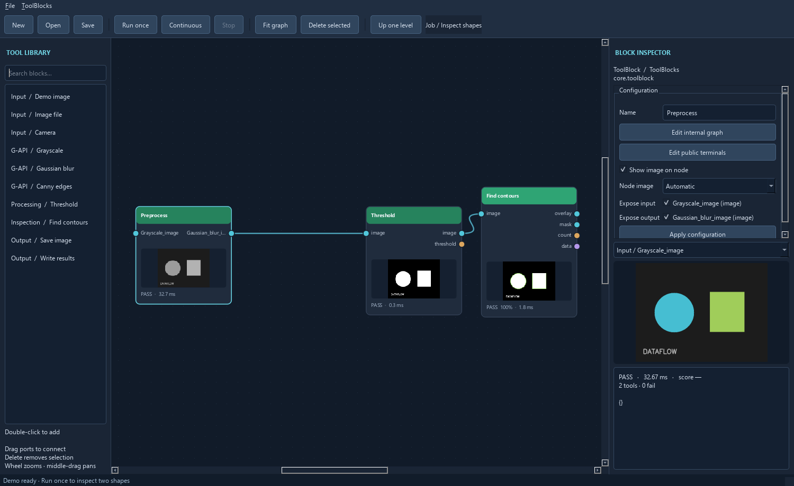

# Reusable ToolBlocks

A ToolBlock is both an editable graph and a normal `Block` instance. It has the
same execution, state, result, thumbnail, and typed-port contracts as a primitive
tool. Its public terminals map to selected internal ports; the internal graph can
contain further ToolBlocks. Jobs remain root graphs responsible for acquisition,
execution, and outputs.

This follows the composition principle described by Cognex's
[CogToolBlock class](https://docs.cognex.com/vpro_0x090A00/web/EN/help/html/T_Cognex_VisionPro_ToolBlock_CogToolBlock.htm)
and [Using a CogToolBlock](https://docs.cognex.com/vpro_0x091500/web/EN/help/html/0fd5c02d-a7ce-49ff-87e3-2f9ebe04d38d.htm):
contained tools, configurable terminals, and aggregate execution records. It is
an independent implementation, without VisionPro binary compatibility.

## Example workflow

1. Run the initial demo once.
2. Select Grayscale, Gaussian blur, Threshold, and Find contours. Use Ctrl-click or
   drag a selection rectangle. Keep Demo image outside the selection.
3. Choose **ToolBlocks > Create from selected nodes**, and name it **Inspect shapes**.
   The job now shows Demo image connected to one Inspect shapes node.
4. Open **Public terminals**. Rename its input to `image`, and its outputs to
   `overlay`, `mask`, `count`, and `data`. The internal mapping column identifies
   the corresponding child ports. Additional mappings may be added or removed.
5. Double-click Inspect shapes. Change the child Threshold or Find contours settings
   and apply them exactly as in the root graph. Select the first two tools and
   encapsulate them again as **Preprocess** to create another nesting level.
6. Run once while inside Preprocess. The root job runs and supplies the input image;
   child records, parent aggregate results, and previews update together.
7. Use **Up one level** to return to the job. Export Inspect shapes, then add it
   again from the library. Wire the same source to the new instance and configure
   its internal expected count differently. Each instance retains separate results.
8. Save the job. Reopening it restores all embedded graphs and interfaces. Import
   the exported definition into another job to reuse the pattern there.



## Class structure

```text
Block
  typed inputs / outputs
  parameters / process(inputs) / execute(...) / close()
  latest inputs / outputs / graphics / status / score / timing
  |
  +-- primitive OpenCV, acquisition, output, or custom Python block
  |
  +-- ToolBlock
        graph: Graph containing Block instances
        input_bindings: public name -> Binding(child id, input name)
        output_bindings: public name -> Binding(child id, output name)
        definition / export / from_definition
```

The interface preserves native port kinds and input-required flags. An internal
input cannot be both wired internally and bound publicly. Each public input maps
to one internal input; bind several inputs separately when needed. Public outputs
may publish any child output, including an intermediate result. Internal graphics
are aggregated with child name/id prefixes. Scores aggregate using the minimum
non-null child score. Any child inspection failure makes the ToolBlock fail;
execution errors or skipped children make it error and block dependent execution.
Errors identify the child tool. Clearing results recursively clears child histories.

Encapsulation validates the replacement graph before changing the job. A selection
that would create a cycle is rejected. Existing external wires and enclosing public
bindings are remapped. Nested terminal renames preserve their enclosing mappings.
Deleting an internal port used by the public interface requires repairing/removing
that binding in Public terminals before the job can be saved or run.

Definitions and embedded projects contain JSON configuration only. Import creates
independent graph instances; native resources and prior execution histories are not
copied. Library entries are session snapshots, not shared live definitions, and
there is no automatic update propagation. Versioned shared libraries, parameter
promotion, explicit boundary nodes, and an operator job manager are future work.
The loader limits nesting to 16 levels. Cancellation and resource cleanup recurse
through nested ToolBlocks, subject to the same cooperative-stop limits as other tools.
