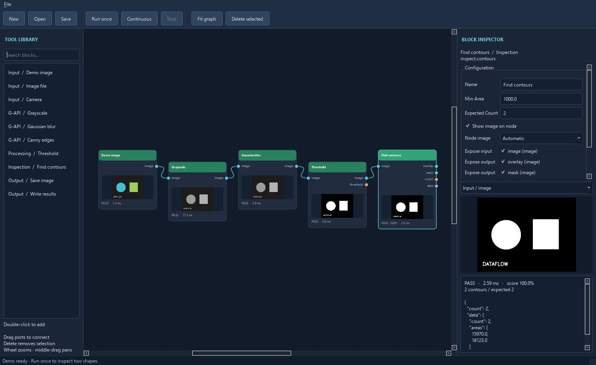

# Workflow guide

Use the [quick start](../README.md#usage) to build your first graph. This guide
covers editor workflows, inspection tools, and the runtime. Run shell commands
from the repository root.

- [Editor and result review](#editor-and-result-review)
- [Project exports and workspace](#project-exports-and-workspace)
- [Pattern matching and pose inspection](#pattern-matching-and-pose-inspection)
- [Tickets, recipes and control flow](#tickets-recipes-and-control-flow)
- [Runtime and plugins](#runtime-and-plugins)
- [Inspection and calibration tools](#inspection-and-calibration-tools)
- [Run a saved example](#run-a-saved-example)
- [OpenCV processing tools](#opencv-processing-tools)
- [Masks and regions](#masks-and-regions)
- [Blob, line, contour and circle collections](#blob-line-contour-and-circle-collections)
- [Channels, payloads and image pyramids](#channels-payloads-and-image-pyramids)
- [Image file formats](#image-file-formats)
- [Video file replay and recording](#video-file-replay-and-recording)
- [Reusable ToolBlocks](#reusable-toolblocks)
- [Python execution and stateful tools](#python-execution-and-stateful-tools)
- [Measurements, stitching and stabilization](#measurements-stitching-and-stabilization)
- [Industrial integration, 3D and machine learning](#industrial-integration-3d-and-machine-learning)
- [Diagnostics and run profiles](#diagnostics-and-run-profiles)

## Editor and result review



1. Expand **OpenCV**, **scikit-image**, **Industrial integration**, **Custom**, or **User**
   in the left toolbox.
   OpenCV tools follow the OpenCV 5 modules, such as **Image Processing (imgproc)**
   and **Video Analysis (video)**. Search by tool name, module, or common API names
   such as `cv2.findContours`. Drag a tool onto the canvas to place it, or double-click
   to add it near the center. Imported ToolBlocks and plugins appear under **User**.
2. Drag between an output socket and an input socket in either direction. Image
   ports and wires are gold for images, purple for regions/masks, blue for poses/transforms,
   pale gold for pyramids, turquoise for depth, green for numbers, and slate for other data.
   The editor checks the declared kinds and accepts supported conversions. For example,
   a numeric count can feed a structured writer, and a pyramid can feed an image input.
   Hover over a converted wire to see its rule. See [connection compatibility](architecture.md#connection-compatibility).
   Hover over a connector dot or its label to see the full port name and any captured
   number, boolean, or text value.
   The **Debug** run profile captures input values.
3. Single-click a block to edit it in the right inspector's **Parameters** tab.
   The sidebar stays full-height when the bottom filmstrip or diagnostics are open.
   Double-click a block for a larger, nonmodal editor: configuration tabs on the
   left, results/images on the right. Drag the divider between the panes to adjust space.
   Closing it returns the same draft to the sidebar; selecting another block
   closes it and discards unapplied changes as usual. The popup size and divider
   are remembered for the current session. Results remain viewable during a run.
   Click **Apply configuration** to save the draft. Switching tabs keeps the
   draft. Switching blocks discards unapplied edits. Use **Block** for the name,
   description, and documentation, and **Show advanced** for recipes, ports, and
   node display. Block size and the result graphics setting take effect immediately.
   Hover over a field for its limits. The inspector shows an inline message when an entry is invalid.
   **Run block** previews eligible tools with their last captured inputs, including text and
   other structured data. The [parameter reference](block-parameters.md) lists declared limits.
   On the canvas, **!** marks invalid configuration or input and **×** marks an
   execution exception. Hover over the node for details.
   Add a plain-text **Description** to explain the block in its hover tooltip.
   Use **Edit documentation…** for longer, formatted notes stored with the block.
   For supported OpenCV blocks, the **OpenCV reference** tab shows the installed Python
   binding signatures and parameter details offline. Use **Copy reference to notes** to
   append them to the editable notes for the project and its documentation export.
   OpenCV enum controls use dropdowns; booleans use checkboxes. Hover over controls
   with help text for method-specific guidance.
4. Run once or continuously. Open the **Results** tab to inspect retained input,
   output, and graphic images. Drag the divider to resize the image and result details. Nodes show pass/fail/error state, timing, and score
   intensity where provided. A failed inspection still supplies results downstream;
   execution errors skip dependent blocks.
   The inspector and automatic node thumbnails prefer the result image, then an output image.
   Double-click an output image, graphic, or point-cloud preview, or click
   **Pop out…**, to watch it in a separate window with a status-colored border
   and the ticket in its title.
   In the **Debug** run profile, pattern matching, template instances, oriented
   edges, and collection filtering include review graphics with accepted items
   in green and rejected candidates in red.

To combine annotations on a final image, expose **Result graphics** on each
source block and connect those outputs to **Overlay result graphics**. Connect
the final image to its **image** input, then run in **Debug**. Use **Choose
graphics…** on the overlay block to check individual layers, then **Apply
configuration** and run again. Image-aligned layers follow crop, resize, and
other recorded transforms in the same coordinate frame. Result graphics are
drawing objects. The overlay block draws them onto the final image to produce
the result image. Standalone previews such as histograms remain available for
inspection. [Try the overlay example](<../examples/demos/overlay_result_graphics/README.md>).

Use **Add annotation layer** to author a line, rectangle, circle, or label
in an image's pixel frame. Choose a shape, RGB color, and layer name. Set the
points in the inspector or wire measured coordinates in the same frame.
For labels, a text input can replace the configured text. Wire each layer's
**Result graphics** output to **Overlay result graphics** to render it on a
result image. Use a different layer name for each annotation you want to
identify in the selector.

The overlay block starts with two visible graphics inputs. Expose more in the
inspector to connect up to eight sources. A ToolBlock's **Result graphics**
collects drawings from its internal blocks. You can also map an internal block's
exposed graphics to a separate public terminal.
5. Use **File → Open…** for saved projects and the bundled examples.
   Select a wire or block and press Delete to remove it. Use the wheel to zoom,
   middle-drag to pan, and **Fit graph** to frame the graph.

## Project exports and workspace

**Save As** preserves references to existing project-relative input images,
point clouds, calibration files, and validation sets when you choose another
folder. Those inputs remain in their original locations. Sealed plugin recipes
and declared bundle dependencies are copied byte-for-byte into the new folder,
retaining their hashes. Existing assets with different contents stop the save
with a conflict message. Relative output paths resolve from the new folder.

Use **File → Export program documentation…** to generate a self-contained HTML
guide from the current applied configuration. It includes a simplified graph,
a linked block index, wiring and port tables, applied parameters, and each
block's description and rich-text notes. Nested ToolBlocks and parallel
inspection templates include their own diagrams and public terminal mappings.
Open the HTML in a browser to read it offline or print it to PDF. The export
includes configured values such as file paths and retains basic note formatting.

Use **File → Export project XML…** to snapshot the open project's saved fields and
values, including in-memory edits that have been applied. The export includes
nested ToolBlocks, recipes, saved training data, descriptions, and layout. External
assets are recorded by their saved references. Use **File → Compare project XML…**
to inspect added, removed, and changed values alongside changes to block order.
The comparison matches blocks by their saved IDs and shows before and after
values. JSON remains the editable project format.

Select a block and use **Save block XML…** to export its applied configuration
with a type-specific suffix such as `.cv.morphology.xml`. **Load block XML…**
applies the file to a selected block of the same type, retaining the destination
node's ID, position, and compatible connections. If loading would remove wires,
the inspector lists them and asks before proceeding. The XML includes saved
training data, documentation, port settings, and any nested block definitions.

After **Run once** captures inputs, click **Run block** in the inspector to preview
a supported block once with its current parameter edits. Enable **Live results**
to preview automatically. Edits within 300 ms of one another produce a single
preview, and **Run block** can run that preview immediately. The checkbox starts
off and resets when you leave the block. Previews stay in the inspector. Use
**Apply configuration** to save the edits to the graph.

In a **Morphology** block, choose **Edit kernel…** to preview a rectangle,
ellipse, cross, or diamond, or toggle individual cells in a custom kernel.
**Use kernel** stages the edit for live preview and **Apply configuration**
keeps it in the graph.

Node rearrangements mark the project as modified. **Save/Ctrl+S remembers node
positions even when connections are unchanged**, including layouts inside nested
ToolBlocks. Layout-only moves retain existing results. Positions are saved in the
project; there is no automatic save on movement.
Choose **Small**, **Medium**, or **Large** under **Block size** in the inspector.
The canvas applies the size immediately and keeps room for every exposed port.
Small hides the thumbnail, and Large gives it more room. Save the project to keep
the size, including for nodes inside ToolBlocks.

Search the toolbox for **Comment** under **Custom → Annotations → Layout**.
Enter a **Title** and **Text** in the inspector, then choose **Apply configuration**.
The yellow note can hold instructions or example credits. Hover to read the full
text when it ends in an ellipsis, or choose a larger **Block size** to show more.
Comments are saved with the project and are included in program documentation.

Use **Workspace → Auto arrange blocks** to organize the current canvas from
inputs on the left to outputs on the right. Groups and independent flows get
separate lanes. Save the project to keep the new positions.

Node borders indicate tool category (including purple region tools and blue pose
tools); node headers keep their pass/fail/error status colors and score intensity.
Selection adds a white outline. **Workspace > Color legend…** explains the palette;
see [canvas colors](canvas-colors.md) for typing and custom-block details.

For larger workspaces, select nodes and use **Workspace > Group selected nodes**
(Ctrl+G). Drag the group's dashed header/border to move its members together;
**Ungroup selection** (Ctrl+Shift+G) removes the container. The overview above the
inspector in the upper-right corner shows the visible region. Click or drag it to
navigate. Save remembers groups, zoom, and viewport position, including inside ToolBlocks.

Open the [image-set workspace](<../examples/demos/image_set_workspace/image_set_workspace.json>)
for a grouped, three-image inspection.
Press **Run all** to run the complete set and see filename tickets and verdict
borders in **Results > Image results filmstrip**. The filmstrip overlays enabled
result graphics for the matching ticket and image frame. Double-click a thumbnail
to open a resizable image viewer with zoom and pan. In an **Image file** block, use
**Select images…** or **Select directory…**, then **Apply configuration**. Run once
advances one image. **Continuous** loops the set until you press **Stop**.
The status bar shows the active run mode.
**File > Reset flow state** restarts the sequence. Filmstrips also appear in the
validation-set window. [Workspace and image-set details](workspaces-image-sets.md)
cover ordering, queue behavior, filename identity, retention and Lean mode.

## Alpha composition

[Source-over alpha composition](<../examples/opencv tools/alpha_composition/README.md>)
combines registered foreground/background layers with embedded or external alpha.
Set alpha association explicitly or use its metadata-aware Auto mode. Choose
stored or linear-sRGB blending and an output format/depth. Masks/regions select
foreground application; the remaining canvas represents the background. Ticket
and frame checks are strict by default, with explicit cross-source/grid options
for static overlays. Output association metadata supports chained composition,
and checkerboard previews expose transparency. The 16-bit example compares three
alpha representations with an independently computed reference.

## Paired-frame motion interpolation

[Motion-compensated frame interpolation](<../examples/opencv tools/frame_interpolation/README.md>)
creates an intermediate image from two equally registered frames. Estimate
bidirectional Farneback flow, refine wired initial fields or use provided fields.
Configure inverse convergence, consistency and optional appearance checks; inspect
the support mask and set an acceptable coverage limit. Hole fill remains unsupported.
Masks/regions select output centers; other pixels stay from A. Numeric output
retains pixel encoding/depth and A-owned ticket/grid/pyramid context, with both
source identities in lineage. Compatible video metadata or explicit timestamps
produce a synthetic media time, separate from ticket processing time. This block
emits one image per pair; sequence pacing and rate expansion remain separate.

## Intensity-weighted centers and axes

[Intensity-weighted center and orientation](<../examples/opencv tools/weighted_moments/README.md>)
measures selected brightness/contrast or uniform support. Set a baseline, polarity
and signal limit, or choose a stored channel. Compare its center and covariance
with the uniform-support reference. Center and principal-axis validity have
separate criteria; a round spot can have a center without an axis. Wire its
image_pose_v1 output to pose-relative regions, choosing principal-axis or explicit
translation-only orientation. Pixels, encoding/depth and coordinate/ticket
payloads are preserved. Peak-normalized moment/weight outputs declare their
scale, while reported mass uses the selected intensity units.

## Pattern matching and pose inspection

Train geometric and texture patterns with **Match shape pattern** and **Match
texture pattern**. Select a matcher, run once to capture its input, then click
**Train from input** in the inspector. Models are retained in saved projects and
can also be imported/exported as JSON. Separate **Train shape pattern** and
**Train texture pattern** blocks provide reusable wired models. Geometric features
include edges, corners, lines and circles; texture detection supports ORB and SIFT.
**Find oriented edges** selects vertical, horizontal or angled edges and filters
thickness, continuous length, strength, intensity, contrast and coverage.

Open [trained patterns and edges](<../examples/custom tools/trained_patterns/trained_patterns.json>) and press F5.
It needs no external assets: expected results are one geometric match, one texture
match and two vertical edges. See [training and edge workflows](patterns-edges.md)
for training regions, pose coordinates, controls and current algorithm limits.
Use **Subpixel** on template match blocks to refine centers and poses.
[Compare pixel-grid and subpixel matches](<../examples/opencv tools/subpixel_template/README.md>).

The [SIFT registration example](<../examples/opencv tools/sift_registration/README.md>) detects and
matches keypoints before estimating an image homography. The
[AKAZE registration example](<../examples/opencv tools/akaze_registration/README.md>) runs the
same workflow with binary MLDB descriptors. The FLANN registration
example uses approximate KD-tree matching.
The [KAZE registration example](<../examples/opencv tools/kaze_registration/README.md>) pairs
extended KAZE descriptors with the same matcher.
The [BRISK registration example](<../examples/opencv tools/brisk_registration/README.md>) uses
binary descriptors and Hamming distance. The [descriptor radius example](<../examples/opencv tools/descriptor_radius/README.md>)
retains multiple candidates per query keypoint within a distance limit.
The [MSER example](<../examples/opencv tools/mser_regions/README.md>)
shows stable bright and dark regions in an image.
[Affine-invariant features](<../examples/opencv tools/affine_features/README.md>)
sample synthetic tilt/roll views with SIFT or ORB and reuse the existing matchers.
Controls expose generated or explicit view schedules and all backend parameters.
Input masks/regions select source centers. Source scale, orientation and support
ellipses retain the sampled-view provenance; frames, tickets and pyramid metadata
travel on the wires. Graphics disabled skips previews and ellipse drawing.
The example compares correspondences with the known image-generating transform.

[Local structure tensor and orientation](<../examples/opencv tools/structure_tensor/README.md>)
reports eigenvalue, energy, coherence, normal/tangent angle and validity maps.
Set the neighborhood, Sobel/Scharr aperture, border mode and confidence limits.
Always check validity when using an angle: corners, flat patches and weak signals
can have no reliable direction. The selected-region example verifies known
unsigned axes and ambiguous probes. Source pixels and coordinate/ticket payloads
remain available; graphics disabled skips previews and drawable direction marks.

Pattern matchers also return a configurable **pose**: set local x/y/angular offsets
to locate an inspection origin on the part. **Pose from feature** creates a frame
from a ranked blob, line, contour or pattern match, and **Offset pose** composes
another local offset. Connect a pose to **Region relative to pose** to position a
rectangle, circle or polygon for downstream masked inspections. Try [pose-relative inspection](../examples/applications/pose_inspection/pose_inspection.json); see
[pose-relative inspection](poses.md) for coordinates and a complete workflow.

**Shape region**, **Region relative to pose** and **Shape mask** have visual
rectangle/circle/polygon editors in their inspectors. Relative-region and mask
editors map drawing and handle movements into the supplied pose's local frame.
Shape mask can also operate in ordinary image pixels with its pose disconnected.

## Tickets, recipes and control flow

Input sources carry numeric, string or timestamp tickets, generated automatically
or supplied through an external data input. **Control flow** tools split/join
parallel branches, batch/unbatch entries, select cases and restore FIFO by ticket.
Try [ticketed control flow](<../examples/control flow tools/control_flow/control_flow.json>). See
[tickets and control flow](control-flow.md) for external/PLC ticket inputs,
buffer limits and stream execution semantics.

Ticketed connections carry each tool's pass/fail, score and accumulated failure
status. Every input has a **continue / reject_failed** policy; rejection emits no
data and retains the last processed previews. **Final ticket judgment** assigns an
explicit decision separately from intermediate tool results. Open **Results >
Ticket results…** to search tickets and inspect their status and event timelines.
Try [ticket results](<../examples/control flow tools/ticket_results/ticket_results.json>). See [ticket results](ticket-results.md)
for status propagation, final decisions, retention limits and plugin event data.

**Coordinate inputs** offers ticket-matched waiting with timeouts, latest snapshots,
triggered latest snapshots, and first-arrival-per-ticket selection. Freshness,
duplicate and late-arrival controls make reuse explicit. Try [input coordination](<../examples/control flow tools/input_coordination/input_coordination.json>). See [input coordination](input-coordination.md) for
recommended policies and cooperative timing limits.

**Recipes > Manage recipes…** stores versioned settings and trained pattern models.
Use **Select recipe** / **Recipe value or model** blocks, or bind tool parameters
and matcher models in **Recipe overrides**. Images retain their recipe revision
across queues and global changes. Try [recipes](<../examples/control flow tools/recipes/recipes.json>); see
[recipes and model swaps](recipes.md) for activation and persistence rules.

**Inspect each pose in parallel** runs a reusable inspection ToolBlock for every
pattern match, measured feature or supplied pose, then returns one aggregate. Set
worker count and optional N-pass/N-failure stop thresholds; results explicitly
identify uninspected parts. The [parallel inspection example](<../examples/control flow tools/parallel_parts/parallel_parts.json>) finds
and inspects 25 parts. See [parallel part inspection](parallel-inspection.md)
for editing the inspection, acceptance policies and cancellation behavior.

Insert **Queue input images** after a source to retain frames and release them
one at a time. It supports bounded FIFO storage, explicit overflow policies and
optional background acquisition during inspection. Try [queued input](<../examples/control flow tools/queued_input/queued_input.json>), then Continuous. See [input queues](input-queues.md) for capacity,
metadata pairing and Stop/Resume behavior. Stop keeps the last completed result visible.

## Runtime and plugins

The supported dependency is OpenCV 5 contrib (development checks use 5.0.0.93).
This desktop application uses native Python bindings. Ordinary OpenCV blocks are
the defaults; legacy G-API blocks remain under **OpenCV > Advanced > G-API**.
Migration details and a possible browser/WebAssembly backend are covered in the
[backend notes](opencv-backend.md).

Load trusted custom blocks via **File > Load Python plugin**. The
[custom invert project](../examples/user_tools/custom_invert/README.md) demonstrates custom
fields, validation, and a popup editor. A project that uses a local Python
plugin can open after you explicitly load that trusted file.

The [Simple Plugins guide](<../examples/Simple Plugins/README.md>) covers
SimplePatternMatch, SimpleSegmentation, and SimpleClassify. Projects open
directly when their integrations are available in the app's Python environment.

Plugin blocks can add their own inspector button and open a Qt dialog for
configuration or review. The dialog can use copies of cached images with their
coordinate metadata. Plugins can opt into a modeless popup to capture new
outputs while the graph runs and subscribe to completed output notices.
Dialogs can also capture the selected block's wired or last processed input.
The reusable image picker gives plugins a source and pyramid-level selector.
Accepted edits appear in the inspector draft for preview and **Apply
configuration**. [Plugin dialog API](plugin-dialogs.md)

If a block raises a Python exception during processing, the app records an error
and traceback in **Diagnostics**. The block emits no outputs, dependent blocks
that require its output are skipped, and independent branches can finish. Plugins
run in the app's process, so native crashes and forced process termination still
end the app.

Custom blocks can supply named `GraphicDrawing` objects through
`Result.drawings`. Each drawing identifies its source image input and contains
objects such as outlines, markers, and labels. The block's existing raster
previews remain available separately.

## Inspection and calibration tools

Built-in tools include demo/image/camera inputs; ordinary grayscale, Gaussian blur,
and Canny; threshold; contour inspection with overlay and mask images; image saving;
and structured result output to CSV, XML, or SQLite. Set a Write results block's
`format` to `csv`, `xml`, or `sqlite` and connect a `data` output to it. CSV and
SQLite append; XML and image writers reject existing files. Output blocks write
on every run, including continuous runs. Relative paths resolve from the process's
working directory; use absolute paths for portable local execution expectations.

The [K-means example](<../examples/opencv tools/kmeans/README.md>) shows color-coded pixel clusters,
an image quantized to the cluster centers, and a scatter plot of clustered numeric samples.
The [watershed example](<../examples/opencv tools/watershed/README.md>) separates touching parts
using automatic distance peaks or editable point seeds. A separate block accepts
foreground and background seed masks.

The [histogram thresholds example](<../examples/opencv tools/histogram_thresholds/README.md>) wires
measured cutoffs into lower-tail, middle-range, and upper-tail masks. Histograms
also report per-channel mean, median, standard deviation, and extrema.

The [Lab color classification example](../examples/applications/lab_color_classification/README.md)
compares a measured patch with named references and reports the closest color.

The [flat-field correction example](<../examples/custom tools/flat_field/README.md>) uses bright and dark
reference images to remove uneven illumination before inspection. The
[guided filter example](<../examples/opencv tools/guided_filter/README.md>) reduces noise while
preserving a high-contrast edge. The [domain transform example](<../examples/opencv tools/domain_transform_filter/README.md>)
compares three edge-preserving smoothing modes. The
[Bayer demosaicing example](<../examples/opencv tools/bayer_demosaicing/README.md>) reconstructs
RGB from a synthetic 16-bit sensor mosaic. The
[in-memory codecs example](<../examples/opencv tools/in_memory_image_codecs/README.md>) sends a
lossless 16-bit RGBA PNG packet between blocks. The
[TIFF page sequence example](<../examples/opencv tools/tiff_page_sequence/README.md>) replays
a multipage TIFF with separate tickets for each page. The
[multipage TIFF output example](<../examples/opencv tools/multipage_tiff_output/README.md>) batches
the pages and writes them to a new TIFF file. The
[raw YUV example](<../examples/opencv tools/raw_yuv/README.md>) decodes an NV12 frame from a file
and from a packed buffer in the graph. The
[EXIF orientation example](<../examples/opencv tools/exif_orientation/README.md>) compares
metadata-only loading with an explicitly oriented JPEG.

The [skeleton pruning example](<../examples/skimage tools/skeleton_pruning/README.md>) extracts
centerlines from a binary mask and removes short spurs. Install the optional
dependency with `python -m pip install -e ".[morphology]"`.

**Local binary patterns** uses the same scikit-image dependency. Wire its histogram to
**Compare histograms** and keep the method, radius, and neighbor count consistent across
reference and sample. The validity mask excludes centers whose neighborhood would cross
the image border. Compare selected areas at the same image scale.

**Gray-level co-occurrence** measures directional texture with the same dependency.
Set pixel offsets as `[dx, dy]` pairs and keep quantization settings fixed for comparisons.
Both pixels in each pair must be inside the selection. The matrix is a probability table
indexed by the two gray levels.

Additional tools include monochrome/per-channel color histograms, planar
pixel-to-physical mapping, offline multi-view lens calibration, undistortion,
white/color balance, reusable calibration ToolBlocks, and typed depth-image
loading, RGB-D pairing and depth sampling. Calibration grid and Calibrate lens
accept chessboards and symmetric or staggered circle targets. Save and load
calibration profiles as JSON for subsequent measurement jobs.
[Calibration and depth workflows](calibration-depth.md) ·
[Circle grid example](<../examples/opencv tools/circle_grid_calibration/README.md>)

**Check chessboard quality** measures edge width, contrast, and brightness
before forwarding accepted calibration images.
[Checkerboard quality example](<../examples/opencv tools/chessboard_quality/README.md>)

**Build lens correction maps** creates reusable pinhole correction maps
for **Remap image coordinates**, with output intrinsics and a separate
coordinate frame for the corrected image.
[Lens correction maps example](<../examples/opencv tools/lens_correction_maps/README.md>)

**Pack remap coordinates** prepares a compact map for **Remap with packed
coordinates**. Lens maps retain their rectified frame. The
[packed remap example](<../examples/opencv tools/packed_remap/README.md>) compares both paths.

**Inspect lens map displacement** shows correction strength and direction
and reports how much of the output samples inside the source image.
[Lens map displacement example](<../examples/opencv tools/lens_map_displacement/README.md>)

**Save lens correction maps** and **Load lens correction maps** preserve
the map pair, output intrinsics, and pixel-grid metadata in one file.
[Lens map files example](<../examples/custom tools/lens_map_files/README.md>)

**Calibrate lens** reports per-view reprojection errors, board poses,
and estimated parameter uncertainty. A worst-view limit can catch a poor
view even when the overall fit passes.
[Lens fit report example](<../examples/opencv tools/lens_fit_report/README.md>)

**Validate lens calibration** checks a fixed profile on a separate grid
image and shows the measured reprojection residuals.
[Lens validation example](<../examples/opencv tools/validate_lens_calibration/README.md>)

**Detect ChArUco board** pairs identified image corners with physical
board coordinates. A partial view can feed the existing PnP pose block.
[ChArUco board example](<../examples/opencv tools/charuco_board/README.md>)

**Calibrate lens** can also fit a batch of ChArUco observations with
different visible corners in each view. It reports the point count and
reprojection RMS for each image.
[ChArUco lens calibration example](<../examples/opencv tools/charuco_lens_calibration/README.md>)

**Validate lens calibration** also accepts identified ChArUco points from
a separate partial view and reports residuals by board corner ID.
[ChArUco validation example](<../examples/opencv tools/validate_charuco_calibration/README.md>)

**Calibrate hand–eye** fits a camera-to-gripper transform from paired
robot and target poses. The output composes with the current gripper
pose to place the camera in the robot base frame.
[Hand–eye example](<../examples/opencv tools/hand_eye_calibration/README.md>)

## Run a saved example

Try [Brick edges](<../examples/opencv tools/brick_edges/README.md>) with its bundled
photograph. Open the project through **File > Open** and press **Run once**.

Launch the built-in synthetic inspection project with:

```powershell
.\.venv\Scripts\opencv-dataflow --starter
```

Run once to detect two parts. Change **Measure two parts > Expected count** to 3
and apply it to exercise an inspection failure, then restore 2. Save the graph
to edit it later.

To verify a saved graph without the editor:

```powershell
.\.venv\Scripts\opencv-dataflow-run "examples/opencv tools/brick_edges/brick_edges.json" --repeat 3
```

Add `--report <new-file.json>` for a JSON receipt of each run, including states,
scores, timings and numeric/data outputs. Existing reports are preserved. Use
`--plugin <trusted-file.py>` to explicitly load custom Python blocks. Exit status
is 0 when all runs pass, 1 for an inspection/execution failure, and 2 for load or
configuration errors. Output blocks still perform their configured writes on every
run. `python -m opencv_dataflow.runner` is an alternative to the console command.

## OpenCV processing tools

The expanded [base-tool catalog](base-tools.md) covers conversion, crop/resize/
flip/rotate, filters, automatic/adaptive thresholds, color-range masks, morphology,
bitwise operations, blending, gradients, components and template matching. These
new wrappers use eager OpenCV calls; legacy native G-API tools live under Advanced.

Additional wrappers include histogram equalization, CLAHE, normalization, gamma,
channel split/merge, masking, absolute difference, corner detection, Hough lines/
circles and distance transform. See [additional tools](additional-tools.md).
After preparing the optional Lena asset, open `examples/opencv tools/lena_features/lena_features.json` to try
CLAHE → corners, edges → line segments, and a histogram in one project.

**Find Hough template** locates translated copies of a shape from its edges.
The [generalized Hough example](<../examples/opencv tools/generalized_hough/README.md>) compares
full-image and region-limited searches.
The [Guil example](<../examples/opencv tools/generalized_hough_guil/README.md>) finds the same
template after rotation and scaling.

The [color normalization example](<../examples/opencv tools/normalize_color/README.md>) compares
shared and independent channel scaling in a selected patch while preserving the
pixels outside it.
The [linear channel transform example](<../examples/opencv tools/channel_transform/README.md>)
mixes color channels using a matrix and derives a grayscale difference image.

The [registration and transform tools](registration-tools.md) add arbitrary
rotation, affine/perspective warps, borders, pyramids, custom filtering, unsharp
masking, FAST/ORB features, descriptor matching, homography estimation and point
transforms. Open `examples/opencv tools/lena_registration/lena_registration.json` after preparing the Lena asset
to match the image to a known rotated copy and compare the estimated warp.

Further tools include box and separable filtering, Harris/minimum-eigenvalue
responses, subpixel corner refinement, phase correlation, full/partial affine
estimation, coordinate remapping, and Cartesian-to-polar image fields. See
[analysis tools and parameter conventions](analysis-tools.md).
**Iterative phase correlation** estimates fractional-pixel translation and
emits an inverse warp. See the [subpixel alignment example](<../examples/opencv tools/iterative_phase_correlation/README.md>).
**Estimate image translation** fits a shift from paired features and
reports inliers and residuals. See the
[matched-feature translation example](<../examples/opencv tools/translation_registration/README.md>).

The [OpenCV coverage backlog](opencv-coverage.md) ranks missing tools and
links to the full Python binding inventory for the pinned contrib build. The
[roadmap](roadmap.md) puts core vision coverage first and tracks editor,
acquisition and deployment work separately. The [DCT example](<../examples/opencv tools/dct_round_trip/README.md>)
displays cosine coefficients and verifies image reconstruction. The
[Fourier filter example](<../examples/opencv tools/fourier_filter/README.md>) removes a periodic
stripe pattern with a band-stop filter. The [Fourier gain example](<../examples/opencv tools/fourier_gain/README.md>)
suppresses only a chosen pair of frequency bins. The
[Fourier correlation example](<../examples/opencv tools/fourier_correlation/README.md>)
finds the signed displacement between two images. The [intensity lookup example](<../examples/opencv tools/intensity_lut/README.md>)
applies separate intensity curves to the red and blue channels. The
[local statistics example](<../examples/opencv tools/local_statistics/README.md>) uses rectangular
neighborhoods to distinguish a flat patch from an equally bright textured patch.
The [intensity transform example](<../examples/opencv tools/intensity_transform/README.md>) clips
a ramp and reconstructs it through log and exponential blocks. The
[image arithmetic example](<../examples/opencv tools/image_arithmetic/README.md>) subtracts
a blurred background and scales the signed residual. The
[weight-map blend example](<../examples/opencv tools/blend_weight_maps/README.md>) feathers
between two aligned images using a per-pixel weight. The
[pixel comparison example](<../examples/opencv tools/pixel_comparison/README.md>) turns the
background difference into a binary texture mask. The [nonzero pixels example](<../examples/opencv tools/nonzero_pixels/README.md>)
extracts coordinates from that mask and outlines its full bounds. The
[intensity profile example](<../examples/opencv tools/intensity_profile/README.md>) plots per-column
mean intensity inside an inspection region and locates the maximum in each column. The
[image statistics example](<../examples/opencv tools/image_statistics/README.md>) reports
selected-region measurements and marks the darkest and brightest pixels. The
[absolute image error example](<../examples/opencv tools/absolute_image_error/README.md>) compares
average, RMS, and worst-case deviations from a reference image. The
[Earth Mover's Distance example](<../examples/opencv tools/earth_movers_distance/README.md>)
measures a seven-level intensity shift between histograms. The
[tilted statistics example](<../examples/opencv tools/tilted_statistics/README.md>) measures
diagonal patches with 45-degree integral-image windows.

The rotated rectangle overlap example fits a part footprint from a contour
and compares it against a reference. The measurement includes intersection
area, intersection-over-union and the fraction of each footprint covered.
[Rotated rectangle overlap example](<../examples/opencv tools/rotated_rectangle_overlap/README.md>)

**Convex polygon overlap** measures intersection area and IoU for polygon
footprints. The [example](<../examples/opencv tools/convex_overlap/README.md>) wires a detected
contour into the block and compares its convex hull with a reference.

**Enclosing convex polygon** fits a footprint under a side-count limit.
The [enclosing polygon example](<../examples/opencv tools/enclosing_polygon/README.md>) compares
a triangle and a quadrilateral fitted to the same part.

**Delaunay triangulation** connects point sites or measured object centers
and reports indexed triangles, unique edges, and edge lengths.
[Delaunay triangulation example](<../examples/opencv tools/delaunay_triangulation/README.md>)

**Voronoi cells** divides an image into zones around detected centers or
wired points. It returns bounded polygons, areas, and a mask for a selected zone.
[Voronoi cells example](<../examples/opencv tools/voronoi_cells/README.md>)

**Minimum spanning tree** finds the lowest total cost to connect nodes
using supplied weights or Euclidean distances from point coordinates.
[Minimum spanning tree example](<../examples/custom tools/minimum_spanning_tree/README.md>)

**Path intensity profile** samples each image channel at regular distances
along an open or closed path and preserves gaps outside the selection.
[Path intensity profile example](<../examples/custom tools/path_intensity_profile/README.md>)

Convert between Cartesian vector components and magnitude/angle fields.
The angle output carries its units through compatible graph blocks.
[Polar field rotation example](<../examples/opencv tools/polar_fields/README.md>)

**Paired Sobel derivatives** exposes signed X and Y gradients for reuse
by **Canny from derivatives**.
[Derivative-fed Canny example](<../examples/opencv tools/canny_derivatives/README.md>)

**Scale absolute to 8-bit** applies a gain and offset to signed or high-depth
samples, then produces a clipped magnitude image for display or thresholding.
[Signed-gradient example](<../examples/opencv tools/scale_absolute/README.md>)

**Colorize scalar image** maps grayscale, response, or depth values to a
built-in or wired palette. See the [distance-map example](<../examples/opencv tools/colorize_scalar/README.md>).

**Labeled distance transform** computes distance to the nearest seed and
returns its region or pixel label. See the [nearest-seed example](<../examples/opencv tools/labeled_distance/README.md>).

**Compare pixels** and **In range mask** accept signed label planes. The
[label-mask example](<../examples/opencv tools/label_masks/README.md>) selects watershed
boundaries and region interiors.

**Gabor texture response** isolates stripes by orientation and wavelength.
Compare two responses to map the dominant texture direction.
[Gabor texture example](<../examples/opencv tools/gabor_texture/README.md>)

**Gabor orientation bank** compares several angles in one block and outputs
the strongest response, winning angle, confidence, and valid-pixel mask.
[Gabor orientation bank example](<../examples/opencv tools/gabor_orientation_bank/README.md>)

**Pyramid mean-shift filter** flattens fine color texture before segmentation.
[Mean-shift filtering example](<../examples/opencv tools/mean_shift_filter/README.md>)

**Temporal non-local means** uses an ordered group of aligned frames to
denoise a selected frame while retaining its ticket and pixel frame.
[Temporal denoising example](<../examples/opencv tools/temporal_nlm/README.md>)

**TV-L1 denoise** restores a monochrome image from one view or a batch of
aligned views with impulse noise.
[TV-L1 denoising example](<../examples/opencv tools/tvl1_denoising/README.md>)

**Wiener deblur** restores detail using Gaussian, linear motion, circular
defocus, or custom blur kernels and a configurable noise-to-signal ratio.
[Gaussian example](<../examples/custom tools/wiener_deblur/README.md>) · [Motion example](<../examples/custom tools/motion_deblur/README.md>)

**Adaptive background correction** estimates lighting from a single image
and subtracts or divides out the estimated background.
[Adaptive background example](<../examples/custom tools/adaptive_background/README.md>)

**Hann window** tapers image edges or rows before a Fourier transform and
exposes the coefficients and coherent gain.
[Hann window example](<../examples/opencv tools/hann_window/README.md>)

The [complete parameter reference](block-parameters.md) lists defaults,
dropdown choices and input ports directly from the block definitions. Existing
wrappers also expose kernel dimensions, anchors, borders, output depths, masks,
threshold modes, contour modes, feature detector controls, matching norms, robust
solver settings, calibration flags and image encoder options where applicable.
Native buffers are managed by the runtime; hardware requests depend on the camera
backend. Existing saved projects acquire new defaults when loaded.

## Masks and regions

Add **Image processing > Regions > Shape region**, choose rectangle, circle or
polygon from its dropdown, and connect its `region` or `mask` output to supported
blocks. Regions retain input-image coordinates and include a tinted overlay.
When both a mask and region are connected, their intersection is used.

Run once, select the Shape region block, then click **Draw / edit region…** in
the inspector. Draw rectangles/circles by dragging or polygons by clicking
vertices. Drag handles to resize, or drag a shape to move it. **Apply region**
updates the block and marks the project modified; **Cancel** preserves it.
The editor uses a captured frame, with correctly scaled pixel coordinates.

Use **Combine regions** to union, intersect, subtract, XOR or invert shapes;
its output is another reusable region, so combinations can be nested. **Measure
selected region** reports pixel area, image coverage, bounds and centroid, with
configurable inspection limits. The [combined regions example](<../examples/custom tools/combined_regions/combined_regions.json>) is
an 11-block project that excludes a circle's center and adds a second part region.

**Region from fitted shape** follows a detected ellipse or enclosing circle.
Use its margin to grow or shrink the selection around the fit.
[Fitted ellipse inspection band](<../examples/custom tools/fitted_shape_region/README.md>)

**Transform region** carries a selection into another image's coordinates. Connect
the target image, source region and the image operation's `geometry` output, or a
registration `transform`. Forward/inverse direction and mask sampling use dropdowns.
Try [transformed regions](<../examples/custom tools/transformed_regions/transformed_regions.json>) for a 12-block crop → resize →
rotation pipeline whose inspection region follows each image operation.

Open [regions](<../examples/demos/regions/regions.json>) for a working
10-block project that inspects each synthetic part separately, computes a polygon
histogram and blurs only the circular selection. No image download is required.
Run it headlessly with `opencv-dataflow-run "examples/demos/regions/regions.json" --repeat 3`.

Selections support filters, segmentation, gradients, image math, histogram and
contrast tools, corner/ORB detectors, contours/components and template search.
Contour/component **Region mode** chooses whole-object center filtering or clipped
measurements. See [region behavior and supported tools](regions.md) for
outside-pixel policies, neighborhood behavior and coordinate rules.

## Blob, line, contour and circle collections

**Find blobs**, **Connected components**, **Find contours**, **Hough line segments**,
**Hough lines from points**, **Hough polar lines**, **Hough circles**, and
**Find line segments (LSD)** expose a `collection`
output. Connect it to
**Filter object collection**, **Sort object collection**, and **Draw object
collection** to select and visualize measured objects without code.

**Hough lines from points** detects lines in sparse coordinates and exposes
the vote count as **Strength**. [Sparse line example](<../examples/opencv tools/point_set_lines/README.md>)
**Hough polar lines** detects lines in an 8-bit edge map. Vote by pixel count
or intensity and restrict voting with a mask or region.
[Binary and weighted voting example](<../examples/opencv tools/hough_polar_lines/README.md>)
**Hough circles** exposes fitted radius and native detection strength for sorting
and filtering. [Circle collection example](<../examples/opencv tools/hough_circle_collections/README.md>)

Use **Clip line segments** to measure only the part of each detected line inside
the image or a rectangular region. [Line clipping example](<../examples/custom tools/clip_line_segments/README.md>)

Filter/sort criteria use dropdowns: area, bounding width/height and position,
centroid, aspect ratio, principal-axis angle, line length, perimeter, fitted box
sizes, extent, solidity, circularity, distance and all seven raw/signed-log Hu moments.
Chain filters for multiple criteria, inspect rejected objects, and use stable
two-key sorting with explicit policies for undefined measurements.

Use **Approximate contour** to simplify a detected boundary or open path.
[Contour approximation example](<../examples/opencv tools/contour_approximation/README.md>)
**Approximate convex contour** reduces a closed boundary to a target number
of sides with an optional added-area budget.
[Convex contour example](<../examples/opencv tools/convex_contour_approximation/README.md>)
Use **Contour hierarchy** to inspect nested boundaries, holes, and islands.
[Contour hierarchy example](<../examples/opencv tools/contour_hierarchy/README.md>)
Use **Contour hull and convexity defects** to measure edge notches and judge their count.
[Contour defect inspection example](../examples/applications/contour_defects/README.md)
Use **Contour profile tolerance** to check a measured outline against an aligned reference.
[Contour profile example](../examples/applications/contour_profile/README.md)

Try [object collections](<../examples/demos/object_collections/object_collections.json>).
This 16-block project orders two parts left-to-right, selects the round contour and
isolates two long vertical lines. See [collection tools and measurement conventions](object-collections.md).

## Channels, payloads and image pyramids

Use **Split three channels / Merge three channels**, or the four-channel alpha
variants, to process planes independently. **Extract image channel** and **Replace
image channel** use channel-index dropdowns and preserve coordinate payloads.
**Route image channels** assembles channels from one or two images with a
configurable or wired index map. See the [false-color example](<../examples/opencv tools/route_channels/README.md>).

**Gaussian image pyramid set** sends all levels together on its `images` port.
Connect it to an ordinary image input: the largest level is used by default.
Choose a smaller level using the inspector's **Pyramid level: input name** dropdown.
**Select pyramid level** provides an explicit single-image output; **Pyramid down**
and **Pyramid up** are separate toolbox entries too.

Images and other port values can carry optional JSON payloads. Built-in spatial
payloads record image dimensions, the mapping to the original image and pyramid
level provenance. Results stay in their working coordinates and show the source
level in the inspector and headless receipts. **Read port payload / coordinates**
exposes a mapping to the largest or original image for **Transform points** and
**Transform region**. **Attach port payload** adds recipe or custom data.

Try [channels and pyramids](<../examples/opencv tools/channels_pyramids/channels_pyramids.json>): it splits/merges channels, carries a recipe
payload through a four-level pyramid, detects blobs at level 2, and maps their
centroids back to the largest image. See [payload and pyramid contracts](payloads-pyramids.md).

## Image file formats

The **Image file** input loads a file and reformats it using inspector dropdowns:

- **Color format:** unchanged, BGR, RGB, BGRA, RGBA, grayscale, HSV, or Lab.
- **Pixel depth:** unchanged, uint8, uint16, or float32 (depth is per channel).

Choose **unchanged** for both to preserve decoded channels, alpha, and depth.
Defaults remain BGR/uint8 for existing jobs. Integer depth conversion scales the
full range (8-bit 255 maps to 16-bit 65535); integer-to-float maps to [0,1]. Float
sources keep their numeric values in float outputs, and float-to-integer clips
to [0,1] before scaling and rounding. There is no per-image contrast normalization.
HSV and Lab support uint8 or float32, not uint16, and use OpenCV's native channel
ranges. See [image format details](image-formats.md).

The `image` output carries the requested format. The `info` output reports size,
channel count, depth, and source/output formats; the decoded source is also available
in the graphic preview selector. Previews and built-in tools interpret the color
encoding correctly. Processing tools still have their own depth requirements:
ordinary Grayscale supports uint8/uint16/float32. Canny and Adaptive Threshold
accept color or grayscale and use an 8-bit working image for their masks. Equalize
Histogram, CLAHE, and Inpaint can preserve the source pixel depth and color encoding.
Legacy G-API Grayscale also requires uint8. For explicit conversion, choose the
color format and pixel depth in the file input or a Convert image block.

## Video file replay and recording

**Video file** emits one decoded frame per graph activation. Set a zero-based
start frame, optional exclusive end frame, stride and stop or loop mode.
The frame ticket and metadata include its filename and index. The metadata
also gives decoder time or an explicitly labeled frame-rate estimate.

Connect the result to **Write video file** to encode processed frames at a
configured playback rate. Choose a new output path and a codec supported by
the selected backend. **Run all** or a headless run with `--all-images`
writes one clip, which is finalized when execution closes.
See [video file workflows](video-files.md).

## Reusable ToolBlocks

Select nodes and use **ToolBlocks > Create from selected nodes** to encapsulate
them as one reusable block. Crossing wires are preserved, unbound inputs become
public inputs, and terminal outputs become public outputs. Use **Edit internal
graph** in its inspector or **ToolBlocks > Edit selected ToolBlock** to develop its contents in
the same node editor. ToolBlocks can contain other ToolBlocks. **Up one level** and
the job breadcrumb show where you are.

Use **Public terminals** to name and map the interface to internal typed ports.
Renaming a terminal preserves connected wires; disconnect a terminal before removing
its binding. Exposed-port checkboxes then choose which public ports appear on the node.
The outer block aggregates child pass/fail status, minimum available score, graphics,
and errors. Internal run records remain inspectable by opening the block after a run.

**Export ToolBlock** writes a `.toolblock.json` definition; **Import ToolBlock**
adds an instance and a session library entry. Creation and export also add reusable
library snapshots. Drag or double-click a library entry to add another independent instance.
Editing an instance does not change other instances or a previously captured library
snapshot; export again to capture the edited version. Job files embed their ToolBlocks,
so they do not depend on the original definition file. Load any local Python plugin
files required by the embedded blocks.

For a ready-made nested pattern, import
[`examples/user_tools/inspect_shapes/inspect_shapes.toolblock.json`](../examples/user_tools/inspect_shapes/inspect_shapes.toolblock.json)
and connect a Demo image or Image file output to its `image` input.

Run controls always execute the entire root job, including when viewing a nested
ToolBlock. Saving also saves the root job. See [docs/toolblocks.md](toolblocks.md)
for the class model and a worked example.

## Python execution and stateful tools

The Python runtime can also execute graphs independently of the editor:

```python
from opencv_dataflow.blocks import builtin_registry, demo_graph

graph = demo_graph(builtin_registry())
graph.run()
for block in graph.blocks.values():
    print(block.name, block.state, block.error)
graph.close()
```

**Sequence** blocks retain memory for running background subtraction, Farneback and DIS optical
flow, Lucas-Kanade point tracking and first/latest/mean image references. They report
readiness and activation counts, suppress primary outputs during warmup, and support
bounded per-stream state, resets and trained references stored in projects or recipes.
Try [sequence memory](<../examples/demos/sequence_memory/sequence_memory.json>), then run continuously. See
[sequence memory](sequence-memory.md) for training, masks, ticket provenance and limits.

## Measurements, stitching and stabilization

**Fit feature covariance** models how numeric measurements vary together.
**Mahalanobis distance** scores new rows and can fail on an outlier.
[Feature covariance example](<../examples/opencv tools/feature_covariance/README.md>)

**Solve linear system** fits one or more observation columns and reports residuals
and numerical rank. See the [linear system example](<../examples/opencv tools/linear_system/README.md>).

**Solve linear program** optimizes continuous allocations under linear limits.
The [linear program example](<../examples/opencv tools/linear_program/README.md>) shows capacity
allocation and minimum-cost demand fulfillment.

**Solve polynomial roots** finds curve crossings or complex roots and checks each
candidate's relative residual. See the [polynomial roots example](<../examples/opencv tools/polynomial_roots/README.md>).

**Multiply matrices** applies weighted matrix products and optional offsets.
The [matrix multiplication example](<../examples/opencv tools/matrix_multiply/README.md>) uses
fitted coefficients to predict new readings.

**Invert matrix** computes inverses or SVD pseudoinverses and reports rank,
conditioning, and square-matrix determinants. See the [matrix inverse example](<../examples/opencv tools/matrix_inverse/README.md>).

**Singular value decomposition** exposes the spectrum, vector bases, numerical
rank, and an optional low-rank reconstruction. See the [SVD example](<../examples/opencv tools/matrix_svd/README.md>).

**Eigendecomposition** extracts real eigenpairs from square matrices and
checks their residuals. See the [eigendecomposition example](<../examples/opencv tools/matrix_eigen/README.md>).

**Check image samples** detects nonfinite and optionally out-of-range pixels.
It emits aligned validity masks for downstream analysis. See the
[image validity example](<../examples/opencv tools/image_validity/README.md>).
**Replace nonfinite samples** substitutes configured values for NaN and
infinity and emits a mask of changed pixels. See the
[nonfinite replacement example](<../examples/opencv tools/nonfinite_replacement/README.md>).

**Join images** assembles a side-by-side or stacked view without resampling.
Its layout output records each panel's source frame. See the
[image join example](<../examples/opencv tools/join_images/README.md>).
**Paste image patch** copies selected pixels onto a canvas and reports
their placement. See the [masked paste example](<../examples/opencv tools/paste_patch/README.md>).
**Crop subpixel patch** samples around a fractional point or pose origin
and carries the patch-to-source transform. See the
[subpixel crop example](<../examples/opencv tools/subpixel_crop/README.md>).
**Polar image warp** straightens circular features into a radius-by-angle grid
and carries a mapping for rewrapping the result. See the
[circular inspection example](<../examples/opencv tools/polar_image_warp/README.md>).
**Tile image** repeats an image in a row-and-column grid. The
[tiling example](<../examples/opencv tools/tile_image/README.md>) uses the grid as a synthetic
fixture for template matching.
**Transpose image** swaps rows and columns without interpolation. The
[transpose example](<../examples/opencv tools/transpose_image/README.md>) maps points from
the transposed crop back to the original image.

**Gram matrix** compares rows or columns by dot product and can reuse the same
centering offset across batches. See the [Gram matrix example](<../examples/opencv tools/gram_matrix/README.md>).

**Find nearest rows** compares numeric feature tables and returns exact nearest
reference indices and distances. See the [nearest rows example](<../examples/opencv tools/nearest_rows/README.md>).

**Sort numeric table** ranks records or sorts values within each row or column
and returns their source indices. See the [numeric table sort example](<../examples/opencv tools/numeric_table_sort/README.md>).

**Fit principal components** reduces numeric feature tables by count or
retained variance. **Transform principal components** projects rows or
reconstructs them with the same fitted model.
[Principal components example](<../examples/opencv tools/principal_components/README.md>)

**Measure image norm** computes a signal magnitude or reference difference inside a
mask or region. Choose infinity, L1, L2, squared L2, Hamming or Hamming2 and set an
optional upper limit. Try the [image norms example](<../examples/opencv tools/image_norm/README.md>).

**Combine Fourier spectra** multiplies two typed DFT outputs or conjugates a spectrum.
The product can drive a custom frequency-domain filter or a circular convolution.
Multiplying by a conjugate gives a separate circular lag frame after IDFT.
Try the [spectrum product example](<../examples/opencv tools/spectrum_product/README.md>).

**Generate random image** and **Add image noise** provide repeatable Gaussian and
uniform fixtures with saved or wired seeds. Add noise inside a mask or region
while keeping the original encoding and depth.
Try the [seeded noise example](<../examples/custom tools/seeded_noise/README.md>).

**Create diagonal matrix**, **Complete symmetric matrix**, and **Measure matrix diagonal**
prepare and inspect numeric tables for fitting, regularization, and inversion.
Try the [matrix structure example](<../examples/opencv tools/matrix_structure/README.md>).

**Stitch image pair** combines overlapping inspection views in a shared frame
or with a wired registration. It reports coverage, overlap, and the mappings
from both inputs. Try the [stitching example](<../examples/opencv tools/stitch_image_pair/README.md>).
For overlapping views with different content, the [graph-cut example](<../examples/opencv tools/stitch_seam/README.md>)
compares averaging with a seam that selects individual source samples.
It includes a larger overlap that uses a smaller seam work grid and keeps
the full mosaic resolution.

**Stabilize camera motion** tracks stable background features to reduce
translation or similarity jitter before measuring a frame. It publishes
corrected pixels, a coverage mask, and the mapping back to the raw image.
Try the [camera stabilization example](<../examples/opencv tools/camera_stabilization/README.md>).
The [recorded camera example](<../examples/opencv tools/recorded_camera_stabilization/README.md>)
compares raw and corrected error over the same covered pixels on a bundled clip.
The [two-plane example](<../examples/opencv tools/stabilization_validation/README.md>)
shows how a separate validation area can catch drift that the background fit misses.
The [recorded depth example](<../examples/opencv tools/recorded_stabilization_validation/README.md>)
exercises the check on near and far patches from a camera recording.
**Stabilize recorded sequence** adds centered look-ahead smoothing for
finite batches and preserves per-frame tickets, coverage, and transforms.
Try the [offline smoothing example](<../examples/opencv tools/offline_camera_stabilization/README.md>).
**Stabilize continuous stream** applies the same centered smoothing to individual
frames with bounded look-ahead. Run all flushes the final tail automatically;
a live source can pulse Flush. Outputs keep their original frame tickets and
timestamps. See the [144-frame example](<../examples/opencv tools/continuous_camera_stabilization/README.md>)
and [buffered stream contract](sequence-memory.md#continuous-centered-stabilization).

**Stitch scan sequence** automatically registers two to eight ordered views.
Each adjacent pair must meet the fit and overlap thresholds before the graph
receives a mosaic. Try the [ordered scan example](<../examples/opencv tools/stitch_scan_sequence/README.md>).
When the last view returns to the first, the [loop closure example](<../examples/opencv tools/stitch_scan_loop/README.md>)
shows how to correct accumulated drift within configured limits.
For scans with uneven lighting, the [exposure example](<../examples/opencv tools/stitch_scan_exposure/README.md>)
shows optional gain correction and feathered blending.

**Register scan layout** accepts up to 64 ordered views and emits geometry
without allocating a mosaic. **Render mosaic tile** reuses that layout to
produce one selected window with coverage, overlap and source mappings.
Tile index is zero-based and advances in row-major order; a connected numeric
input overrides its parameter. Feathering renders a halo around the requested
window to retain edge weights across tile boundaries. Source images remain a
bounded resident batch, and each output window has a workspace guard.
Use these blocks for canvases beyond the dense stitcher's limits.
The [tiled mosaic example](<../examples/opencv tools/tiled_scan_mosaic/README.md>)
runs twelve views and displays three windows from an 18,850-pixel-wide strip.

**Measure line pair** consumes two line fits or selected line-collection entries.
It measures a corner, an acute/obtuse angle, or a transverse gap over common
support. Compatible crop or pyramid frames map into the selected image grid.
Select physical units and connect Rectify workplane's Scale and Valid mask
for calibrated measurements. Coverage or conditioning failures withhold numeric
results; tolerance failures retain the measured values and supply fail reasons.
Try the [corner and gap examples](<../examples/custom tools/line_pair_metrology/README.md>).

## Industrial integration, 3D and machine learning

Browse the [example catalog](../examples/README.md) for runnable projects organized
by workflow. Examples with bundled photographs link to their
[image sources and licenses](../examples/assets/photograph-sources.md).

**Industrial integration** includes ControlLogix tag reads, triggers and writeback,
plus FANUC register access and ticketed robot poses for hand–eye calibration.
[Industrial integration guide](industrial-integration.md)

**3D vision** includes camera and pose geometry, stereo calibration/rectification,
disparity, RGB-D projection and registration, point clouds, ICP/PPF, ArUco,
structured light, odometry, and posed TSDF fusion. Try [stereo cloud](<../examples/opencv tools/stereo_cloud/stereo_cloud.json>), press **Run once**, and open **Results > 3D point-cloud viewer…**.
The example reconstructs a synthetic 3 m plane; no hardware or extra packages
are needed. The [stereo confidence example](<../examples/opencv tools/stereo_confidence/README.md>)
uses a WLS confidence cutoff before reconstruction. The
[depth hole filling example](<../examples/custom tools/depth_hole_filling/README.md>) restores
small enclosed gaps and marks the estimated samples.
See [3D workflows and conventions](vision-3d.md).

**OpenCV > Deep Neural Networks (dnn)** contains ONNX inference, classification
and embedding tools. **Custom > ML** contains SIFT + LightGlue and Annoy. The Annoy
index writer is under **Custom > Output > ML models**. Try [DNN embedding](<../examples/opencv tools/dnn_embeddings/dnn_embeddings.json>) with the
included tiny synthetic ONNX model. [Annoy search](<../examples/custom tools/annoy_search/annoy_search.json>) and [LightGlue matcher](<../examples/custom tools/lightglue_match/lightglue_match.json>) use optional libraries. See [ML setup and workflows](ml.md)
for installation, local weights and runnable examples. Graph execution never downloads
learned weights or imports optional ML libraries until their blocks need them.

Use [OCR and text verification](ocr.md) to detect text regions, read
cropped lines with a local CTC model, and check OCR or barcode results.

The optional `barcodes` extra adds [Data Matrix and multi-format barcode reading](barcode-reading.md).

## Diagnostics and run profiles

Choose **Run profile: debug / balanced / lean** in the toolbar to control observation
overhead. Lean skips routine diagnostic capture and image preview transfers, samples GUI
updates, and removes the development pacing delay while preserving processing outputs,
failure reasons, counters and private input isolation. The headless runner accepts
`--profile lean`. See [run profiles and measured performance](run-profiles.md).

Use **Graphics default** in the toolbar to turn optional result graphics on or off
across the project, or set **Result graphics** on a block to override the default.
Declared image outputs remain available. Both choices are saved with the project.

Independent graph branches can run concurrently as soon as their inputs are ready.
Use **Branch workers** in the toolbar to save **Auto**, **Serial**, or a worker
limit for the current graph. The headless runner accepts `--branch-workers 1` to
run the root graph serially. See [branch scheduling](control-flow.md).

The bottom status bar shows running ticket totals, pass/fail counts, pass rate and
average end-to-end time. Final judgments can attach stable failure codes and explanations.
Use **Results > Validation image sets…** to grade saved images as must/should pass,
unknown or must/should fail, optionally matching a preferred failure code. Runs produce
a score and per-image report without affecting production counts. Try [validation image set](<../examples/demos/validation_images/validation_images.json>); see [production counts and validation](production-validation.md).

Open **Results > Block diagnostics** (**Ctrl+Shift+D**) for a bottom dock with
severity-colored logs. Selecting a block isolates its logs; clearing the selection shows
all blocks. Filter verbosity/severity, search messages, and inspect structured parameters
and chained exception tracebacks. Every block exposes `block.logger` for custom
diagnostics. See [block diagnostics](diagnostics.md).

**Results > Ticket activity timeline…** displays a ticket Gantt chart, while
**Results > Block concurrency…** shows verdict-colored activity bars in a rolling
time window. Both use a common block start/finish event log with ticket identities,
exception/blocked-input/queue flags, filters, pause, zoom and JSON export. Nested and
parallel inspections share the same collector. See [activity events and timelines](activity-timelines.md).

Every block retains current/last/average execution timing and an activation count.
The inspector shows these statistics, and headless reports include them. Ticketed
connections carry source-start/output-finish UTC timestamps and monotonic elapsed time,
including queue waits. **Results > Ticket results…** shows the overall observed span
and per-tool durations. See [execution and ticket timing](timing.md) for measurement
boundaries, parallel work and explicit final-decision timestamps.

## Slanted-edge sharpness

Use **OpenCV → Image Processing (imgproc) → Measurements → Measure slanted-edge sharpness**
(`inspect.slanted_edge`) for one clean near-vertical or near-horizontal edge.
An optional mask/region limits the support. Include flat plateaus on both sides,
use linear luminance or a known gamma correction, and avoid saturation. The
original image encoding and ticket/frame payload remain attached to the output.

The report contains sampled ESF and LSF arrays, the SFR frequency axis, MTF50/10,
10–90% width, fit quality and all measurement settings. Frequencies are cycles
per selected length unit; sample pitch is length per **current input pixel**.
Set it again after resizing. The block does not infer a physical calibration.
Crossings above native Nyquist have no scalar output and are reported as bounds.
The optional minimum MTF50 uses an inclusive limit in the selected units. The
node score is MTF50 relative to native Nyquist, capped at one for a bound.

The result chart is diagnostic; fitted-edge, sampling-band and status annotations
are drawable result graphics on the original image. Both honor graphics settings.
Low contrast, clipping, curvature, incomplete support or unfilled subpixel bins
produce a failed report with a reason, rather than an invented measurement.
This is an engineering estimate, not an ISO 12233 compliance instrument. Try the
[sharp/blurred example](<../examples/custom tools/slanted_edge_sharpness/README.md>).

## Aligned image comparison

Use **OpenCV → Video Analysis (video) → Measurements → Compare aligned images
(correlation)** (`inspect.image_correlation`) to score an already aligned image
against an equal-size reference. Mask and region selections intersect on the
candidate's grid; their samples select the same positions in both images.
Choose native ECC or normalized correlation, per-channel or grayscale processing,
and minimum or mean channel aggregation. Alpha is ignored unless requested.

The signed similarity is on [-1,1]. The optional minimum is inclusive; endpoint
roundoff within 64 float64 epsilon is snapped to ±1. Constant regions fail by
default. The explicit `match_equal` policy assigns a similarity of one to matching
constant samples while reporting a null measured coefficient. Any undefined
channel fails the comparison, even with threshold checking disabled. Minimum
standard deviation and constant tolerance use raw sample units, without rescaling
mixed input depths. `same_frame` requires matching spatial payloads on both
inputs; `pixel_grid` intentionally compares equal-size pixels by index.

The numeric report contains each channel's score and standard deviations. The
optional residual image contains the maximum absolute channel z-score difference,
zero outside the selection. A fixed-range heat map appears in diagnostic results
when graphics are enabled. The original candidate output retains its encoding,
ticket and frame; its score label is drawable result graphics. Correlation ignores
positive gain/offset and is a global score: use absolute-error metrics or local
regions when brightness differences or small defects must fail. Try the
[intact/missing-bore example](<../examples/opencv tools/aligned_image_comparison/README.md>).

## Laplacian image pyramids

Use **OpenCV → Image Processing (imgproc) → Pyramids → Laplacian image pyramid
set** (`cv.laplacian_pyramid`) to produce largest-first signed detail bands and
one coarse base. The set uses the existing pyramid connector. **Select pyramid
level** preserves a band's signed samples and local coordinates; its diagnostic
preview maps zero to neutral gray. Ordinary image inputs can also select a level.
A Laplacian level is a coefficient image, rather than a lower-resolution original.

The default floating backend uses raw-unit float64 bands; float32 is optional.
Gray, RGB/BGR and RGBA/BGRA uint8, uint16, int16 and floating inputs are supported.
Convert HSV/Lab or split their channels first. Native detail wraps the CPU stitching
helpers for uint8 three-channel images, signed int16 bands and reflect-101 borders.
Both backends record exact dimensions so odd widths/heights reconstruct correctly.

**Reconstruct Laplacian pyramid** (`cv.reconstruct_laplacian_pyramid`) restores the
source frame, source pyramid context and original dtype by default. Integer output
rounds and saturates, reporting clipped samples. Floating output retains raw sample
units, including a 0–65535 scale when the source was uint16. Floating pyramids also
accept a largest-first detail-gain list; zero removes that band and an empty list
uses unit gains. Native detail reconstruction requires unit gains and copies bands
before its in-place native call. Incomplete, Gaussian or incompatible sets fail
validation. The CPU paths are qualified; GPU detail helpers are not included.
Try the [16-bit round-trip and band-edit example](<../examples/opencv tools/laplacian_pyramid/README.md>).

## Floating-point image storage

**Encode image in memory** now offers TIFF, HDR and capability-dependent EXR,
alongside PNG/JPEG. **Save image** shares the same controls. TIFF explicitly uses
lossless compression (none by default), avoiding the native float32 color LogLuv
default. Choose LZW/deflate and a predictor for compressed files; floating
prediction requires float data, horizontal prediction requires integer data.
Strip height is configurable. Multipage TIFF output/replay also supports floats.

TIFF preserves finite float32/float64 gray/color/alpha values, including negatives
and values above one. Set **Load image → pixel depth → unchanged** to retain them.
Float64 RGB/RGBA permutations retain double precision; HSV/Lab still require a
supported explicit depth. Multichannel float64 TIFF emits a native photometric/ExtraSamples
warning on this build despite exact OpenCV readback; cross-reader metadata
interpretation remains unqualified. Memory packets keep spatial/ticket payloads, while
external image files do not serialize graph payloads. Storage retains raw sample
units; normalize a separate branch for viewing HDR ranges.

Radiance HDR requires nonnegative float32 RGB/BGR, no alpha, and values below
2**127. RLE and uncompressed modes both use lossy RGBE shared exponents; tiny
values can underflow and dim channels lose precision beside bright channels.
PNG/JPEG reject unsupported float input instead of silently saving 8-bit samples.
The file saver still preserves an existing output path.

EXR offers float32/half storage and compression options for a capable build.
The supported OpenCV 5 wheel reports **OpenEXR: NO**. EXR output fails clearly
without creating a file, and its native round-trip tests remain skipped. The app
does not change global codec environment settings. This qualification remains
open in S1-125. Try the [TIFF/HDR and float64 examples](<../examples/opencv tools/float_image_codecs/README.md>).

## Lossless high-bit-depth image codecs

Choose **Encode image in memory → codec → jpeg2000** for JP2 packets, or use a
`.jp2` path in **Save image**. Both share the same controls. Lossless is the
default and preserves uint8/uint16 gray, RGB/BGR and RGBA/BGRA samples on the
supported OpenCV 5/OpenJPEG backend. Decoding restores the logical channel order;
encoded connections retain tickets, coordinates and other payloads.

Lossy mode must be selected explicitly. Its rate ×1000 is a target (1–999), not
a quality percentage or guaranteed file size. Lossless mode always uses the native
1000 setting. Floating JP2 input and images below 32 pixels in either dimension
are rejected before publication. A missing backend produces an explicit codec
error. No padding, depth fallback or alternate file type is silently substituted.

PNG compression/strategy controls also expose native, individual, fast and
all/adaptive filters. Its libpng buffer accepts zero for the native default or
6–1,048,576 bytes; this setting does not apply to SPNG. These controls affect
encoding work and file size while preserving samples. Bilevel PNG remains an
8-bit monochrome mask option. Select **Load image → pixel depth → unchanged**
when checking file round trips. Try the [16-bit color/alpha and grayscale examples](<../examples/opencv tools/high_bit_depth_codecs/README.md>).

## Packed RAW10 / RAW12 sensor data

Use **OpenCV → Image Codecs (imgcodecs) → Files → Packed RAW10 / RAW12 file**
(`input.raw_sensor`) for a stored frame, or **Unpack RAW10 / RAW12 sensor frame**
(`cv.decode_raw_sensor`) for bytes/bytearray/uint8 buffers from a plugin. SDK
memoryviews should be converted to bytes before entering graph history.

Choose the actual MIPI packing, pixel width/height, header byte offset and row
stride (including final-row padding). Zero stride uses tight rows. Exact size
rejects extra bytes; `at_least` explicitly selects a frame from larger storage.
RAW10 width must be divisible by four and RAW12 by two. Outputs are uint16:
right alignment keeps ADC counts, while left alignment shifts their bit positions.
Previews stretch the declared range for viewing without changing those values.
PFNC/vendor bitstreams, 16-bit containers and CSI packet transport need adapters.

Choose Bayer tile and capture-origin parity, then enable **Demosaic Bayer image →
Use sensor metadata**. Phase follows integer crops, flips and right-angle rotations
through the recorded pixel frame. Automatic mode rejects geometrically resampled,
monochrome or already-consumed mosaics; manual settings remain available. Apply
demosaicing before spatial filters or resizing that mix CFA samples. VNG still
requires uint8; bilinear and edge-aware processing accept uint16.

Byte-grid coordinates are discarded. The optional `pixel_frame` input describes
the decoded image grid and must match its dimensions; it does not infer CFA origin.
Otherwise a local frame is assigned. Tickets and arbitrary companion payloads
survive decoding, and files can use filename tickets. The supported layouts are
qualified with offline known bytes and generated images; camera SDK transport is
separate. Try the [RAW10/RAW12 projects](<../examples/opencv tools/packed_raw_sensor/README.md>).
