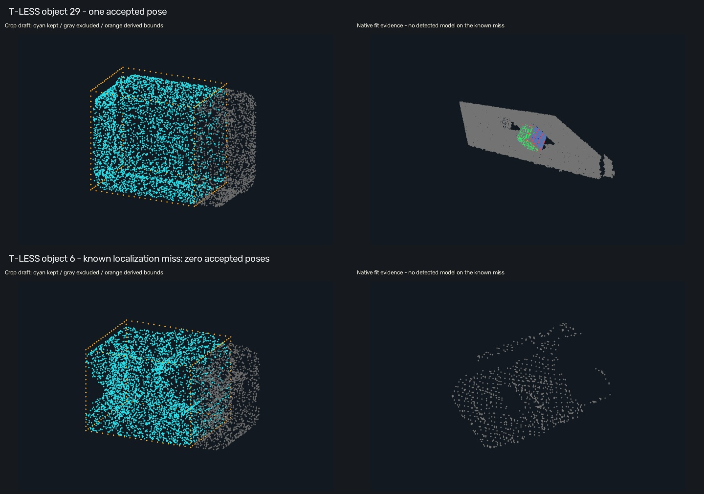

# Simple3DLocate native teaching

Restart if another locator version is already imported. Load this folder's
**plugin.py first**, then open a project. It verifies the bundled dev22 wheel
without installing packages or replacing the host environment.

| Real first-surface example | Original | Retrained workflow |
| --- | --- | --- |
| T-LESS object 29, one accepted pose | [Open](real_positive/project.json) | [Open](real_positive/staged_project.json) |
| T-LESS object 6, known localization miss | [Open](real_no_match/project.json) | [Open](real_no_match/staged_project.json) |

Both retain the original full reference/CAD, settings, camera and measured search/
depth inputs. The publisher supplied the visible-mask preprocessing; test poses
are evaluation-only and never seed matching. Training workflow success does not
repair the object-6 miss or establish broad matching accuracy. See
[dataset attribution and source pins](SOURCES.md).

## Teach and review

1. Select the locator and **Train 3D locator…**. The saved full reference, CAD,
   learned samples and settings restore. **Native 3D · orbit / flyaround** is the
   primary tab. Its view uses the host's actual CloudViewer, with RGB point colors,
   yaw/pitch, point size and Flyaround. The secondary assessment image stays
   available. Runtime `fit` cloud thumbnails remain primary.
2. Load/capture one isolated cloud or import a mesh. The persistent summary shows
   source point count, physical XYZ extent, units/frame, normal convention and CAD
   availability. Unit fields **relabel** coordinates; they do not rescale XYZ.
   Use the mesh import's explicit coordinate multiplier or convert upstream when
   changing coordinate units. Model and scene units must agree for testing.
3. **Fill model bounds**, edit the minimum/maximum XYZ triples, then **Preview crop**.
   Cyan points are retained source samples, gray are excluded source samples, and
   orange points form a derived bounds glyph. The display balances/downsamples
   source categories for visibility; the reported count and applied crop use all
   source points. Preview does not change the recipe or train on the bounds glyph.
4. **Crop model to bounds** applies the selection to the draft and requires at
   least 30 points. Cropped CAD samples become a cloud reference. **Undo crop**
   restores the preceding cloud/CAD in this session (up to eight crops).
   **Clear crop preview** removes the display without changing the reference.
   Pending bounds are explicit; train/stage use the current reference until a
   crop is applied. Original uncropped sources and crop history are not added to
   a staged cropped recipe. Reopen starts from the retained recipe reference.
5. Check units, model viewpoint/normal convention and observation mode. **surface**
   is the first-visible-surface default; **complete** is an explicit full-volume/
   fused-observation assumption. **Train surface model** fits and compiles on a
   bounded background worker. Persistent preparation health reports learned/full
   point counts, sampling budget, diagonal and normal spread—not detection accuracy.
6. Load/capture an independent scene. **Capture last processed inputs** freezes the
   actual completed search/camera/separate-depth inputs together. Manual/latest
   inputs remain labeled separately. The summary shows scene/frame/units, camera
   size/focal lengths and depth source, and reports incompatible units/frames
   before testing. Acquisition declarations do not prove physical synchronization.
7. **Locate in test scene** also runs in the background. Mutation/staging controls
   stay disabled during a job; native orbit/flyaround remains available. **Cancel
   job** requests cancellation between native phases. It cannot interrupt a native
   PPF/ICP call already running. Cancelled, changed-input and closed-window jobs
   cannot publish a model/result or activate a recipe. Restored training-geometry
   compilation is deferred to the same worker without retraining.
8. Use existing instance/rejected-candidate, layer and camera-depth review controls
   to assess the recorded fit. A rejected/alternative expected model is not an
   accepted pose or extra sensor return. Missing depth remains unknown. Training
   preview uses the same matcher/settings as runtime; independent completed-run
   Results review remains separate.
9. **Stage recipe** creates a new archive in the inspector draft; **Apply** commits
   it. Teaching content scrolls on smaller screens while job and Stage actions
   remain reachable. Reopen restores exact reference/CAD/samples/settings. Save As copies the
   archive exactly, while ordinary scene input paths rebase to the original files.
   Camera/test/depth captures are session-only and are not silently sealed as a
   recipe's future runtime inputs.

The two native workflows preview/apply/undo a crop, cancel work, train with
unchanged inputs, capture/test the original scene, Stage without Apply, Apply,
reopen and Save As. Retrained reference/sample/CAD arrays and settings are exact;
accepted counts remain **1 / 0** and original match records are unchanged.



The primary evidence remains native colored PLY:
[object-29 crop](real_positive/crop_preview.ply),
[object-29 fit](real_positive/reviewed_fit.ply),
[object-6 crop](real_no_match/crop_preview.ply) and
[object-6 fit](real_no_match/reviewed_fit.ply).
The PNGs are programmatic documentary renders, not window captures. A crop PLY
contains the labeled derived bounds glyph and is a display artifact, not a
training acquisition. The known miss may have no retained pose geometry to draw.

## Reproduce and limitations

Use the host interpreter and a fresh output directory:

```powershell
$env:QT_QPA_PLATFORM = "offscreen"
python check_training.py --output C:/path/to/new-3d-training-check
```

The source suite passes 209 tests; the final wheel passes 81 affected checks.
Packaged host checks cover both native workflows and artifact pins. Four prior
runtime projects keep exact reports/poses and XYZ/RGB/default bitmap bytes;
four frozen exports verify. Timing fields are excluded from those comparisons.
See [native receipts](validation_training.json), [qualification](qualification.json),
[source/wheel identity](wheel_verification.json), [runtime parity](runtime_parity.json)
and [artifact pins](artifact_manifest.json).

These are native offscreen/software checks. Hands-on acceptance, draggable crop
handles/picking, semantic native box/line layers, undo/history across reopen,
background file import/restoration and finer cancellation remain follow-ups.
The shared viewer improvements have been requested from the host chat. Broader
novel-model localization and independent sensor/pose qualification remain open;
no matching thresholds, defaults or per-application recipes were tuned here.
