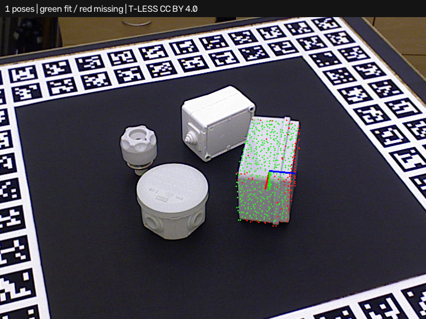

# Simple3DLocate · real T-LESS depth capture

Requires **Simple3DLocate 0.1.0.dev3** or later. Open [project.json](project.json)
and run. The existing camera block supplies calibrated intrinsics to the
locator. The expected result is one CAD pose for industrial object 29 in real
PrimeSense capture 230. This example demonstrates localization **after supplied
segmentation**, not blind object search or learned segmentation.



The depth camera sees the first surface. Missing pixels, noise and occlusion
remain in the measured cloud. No hidden CAD surfaces are added to that scene.
CAD visibility scoring excludes expected back faces/self-hidden samples.
Green model points fit; red points are missing; blue-gray 3D model points are
self-hidden. RGB axes mark the model's pose.

Open **Train 3D locator…** to see the retained CAD model. To preview the same
scene, load `assets/scene.ply` and `assets/camera.json`, or, with plugin dev8, run in Debug and choose **Capture last processed inputs**
to capture the scene and camera consumed by the locator together. Review
[Test search cloud and capture provenance](../CAPTURE.md); common execution
does not prove simultaneous acquisition. Model and camera coordinates are millimeters;
the output maps `tless_object29` to `camera`.

The match score combines geometric coverage, point-to-plane fit and normal
agreement; it is not a probability. Default overlap rejection keeps the higher
score when either 3D box overlap or shared scene support exceeds 60%. The trainer
exposes the threshold and metric. Set observation mode to `complete` for fused
or volumetric observations that intentionally contain hidden surfaces.

For the optional local-descriptor/RANSAC route, see the
[feature candidates example](feature_candidates/README.md), including the
three-backend comparison and retained real-scene failures.

The [competing-orientations example](pose_alternatives/README.md) reproduces
a wrong selected orientation and exposes verified alternatives and score
margins with plugin dev9. Its annotation failure remains counted.

The [parallel verification example](parallel_verification/README.md) compares
one and four workers on unchanged models and inputs. Plugin dev10 adds the
worker limit and parallel comparison profile; legacy recipes stay serial.

## Measured scope and failures

With default training/execution settings, capture 230's isolated object has
approximately 3.31 mm translation error and 2.24 degrees rotation error,
allowing its documented 180-degree symmetry. These are saved-image results,
not sensor repeatability or production qualification.

[benchmark.json](benchmark.json) retains eight cases: four isolated object
captures and the same four full scenes. Isolated inputs use dataset visible
masks upstream; full inputs use only one fixed 300–1100 mm depth workspace.
No test pose is passed into the locator. Ground truth is evaluation-only.
At 5 mm / 5 degree validation limits, **one of four isolated cases is correct**;
other isolated cases include incorrect poses and a missed occluded part.
**All four full-scene targets are missed** by the current candidate search.
Background-plane/clutter handling and wider view/occlusion robustness remain
development work. All case JSON reports and image overlays are included.

Rebuild with both Python packages available:

```powershell
python build_tless_demo.py source . --host-project
```

An additional [experimental plane-candidate comparison](plane_candidates/README.md)
uses the full scene without an object mask. It recovers the correct best pose
in capture 230 but retains false extra poses and is not the default route.

The [depth-verified full-scene example](depth_verified/README.md) uses dev5
camera-ray evidence to reject the extra pose in capture 230. The wider dataset
still contains misses and incorrect orientations.

The [cropped search with full-frame depth example](cropped_search_depth/README.md)
uses dev6 to retain background verification while searching an isolated cloud.
Its search segmentation is supplied by the dataset.

## License and attribution

Real images, depth, masks, CAD, annotations and derivatives retain
**CC BY 4.0**. Authors: Tomáš Hodaň, Pavel Haluza, Štěpán Obdržálek, Jiří Matas,
Manolis Lourakis, and Xenophon Zabulis. *T-LESS: An RGB-D Dataset for 6D Pose
Estimation of Texture-less Objects*, WACV 2017.

[Original project and license](https://cmp.felk.cvut.cz/t-less/),
[CC BY 4.0](https://creativecommons.org/licenses/by/4.0/),
[full attribution and changes](source/ATTRIBUTION.md),
[source revision and hashes](source/provenance.json).
The adapter/builder code uses this repository's MIT license. Dataset authors
do not endorse the tool. The OpenCV PPF backend's separate published patent
notice remains applicable as documented by the tool's dependency notes.
