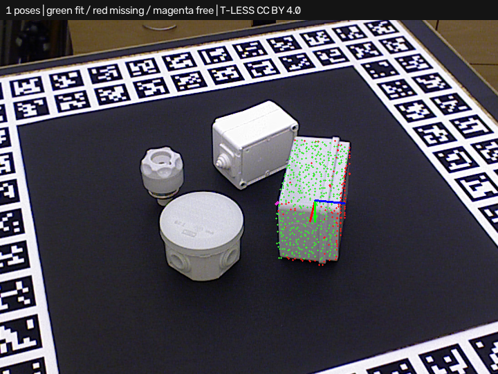

# Simple3DLocate · cropped search and full-frame depth

Requires **Simple3DLocate 0.1.0.dev6**. Open [project.json](project.json) and run.
The search cloud contains object 29 from real T-LESS capture 230, isolated by
the **supplied dataset mask**. This tool does not predict that segmentation.
The separate `depth_scene` input contains all measured returns from the same
capture, including background outside the search crop. The camera block uses
the original full-frame intrinsics.

Expect **one correct pose**, approximately 3.31 mm / 2.24 degrees after the
documented symmetry allowance. This is a selected pose-estimation example
after supplied segmentation, not blind full-scene detection.



## Workflow

Connect the reduced cloud to `scene`, full-frame measured cloud to
`depth_scene`, and rectified camera calibration to `camera`. Both clouds must
retain the same units, original camera coordinates and capture identity.
Convert/transform upstream if necessary. Point-cloud cropping does not require
changing the full-frame camera calibration.

Full-frame evidence only supplies the depth check. It never enters PPF,
plane proposals, normal estimation, ICP, geometric support or the fit cloud.
The report shows search point counts separately from depth source/point counts.
An empty search still produces no candidates. Empty explicit depth remains
unknown and does not fall back to search pixels. Unknown rays never count as
agreement. The candidate backend here is the default PPF route.

Open the trainer to preview the saved model. Load `assets/scene.ply`, load
`assets/camera.json`, then load `assets/depth.ply` as verification depth.
The **Verification depth cloud** view displays that input. Clearing it restores
verification from the search cloud; loading a new search clears earlier depth.
Stage stores the model/thresholds. Runtime needs the actual separate input wire.

For capture, use matching saved files or a paused/static acquisition. Current
individual input capture actions snapshot latest values independently; they
are not a synchronized live bundle. Units/frame validation does not establish
capture timing. A coherent processed-input capture hook has been requested
from the host for future paired live capture.

## Scope and remaining failures

Compared with verification from each search cloud, full-frame evidence reduces
extras from three to two for PPF and six to five for the plane/PPF hybrid across
the retained eight real cases. Correct/missed counts remain one/seven and
two/six respectively. [comparison.json](comparison.json) retains all cases;
neither route qualifies on the whole set. Cropped capture 220 loses one extra
pose, while its remaining orientation is still incorrect.

The full depth index has a cost even when the search is small. Timings cover
the locator and exclude upstream segmentation. Similar shapes and ambiguous
orientations remain unresolved by depth alone. All case reports and overlays
remain available in this folder.

Reproduce with both Python packages installed:

```powershell
python build_tless_demo.py ../source . --backend ppf --project-scene isolated --separate-depth --host-project
python benchmark_candidates.py ../source comparison.json --separate-depth
```

## Attribution and license

Real T-LESS data and these derived clouds, recipes and overlays retain
**CC BY 4.0**. Authors: Tomáš Hodaň, Pavel Haluza, Štěpán Obdržálek, Jiří Matas,
Manolis Lourakis and Xenophon Zabulis. *T-LESS: An RGB-D Dataset for 6D Pose
Estimation of Texture-less Objects*, WACV 2017.

[Original project/license](https://cmp.felk.cvut.cz/t-less/),
[CC BY 4.0](https://creativecommons.org/licenses/by/4.0/),
[full attribution/changes](../source/ATTRIBUTION.md),
[source revision and hashes](../source/provenance.json).
Changes comprise depth-to-XYZ conversion, supplied-mask search selection,
full-frame depth preservation, CAD sampling/training and predicted-pose overlays.
No hidden or invented points are added to measured clouds. Ground-truth poses
are evaluation-only. No dataset author endorsement is implied. Builder code
uses this repository's MIT license; the OpenCV PPF backend's separate patent
notice remains documented by the tool.
