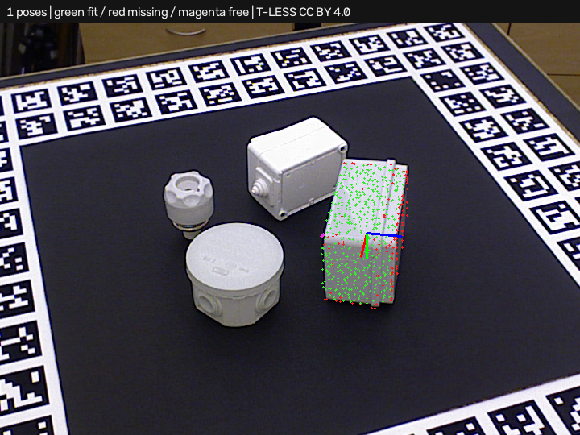

# Simple3DLocate · depth-verified full scene

Requires **Simple3DLocate 0.1.0.dev5**. Open [project.json](project.json) and run.
The input is the real T-LESS capture 230 depth cloud in a fixed 300–1100 mm
camera workspace. No object mask or pose seed is supplied.

The saved recipe combines plane/PPF candidates with calibrated camera-depth
verification. Expect **one accepted pose**, approximately 3.32 mm translation
error and 2.34 degrees rotation error after the documented symmetry allowance.
The incorrect extra from the [earlier example](../plane_candidates/README.md)
is rejected because the model occupies space the camera measured as empty.



This case passes the one-instance 5 mm / 5 degree pose check. It is a selected
saved-capture result; the wider dataset still has misses and incorrect poses.

## Depth evidence

The existing camera block supplies rectified intrinsics. All coordinates are
in millimeters in the camera frame. The tool separates agreement, foreground
occlusion, empty-space contradiction and unknown depth. It uses the existing
physical fit tolerance, corrected for model surface slope, and a conservative
3×3 pixel neighborhood. Missing pixels and near-grazing rays remain unknown.

The new generic defaults require 80% useful depth coverage and enough distinct
known rays before applying a 10% maximum contradicted-ray fraction. About 14%
of the earlier extra pose's known rays contradict depth, versus less than 1%
for the retained correct pose. Unknown rays never count as agreement.
Cropping or segmentation may remove background depth needed for this check.

Green points fit geometry, red lack support, blue-gray are self-hidden, and
magenta contradict measured depth. RGB axes mark the model pose. The geometric
fit score is unchanged; it is not a probability. The execution report includes
depth-rejected candidate poses/evidence and separate depth preparation/check
times. A candidate count can exceed the number of final rejected instances.

In the trainer, choose `depth verification = report` to inspect evidence without
rejecting, `auto` to apply the guard, or `off` to retain geometric-only behavior.
The thresholds are acceptance settings and are preserved by execution profiles.
Complete/volumetric observations bypass this camera check. Older saved recipes
load with the new check off until explicitly changed and re-staged.

## Broader comparison and limits

[comparison_off.json](comparison_off.json) and
[comparison_auto.json](comparison_auto.json) retain all eight real cases at
5 mm / 5 degrees: four with supplied isolation masks and four full scenes.

| Route | Correct poses / 8 expected | Missed | Extra |
| --- | ---: | ---: | ---: |
| PPF, depth off | 1 | 7 | 3 |
| PPF, depth auto | 1 | 7 | 3 |
| PPF + planes, depth off | 2 | 6 | 7 |
| PPF + planes, depth auto | 2 | 6 | 6 |

The optimizer recommends neither candidate route on the whole set. Similar
shapes and ambiguous orientations can agree with both geometry and depth.
PPF remains the default candidate backend. Local timing reports are not
production cycle-time guarantees. This custom pose check is not an official
BOP leaderboard evaluation. All auto-mode case reports and overlays are retained.

Rebuild with both Python packages installed:

```powershell
python build_tless_demo.py ../source . --backend ppf_planes --project-scene full --depth-verification auto --host-project
python benchmark_candidates.py ../source comparison_auto.json --depth-verification auto
python benchmark_candidates.py ../source comparison_off.json --depth-verification off
```

## Attribution and license

Real T-LESS assets and derived point clouds, recipes and overlays retain
**CC BY 4.0**. Authors: Tomáš Hodaň, Pavel Haluza, Štěpán Obdržálek, Jiří Matas,
Manolis Lourakis and Xenophon Zabulis. *T-LESS: An RGB-D Dataset for 6D Pose
Estimation of Texture-less Objects*, WACV 2017.

[Original project/license](https://cmp.felk.cvut.cz/t-less/),
[CC BY 4.0](https://creativecommons.org/licenses/by/4.0/),
[full attribution and transformations](../source/ATTRIBUTION.md),
[source revision and hashes](../source/provenance.json).
Changes comprise depth-to-XYZ conversion, fixed depth-range selection, CAD
sampling/training and predicted-pose/evidence overlays. No invented or hidden
points are added to measured scenes. Ground truth is evaluation-only. No dataset
author endorsement is implied. Builder code uses this repository's MIT license.
The OpenCV PPF backend's separate patent notice remains documented by the tool.
