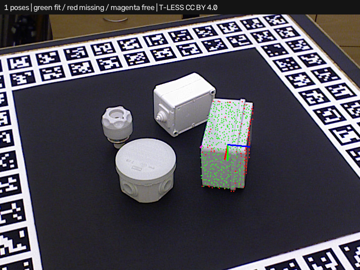

# Simple3DLocate · local feature candidates

Requires **Simple3DLocate 0.1.0.dev7**. Open [project.json](project.json) and run.
This example searches the real T-LESS capture-230 depth workspace without an
object mask or pose seed. The optional `ppf_features` route adds local angular
descriptors and geometric-consistency RANSAC proposals to PPF. Expect one
correct object-29 pose within 5 mm / 5 degrees, approximately 3.2 mm / 1.2
degrees in the saved run, allowing the documented 180-degree Z symmetry.



## Workflow

The `scene` input contains real depth returns in a fixed 300–1100 mm workspace.
`depth_scene` contains all measured returns from the same capture, including
farther background. The camera uses original full-frame intrinsics. Both
clouds retain millimeter units and original camera coordinates. No hidden
surfaces are invented or added to measured data. Full-frame depth is used only
for physical consistency verification, not feature search or ICP.

Open **Train 3D locator…** to restore the retained CAD model. Select
`candidate backend = ppf_features`, or use **Optimize execution…** to compare
the added **features** profile with the other plans. Load `assets/scene.ply`,
`assets/camera.json` and `assets/depth.ply` for a saved-data preview. These are
matched saved inputs; independent latest-value captures are not a timing
guarantee. The host's processed-input bundle API is available for future
trainer integration, but the plugin's existing capture buttons remain separate.

Model signatures are cached. Runtime work is bounded to 64 descriptor
neighbors, 2048 correspondences, 4096 guided RANSAC trials and 128 coarse
feature proposals. Features reserve at most half the existing refinement
budget; PPF retains the remainder or all of it if no features propose poses.
The full trained geometry and all acceptance thresholds stay unchanged.
The implementation uses NumPy/OpenCV and adds no dependency.

Green points fit; red points are missing; magenta points contradict depth.
RGB axes mark the model pose. The match's geometric score is not a probability.
Reports identify `candidate_source="features"` and separate descriptor,
consensus, ranking, PPF and refinement timing.

## Measured scope and failures

[comparison.json](comparison.json) retains all eight real cases and three
routes at unchanged 5 mm / 5 degree validation limits with full-frame depth:

| Route | Correct / 8 expected | Missed | Extra |
| --- | ---: | ---: | ---: |
| PPF | 1 | 7 | 2 |
| PPF + planes | 2 | 6 | 5 |
| PPF + features | 2 | 6 | 3 |

Features recover this full-scene pose and preserve the isolated correct pose.
Other cases still contain wrong orientations and misses. None of the routes
qualifies on the complete set. Local one-repeat mean times were approximately
0.93 / 1.73 / 3.23 seconds respectively, excluding acquisition/segmentation.
This feature route is slower and remains experimental; PPF is the default.
Four benchmark cases use supplied masks, four use only the fixed workspace.
No test truth or expanded symmetry is used by matching.

[generated_summary.json](generated_summary.json) records a separate complete/
fused-observation regression: six positive scenes, twelve expected instances,
two negatives, all six profiles with zero misses/extras in one repeat. It does
not qualify camera sensing. All real-case reports and overlays remain in this
folder, including failures. Broader view/occlusion, shape specificity, normal
robustness, orientation ambiguity and parallel runtime work remain open.

Reproduce with both Python packages installed:

```powershell
python build_tless_demo.py ../source . --backend ppf_features --project-scene full --separate-depth --host-project
python benchmark_candidates.py ../source comparison.json --separate-depth
```

## Attribution and license

Real T-LESS data and derived clouds, recipes and overlays retain **CC BY 4.0**.
Authors: Tomáš Hodaň, Pavel Haluza, Štěpán Obdržálek, Jiří Matas, Manolis Lourakis
and Xenophon Zabulis. *T-LESS: An RGB-D Dataset for 6D Pose Estimation of
Texture-less Objects*, WACV 2017.

[Original project/license](https://cmp.felk.cvut.cz/t-less/),
[CC BY 4.0](https://creativecommons.org/licenses/by/4.0/),
[full attribution/changes](../source/ATTRIBUTION.md),
[source revision/hashes](../source/provenance.json).
Changes comprise measured depth-to-XYZ conversion, fixed workspace selection,
full-frame evidence retention, CAD sampling/training and predicted-pose
overlays. Ground truth is evaluation-only. No author endorsement is implied.
Builder code uses this repository's MIT license. The OpenCV PPF backend's
separate patent notice remains documented by the tool.

Descriptor design references:
[PCL FPFH](https://pointclouds.org/documentation/tutorials/fpfh_estimation.html),
[Open3D global registration](https://www.open3d.org/docs/latest/tutorial/pipelines/global_registration.html).
Our angular signatures are an independent implementation, not compatible
PCL/Open3D FPFH signatures; no code from those libraries is bundled.
