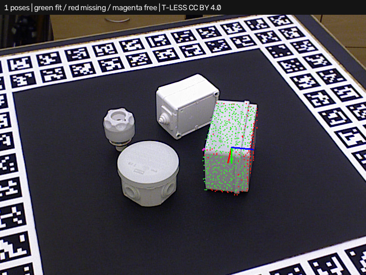

# Simple3DLocate · parallel verification

Requires **Simple3DLocate 0.1.0.dev10**. Open [project.json](project.json) and run.
This saved example uses four candidate workers on real T-LESS capture 230.
Expect one correct object-29 pose within the documented 5 mm / 5 degree check,
allowing the dataset's 180-degree Z symmetry. The search uses the supplied
object mask; this tool does not predict that segmentation. The camera and
separate full-frame depth come from the same saved capture.



## Workflow

Open **Train 3D locator…** to restore the trained CAD model. **Execution workers**
is four in this recipe. **Optimize execution…** adds a **parallel** profile,
changing only the worker limit while preserving trained samples and acceptance
settings. Compare representative positive and negative scenes before choosing
a plan. On hosts with retained inputs, run in Debug and use **Capture last
processed inputs** for the scene, camera and depth bundle; see
[capture workflow](../../CAPTURE.md).

Worker counts accept **1..8**. Existing recipes without this setting use one,
which is also the compatibility default. Increasing the count uses more CPU
and private index memory. Coordinate it with other simultaneously running
blocks and native OpenCV threading; it is a per-tool limit, not a process-wide
CPU budget. No host API extension is needed.

Native PPF candidate search remains serialized per locator. Independent
candidate ICP and verification use a per-run pool, private nearest-neighbor
indices and separate native ICP objects. Outcomes return in candidate order
before the unchanged score-ordered overlap suppression. Input points, trained
geometry, candidate budgets, depth gates and pose-selection policy are retained.
Threads join when the run finishes, including unexpected verification errors.

Reports include requested and actual active workers. `total` and `refine_verify`
are wall times. `depth_verify` and `worker_index_prepare_sum` sum worker
intervals that can overlap, so they cannot be added to obtain wall time.
The normal result still includes fit/missing surfaces, pose axes, depth evidence
and competing-pose diagnostics; the score is geometric, not a probability.

## Measured scope

[comparison.json](comparison.json) compares the same eight real cases with
full-frame depth and three timed repeats per scene:

| Workers | Mean of scene median times | Correct / missed / extra per repeat |
| --- | ---: | --- |
| 1 | 1.134 s | 1 / 7 / 2 |
| 4 | 0.591 s | 1 / 7 / 2 |

That is about **1.9× faster** locally, including per-run thread startup and
private index preparation. Model compilation is separate; acquisition and
segmentation cost are excluded. These measurements do not guarantee cycle
time. Four cases use supplied masks and four a fixed depth workspace.
Neither route qualifies on the whole set, so the optimizer recommends neither.
The faster execution retains the known missed/wrong-pose cases.

[generated_summary.json](generated_summary.json) records a separate regression:
all seven profiles have zero misses/extras over six independent positive
curved/CAD scenes, twelve expected instances and two negatives in one repeat.
Those complete/fused observations do not qualify camera sensing. The real
case reports and overlays in this folder preserve failures as well as successes.

Reproduce with both Python packages installed:

```powershell
python build_tless_demo.py ../source . --backend ppf --separate-depth --workers 4 --host-project
python benchmark_parallel.py ../source comparison.json --repeats 3
```

The CLI also supports `simple-3d-locate locate part.s3l scene.npz --workers 4`
as a one-run override without rewriting or retraining the stored recipe.

## Attribution and license

Real T-LESS data and derived clouds, recipes and overlays retain **CC BY 4.0**.
Authors: Tomáš Hodaň, Pavel Haluza, Štěpán Obdržálek, Jiří Matas, Manolis Lourakis
and Xenophon Zabulis. *T-LESS: An RGB-D Dataset for 6D Pose Estimation of
Texture-less Objects*, WACV 2017.

[Original project/license](https://cmp.felk.cvut.cz/t-less/),
[CC BY 4.0](https://creativecommons.org/licenses/by/4.0/),
[full attribution/changes](../source/ATTRIBUTION.md),
[source revision/hashes](../source/provenance.json).
Changes comprise measured depth-to-XYZ conversion, supplied-mask search,
full-frame evidence retention, CAD training and predicted-pose overlays.
No hidden scene surfaces are added; truth is evaluation-only. No endorsement
is implied. Builder code uses this repository's MIT license; the existing
OpenCV surface-matching patent notice still applies. No new dependency or
third-party implementation is bundled for parallel execution.
