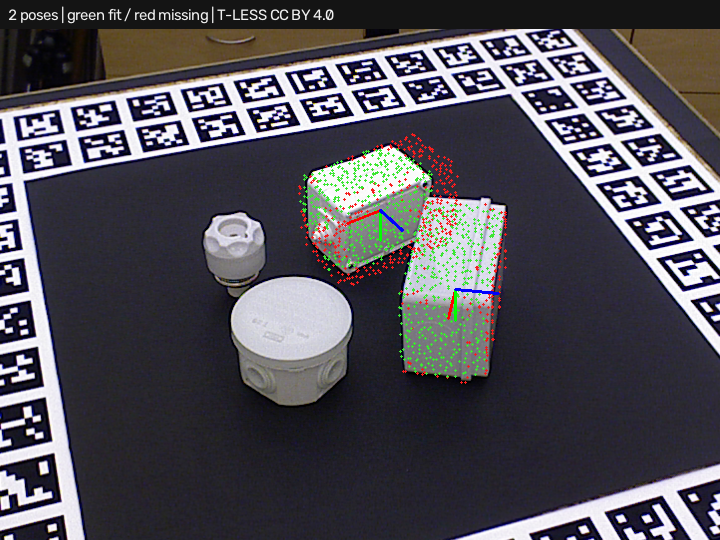

# Simple3DLocate · experimental plane candidates

Requires **Simple3DLocate 0.1.0.dev4**. Open [project.json](project.json) and run.
The input is the real T-LESS capture 230 depth cloud within a fixed
300–1100 mm camera workspace. **No object mask or pose seed is supplied.**
The trained recipe enables the optional `ppf_planes` candidate backend.

The expected output has **two accepted poses**. The highest-scoring pose is
correct within 5 mm / 5 degrees, at approximately 3.32 mm / 2.34 degrees after
the documented symmetry allowance. The second pose is an incorrect extra.
This is a development comparison showing a remaining false-positive problem;
it does not pass a one-instance application acceptance check.



The plugin still defaults to PPF. The optional hybrid caches model plane patches,
matches bounded scene plane pairs, and reserves at most half the existing
refinement budget for plane proposals. PPF supplies the remainder. Full-model
fit thresholds, visibility checks and overlap rejection are unchanged.
The report identifies candidate sources, patch counts and separate search times.

## Comparison results

[comparison.json](comparison.json) compares PPF and the hybrid across all eight
retained real cases: four isolated inputs with supplied segmentation and four
full scenes. At 5 mm / 5 degrees:

| Route | Correct poses / 8 expected | Missed | Extra | Mean scene time |
| --- | ---: | ---: | ---: | ---: |
| PPF | 1 | 7 | 3 | 0.96 s |
| PPF + planes | 2 | 6 | 7 | 1.46 s |

Times are local saved-data measurements. The optimizer recommends neither
route on this set. The hybrid improves candidate recall while adding incorrect
poses. Symmetry/view ambiguity, shape specificity and depth consistency remain
open work. All hybrid case reports and overlays are retained in this folder.
The [existing example](../README.md) retains the default PPF route.

In the trainer, **Optimize execution…** now includes a **planes** profile and
supports validation manifests with per-scene cameras, poses and symmetries.
Review extra poses as well as the best pose before choosing a route.

Reproduce with both Python packages installed:

```powershell
python build_tless_demo.py ../source . --backend ppf_planes --project-scene full --host-project
python benchmark_candidates.py ../source comparison.json
```

## Attribution and license

The original T-LESS assets and these derived point clouds, recipes and overlays
retain **CC BY 4.0**. Authors: Tomáš Hodaň, Pavel Haluza, Štěpán Obdržálek,
Jiří Matas, Manolis Lourakis and Xenophon Zabulis. *T-LESS: An RGB-D Dataset for
6D Pose Estimation of Texture-less Objects*, WACV 2017.

[Original project/license](https://cmp.felk.cvut.cz/t-less/),
[CC BY 4.0](https://creativecommons.org/licenses/by/4.0/),
[original attribution and transformations](../source/ATTRIBUTION.md),
[source revision/hashes](../source/provenance.json).
Changes comprise depth-to-XYZ conversion in millimeters, fixed depth-range
selection, CAD sampling/training and predicted-pose overlays. No hidden or
invented points are inserted into measured scenes. Ground truth is used only
for evaluation. No endorsement by dataset authors is implied. Builder code
uses this repository's MIT license. The OpenCV PPF backend's separate patent
notice remains as documented by the tool.
