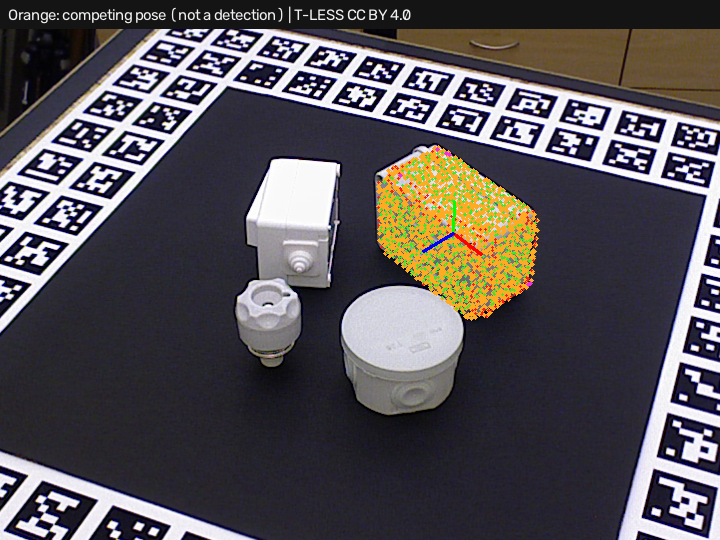
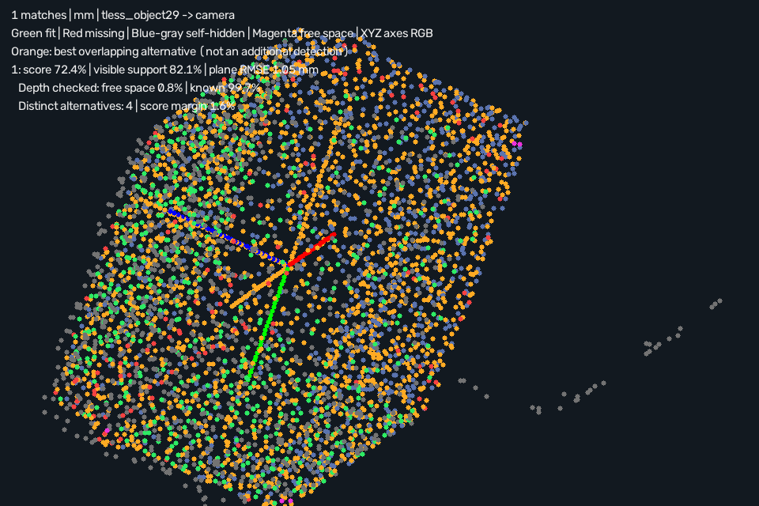

# Simple3DLocate · competing orientations

Requires **Simple3DLocate 0.1.0.dev9**. Open [project.json](project.json) and run.
This diagnostic example deliberately reproduces a **wrong orientation with a
plausible geometric fit** in real T-LESS capture 220. The input uses the supplied
dataset mask to isolate object 29, with the original full-frame depth on the
separate verification input. No annotation pose is supplied to matching.

The expected output is one geometrically accepted match whose annotated
orientation check fails. Overlap suppression still keeps the highest score.
The new `pose_alternatives` report reveals other verified overlapping poses,
including poses that agree with the annotation.



## Inspect the ambiguity

Run in Debug, open **Train 3D locator…**, choose **Capture last processed inputs**,
then **Locate in test scene**. Select **Competing poses** to draw the best
distinct alternative in orange alongside the retained model and RGB pose axes.
See [capture workflow](../../CAPTURE.md) for execution history and acquisition
pairing semantics. The normal runtime fit cloud contains accepted instances;
the orange competitor is a diagnostic drawing.



The match/pose output's `pose_alternatives` object provides:

- Distinct alternative-group count and suppressed-candidate count.
- Score gap and relative margin to the best distinct competitor.
- Up to three alternative model-to-scene matrices, scores, coverage, RMSE,
  candidate source, overlap and pose separation.
- Explicit export truncation and a non-exhaustive-search indication.

In the saved run the retained score is about **0.724**, with **four distinct
alternative groups** and a **1.6% relative score margin**. Exported alternatives
include an annotated-correct pose around 4.66 mm / 0.66 degrees under the existing
5 mm / 5 degree check and documented 180-degree Z symmetry. These alternatives
do not increase the detection count or the number of successful detections.

Margin is `(winner_score - best_alternative_score) / winner_score`. It is a
geometric comparison, not a calibrated probability or pose confidence. A missing
competitor has a null margin, not 100% confidence. Distinct orientations may
reflect model symmetry, partial views, shifted estimates or a wrong fit; the
tool does not automatically merge model symmetries. A large margin cannot fix
a missing candidate or prove the selected pose correct.

Nearby estimates are grouped within the existing distance tolerance times
model diagonal and `360 / angle_bins` degrees. Displacement uses the transformed
model center, independently of where the taught origin lies. Only candidates
passing active geometric/depth checks and rejected by this match's overlap
decision compete. A match-count limit or rejected depth does not create an
alternative. Highest-score ordering, fit thresholds and recipe settings stay
unchanged. No extra candidate search or ICP pass is added. Grouping and report
serialization have bounded cost; `execution.seconds.pose_alternatives` measures
the postprocessing separately from overlap suppression.

## Retained failures

[benchmark.json](benchmark.json) contains all eight cases with every missed or
extra detection counted. PPF remains at one correct / seven missed / two extra
with full-frame depth. A correct alternative is still a failed selected pose.
The ordinary project judgment remains pass when a geometric match is accepted;
the separate annotation check in `isolated_000220.json` remains failed. Review
pose alternatives and margins in downstream application logic as needed.

Four cases use supplied masks and four a fixed 300–1100 mm depth workspace.
Sensor acquisition and segmentation cost are excluded. Symmetry handling,
shape specificity, ranking and broader real-data qualification remain open.
All case reports and RGB overlays remain available in this folder.

Reproduce with both Python packages installed:

```powershell
python build_tless_demo.py ../source . --backend ppf --project-frame 220 --separate-depth --show-alternatives --host-project
```

## Attribution and license

Real T-LESS data and derived clouds, recipes and overlays retain **CC BY 4.0**.
Authors: Tomáš Hodaň, Pavel Haluza, Štěpán Obdržálek, Jiří Matas, Manolis Lourakis
and Xenophon Zabulis. *T-LESS: An RGB-D Dataset for 6D Pose Estimation of
Texture-less Objects*, WACV 2017.

[Original project/license](https://cmp.felk.cvut.cz/t-less/),
[CC BY 4.0](https://creativecommons.org/licenses/by/4.0/),
[full attribution/changes](../source/ATTRIBUTION.md),
[source revision/hashes](../source/provenance.json).
Changes comprise supplied-mask depth-to-XYZ conversion, full-frame evidence
retention, CAD training, selected/alternative-pose diagnostics and overlays.
Missing returns remain absent; no hidden surfaces are invented. Ground truth
is evaluation-only. No endorsement is implied. Builder code uses this
repository's MIT license; the OpenCV PPF backend's separate patent notice
remains documented by the tool.
