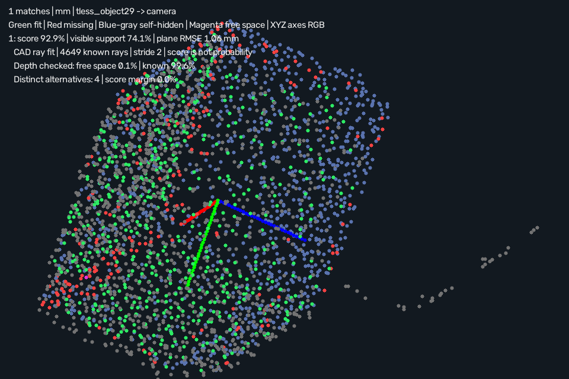

# Simple3DLocate · rendered CAD depth scoring

Requires **Simple3DLocate 0.1.0.dev11**. Open [project.json](project.json) and run.
This recipe uses four workers and optional **projective** scoring on real
T-LESS capture 220. Expect one object-29 pose within the documented 5 mm /
5 degree check (about 4.68 mm / 0.39 degrees), allowing the dataset's
180-degree Z symmetry. The input uses the supplied visible object mask;
localization does not predict that segmentation. Separate full-frame depth
and the calibrated camera belong to the same saved capture.



## Training and execution

Open **Train 3D locator…** to restore the CAD mesh. Choose **Pose scoring →
projective** to rank geometrically verified candidates by rendered/observed
depth agreement. **Optimize execution…** includes the new **projective**
profile. It changes only scoring; the existing geometry, refinement and
free-space gates and candidate budgets are preserved. Validate the score on
independent positives and negatives before selecting it.

Projective scoring renders the nearest front-facing triangle on each sampled
camera ray. The score averages a soft, incidence-corrected depth agreement;
it is **not a probability**. The result retains geometric coverage and RMSE,
plus `projective_scoring` metadata: original geometric score, stride, known
ray coverage and consistent/occluded/free-space counts. Pose records include
the same information. Fit/missing surface colors and pose axes remain available;
the overlay labels CAD ray fit separately.

CAD, a calibrated camera, surface observation and enabled depth are required.
Otherwise the entire run falls back to geometric scores with a reported
reason. Existing recipes default to geometric scoring. In an active projective
run, insufficient known rendered rays reject the candidate; a geometric score
is never mixed into that ranking. Missing depth stays unknown. Occlusion and
free space remain distinct evidence, though both lower soft agreement.

Rendering uses at most 640×640 grid cells and four million triangle/pixel pairs,
processed in bounded batches. Complex projections use a larger reported stride.
Fine details may be undersampled. Meshes crossing the camera plane cannot be
scored. Per-candidate workers use private scratch arrays; coordinate their CPU
and memory limits with other blocks. `projective_score_sum` sums overlapping
worker intervals; `total` is elapsed wall time.

## Retained comparisons

Each comparison uses the same eight real cases, unchanged training and fit
settings, full-frame depth, four workers and three repeats. Values below are
correct / missed / extra per repeat:

| Candidate backend | Geometric score | Projective score |
| --- | --- | --- |
| PPF | 1 / 7 / 2 | 3 / 5 / 0 |
| PPF + planes | 2 / 6 / 5 | 5 / 3 / 2 |
| PPF + features | 2 / 6 / 3 | 4 / 4 / 1 |

See [PPF comparison](comparison_ppf.json), [planes](comparison_planes.json)
and [features](comparison_features.json). The default PPF route fixes isolated
captures 220 and 347 while keeping capture 230 correct. Capture 488 and all
four full-scene targets remain missed with PPF. Hybrid backends still retain
false positives. All overlays and reports preserve these failures.

No profile qualifies on the whole set, so the optimizer recommends neither.
Four cases use supplied masks; four use a fixed depth workspace. Annotation
poses and symmetry enter evaluation only. These development cases informed
the score and do not constitute independent full-dataset or sensor qualification.
Local PPF mean scene median wall times are about 0.6 s for both scores; no
speed improvement or cycle guarantee is claimed. Acquisition and segmentation
costs are excluded. Compile costs are reported separately.

[generated_summary.json](generated_summary.json) retains the separate eight-profile
regression over six generated positive scenes, twelve expected instances and
two negatives. Projective mode falls back to geometric scoring for these
complete/fused observations; this does not validate rendered camera scoring.

Reproduce with both Python packages installed:

```powershell
python build_tless_demo.py ../source . --host-project --separate-depth --pose-scoring projective --workers 4 --project-frame 220
python benchmark_projective.py ../source comparison_ppf.json --workers 4 --repeats 3
python benchmark_projective.py ../source comparison_planes.json --workers 4 --repeats 3 --backend ppf_planes
python benchmark_projective.py ../source comparison_features.json --workers 4 --repeats 3 --backend ppf_features
```

## Attribution and license

Real T-LESS data and derived clouds, recipes and overlays retain **CC BY 4.0**.
Authors: Tomáš Hodaň, Pavel Haluza, Štěpán Obdržálek, Jiří Matas, Manolis Lourakis
and Xenophon Zabulis. *T-LESS: An RGB-D Dataset for 6D Pose Estimation of
Texture-less Objects*, WACV 2017.

[Original project/license](https://cmp.felk.cvut.cz/t-less/),
[CC BY 4.0](https://creativecommons.org/licenses/by/4.0/),
[full attribution/changes](../source/ATTRIBUTION.md),
[pinned source hashes](../source/provenance.json).
Changes comprise measured depth-to-XYZ conversion, supplied-mask searches,
full-frame evidence retention, CAD training, depth rendering and pose/fit
overlays. No hidden scene points are invented. No endorsement is implied.
Builder code uses this repository's MIT license; the existing OpenCV
surface-matching patent notice still applies. No new dependency or dataset is
added by this scoring mode.
