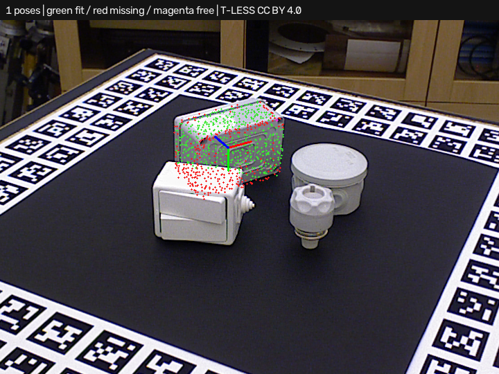

# Simple3DLocate · regional candidates in clutter

Requires **Simple3DLocate 0.1.0.dev12**. Open [project.json](project.json) and run.
This example uses real T-LESS full-scene capture **347**, without an object
mask. One fixed 300–1100 mm workspace selects the search cloud; separate
full-frame measured depth and calibrated intrinsics are retained. Expect one
object-29 pose at about **3.64 mm / 2.95 degrees** under the existing 5 mm /
5 degree check with the documented 180-degree Z symmetry.



## Workflow

Open **Train 3D locator…** to restore the retained CAD mesh. This recipe uses
**Candidate backend → ppf_regions**, **Pose scoring → projective**, and four
candidate workers. **Optimize execution… → regions** changes only the backend;
it preserves the current score and geometric/depth settings. The two score
modes are benchmarked independently below. Existing recipes keep their backend.

The global PPF search is retained. A proposal-only pass removes oversized
normal-consistent support planes, groups nearby surfaces, and searches up to
twelve object-scale regions. Touching/large groups receive bounded overlapping
windows. Coarse ranking gives regional proposals up to half the original
verification slots; global PPF fills the rest. A one-slot budget skips regions.
This can displace lower-ranked global poses, so validate against independent
positives and negatives before selecting it.

Plane removal does not alter the original global cloud or any geometric/depth
verification evidence. No hidden points are invented. A separate regional
native detector is lazily compiled and cached; native errors discard its state
and are counted. Native searches are serialized per locator; the existing
worker count still controls candidate refinement/verification. No host API
extension or new runtime dependency is required.

Reports expose `execution.region_search`: proposal-only removed points/planes,
components, region counts, native errors, model compilation and stage timing.
Returned poses identify candidate source `regions` or `ppf`. The result image
shows found/missing surfaces and pose axes. The fit cloud uses the original
scene. CAD ray scores remain fit measurements, not probabilities.

## Measured comparisons

Each report compares global PPF and the regional hybrid on the same eight real
cases, three repeats and four workers. Training, scoring, geometric/depth gates,
the total verification budget and full-frame depth are held fixed.

| Score | Global: correct / missed / extra | Regional: correct / missed / extra |
| --- | --- | --- |
| geometric | 1 / 7 / 2 | 2 / 6 / 4 |
| projective | 3 / 5 / 0 | 5 / 3 / 1 |

See [projective comparison](comparison_projective.json) and
[geometric comparison](comparison_geometric.json). No route qualifies on the
whole set, so the optimizer recommends neither. Regional search with CAD
depth scoring recovers full scenes 230 and 347 while preserving three isolated
successes. Full capture 220 returns a near fit at **5.06 mm / 1.55 degrees**;
it remains a miss and an extra under the unchanged 5 mm check. Both occluded
488 cases remain missed. All eight overlays/reports preserve these outcomes.

Projective scoring's local mean scene median wall time increases from about
**0.64 s to 0.97 s**; geometric scoring increases from 0.54 s to 0.78 s. This is
a recall/cost tradeoff, with no cycle-time guarantee. Acquisition, segmentation
and global locator compilation are excluded. Lazy regional compilation and
extra search work are included. Per-tool worker limits need coordination with
other simultaneous blocks and native threads.

Four benchmark cases use supplied masks, while four use one fixed workspace.
Annotated poses and symmetry are evaluation-only; region extraction receives
neither poses nor annotated boxes. These are development cases, not independent
full-dataset or production qualification. Touching groups, sparse normals,
small parts and larger workspaces can exceed the bounded proposal coverage.

[generated_summary.json](generated_summary.json) retains all nine profiles on
six generated positive scenes, twelve expected instances and two negatives.
All have zero misses/extras in that separate regression. Complete/fused scenes
use geometric scoring; they do not qualify calibrated camera performance.

Rebuild with both packages installed:

```powershell
python build_tless_demo.py ../source . --host-project --separate-depth --backend ppf_regions --pose-scoring projective --workers 4 --project-scene full --project-frame 347
python benchmark_regions.py ../source comparison_projective.json --workers 4 --repeats 3
python benchmark_regions.py ../source comparison_geometric.json --workers 4 --repeats 3 --pose-scoring geometric
```

## Attribution and license

Real T-LESS data and derived clouds, recipes and overlays retain **CC BY 4.0**.
Authors: Tomáš Hodaň, Pavel Haluza, Štěpán Obdržálek, Jiří Matas, Manolis Lourakis
and Xenophon Zabulis. *T-LESS: An RGB-D Dataset for 6D Pose Estimation of
Texture-less Objects*, WACV 2017.

[Original project/license](https://cmp.felk.cvut.cz/t-less/),
[CC BY 4.0](https://creativecommons.org/licenses/by/4.0/),
[full attribution/changes](../source/ATTRIBUTION.md),
[pinned source hashes](../source/provenance.json).
Changes comprise measured depth-to-XYZ conversion, CAD training, fixed-workspace
or supplied-mask searches, proposal-only grouping, full-frame evidence retention,
CAD depth rendering and pose/fit overlays. No endorsement is implied. Builder
code uses this repository's MIT license; the existing OpenCV surface-matching
patent notice still applies. No new dataset is added.
