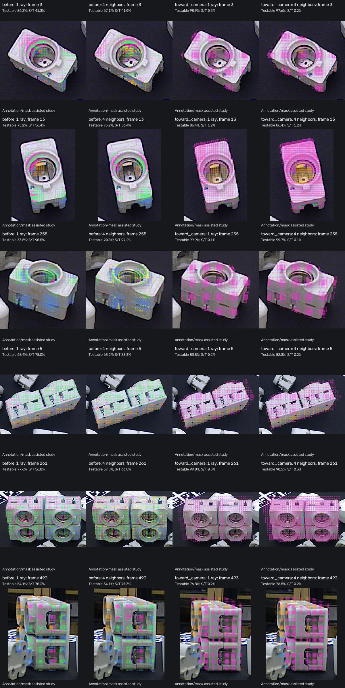

# Visibility, neighborhood and weighting diagnostics

This fixed study helps interpret current pose evidence. It does not choose a
new acceptance gate or modify a trained recipe, runtime pose or threshold.
Open either native frozen-cloud review in the stock app; no plugin is needed
for these file-only views. The pinned parent plugin is needed to reproduce analysis:

- [T-LESS object 6](ray_study/review_object6/review.json)
- [T-LESS object 8](ray_study/review_object8/review.json)

Both contain six built-in file inputs: sampled/triangle integer-ray queries with
one/four depth neighbors, and two translated triangle hypotheses. Select
**Cloud / cloud** for native RGB fly-around thumbnails and popouts. Clouds are
derived query geometry, not extra measurements. JSON sidecars retain states,
capture identity and the declared diagnostic population.



Green is support, magenta contradiction, blue foreground occlusion, orange
unknown depth, yellow ambiguous neighbors and purple label mismatch. Each gallery
row shows the supplied CAD pose with one/four neighbors, then the fixed
toward-camera perturbation. S/T means support divided by testable rays; read it
with the displayed testable fraction. Bounded cloud display density is not a
percentage. Full counts and estimated area weights are in the reports.

## What is isolated

The production point gate already deduplicates front-facing samples, retaining
the nearest sample per rounded full-image pixel. Its four-neighbor lookup uses
the original fractional sample position. The study preserves that gate exactly;
all 40 original before/after reports reproduce bit for bit as JSON values.

The triangle ablation holds predicted Z and integer camera rays fixed while
changing only the depth neighborhood. Both policies use the same domain,
excluding the final image row/column so four neighbors are available. The
weighting ablation then holds states fixed and compares pixel count with
estimated visible surface area. This separates neighborhood from weighting.

A second ablation compares nearest sampled versus exact triangle query Z on
their **common integer pixels**, at 4,000/40,000/50,000 samples and fixed seed 27.
It reports occupied mesh pixels, sampled-only pixels, Z residuals and state
changes. Rounding sample positions onto an integer ray introduces approximation;
this experiment includes sampling/projection/visibility differences and cannot
attribute them solely to self-occlusion. It is not a new production sampler.

Eight independent analytic plane controls cover complete support, a hidden
second model layer, external occlusion, missing depth, mixed neighborhoods,
one observed ray, all-occluded/all-missing surfaces and contradiction. Plane
equations provide measured depth independently of the renderer. A separate
analytic test checks depth/incidence area scaling and tessellation-free ray
statistics. No synthetic renderer output is reused as measured depth truth.

## Frozen real-data results

Ten real captures, two objects and CAD/reconstructed geometry produce 100
hypotheses: 40 prior before/after poses plus 60 fixed translations. Translations
are one quarter of the model diagonal laterally, toward the camera or away.
They are diagnostic perturbations, not independently labeled physical negatives.
The research-refined poses retain the earlier within-capture fitting limits;
they are not independent pose estimates. Raw depth, calibration and missing
measurements remain unchanged; no exposure, calibration or tolerance fitting.

Across the 20 original model/capture cases, descriptive mean pixel support over
expected rays is **50.4%** for one depth ray versus **45.6%** for four neighbors;
**13.4%** of ray classifications differ. Estimated visible-area support is
**36.0%** on those same one-ray states. These are different denominators, not
competing accuracy scores. Means weight model/capture cases equally.

Mean sampled occupancy of the exact rendered grid is **11.1%, 57.9%, 64.1%**
at 4k/40k/50k samples. More model samples improve coverage here but do not remove
neighborhood or representation effects. None of the 100 hypotheses passes the
unchanged production point gate.

Moving the model behind measured surfaces leaves only **0.9%** mean testable
pixel coverage, while finite conditional support averages **37.1%**. Some
conditional ratios are undefined; `summary.json` records valid case counts for
each mean. The analytic one-ray case reaches **100% support/testable** with only
**1/1521** expected rays testable. All-occluded/all-missing cases return unavailable
conditional support. A high conditional ratio alone must never qualify a pose.

## Decision and next work

Keep the current gate. A future opt-in mesh policy needs absolute evidence,
testable coverage, contradiction limits and independent calibrated captures with
hard negatives. Pixel/area weighting and neighborhood policy must be declared;
silhouette quadrature and grazing incidence need additional evaluation. A single
conditional score or a per-example tuned threshold is insufficient.

Next implementation work can add generic contact proposals while retaining
explicit grasp review and these unchanged pose/clearance holds. Mesh acceptance,
sensor uncertainty, force closure and robot trajectory qualification remain open.

## Reproduce and attribution

From the parent folder, with host NumPy/SciPy/OpenCV/Qt and its `src` on PYTHONPATH:

```powershell
python study_ray_evidence.py . C:\path\to\new-study
python verify_pose_agreement.py C:\path\to\new-study C:\path\to\new-review --native
```

For unattended native checks set QT_QPA_PLATFORM=offscreen. All 38 pinned original
members in `pose_agreement/source` are hashed before analysis; no download,
network acquisition or robot call occurs. Reports include all individual cases,
fixed settings and valid metric counts; averages are descriptive, not calibrated
confidence or benchmark accuracy.

Code and analytic controls are MIT. Real T-LESS inputs and derived images,
clouds and metrics retain **CC BY 4.0**. Preserve the [full attribution and source
hashes](tless/ATTRIBUTION.md), [publisher](https://cmp.felk.cvut.cz/t-less/) and
[license](https://creativecommons.org/licenses/by/4.0/). T. Hodaň, P. Haluza,
Š. Obdržálek, J. Matas, M. Lourakis and X. Zabulis, *T-LESS: An RGB-D Dataset for
6D Pose Estimation of Texture-less Objects*, IEEE WACV 2017. Changes: metric
conversion, fixed diagnostic perturbations, resampling, depth-neighborhood and
weighting comparisons, colored query clouds and image overlays. No endorsement
is implied. Original source bytes remain unchanged.
