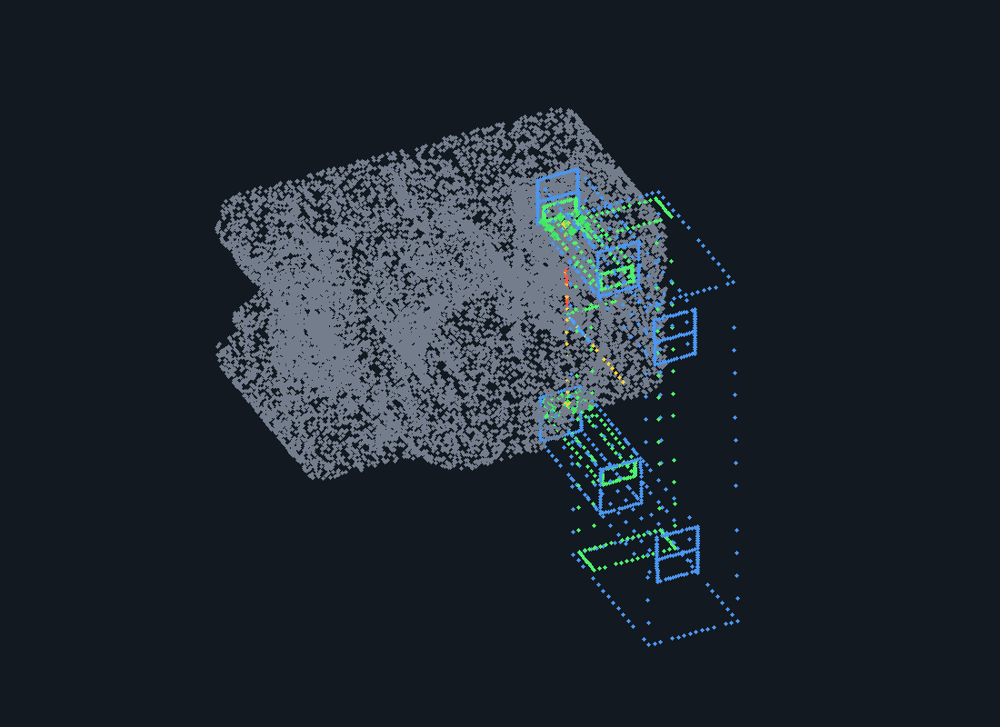
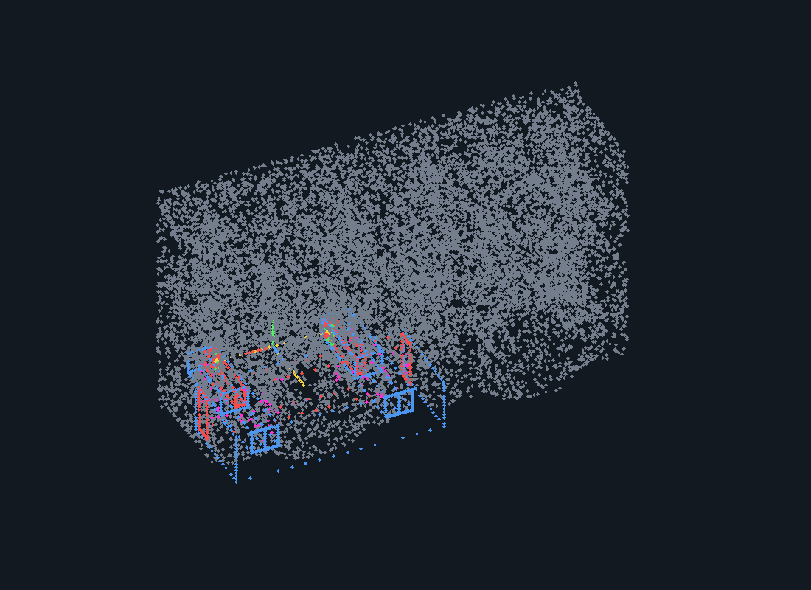

# Reviewed CAD contact suggestions

Load the parent plugin for execution/training projects. The native file-only
reviews need no plugin. All three cases use the same gripper settings and fixed
generic search; no application-specific contact or pose threshold changes.

| Case | Model review | Retained execution outcome |
| --- | --- | --- |
| [Clear control](clear/project.json) | 20 displayed suggestions pass sampled model checks; one explicitly added. | One eligible alternative after current depth/pose preview. |
| [Real T-LESS object 6, frame 13](tless_frame000013/project.json) | Three displayed suggestions pass sampled model checks; one explicitly added. | Zero eligible alternatives: supplied pose assistance still fails the current depth check. |
| [Real object 8, CAD-only](object8_rejected/proposals.json) | All displayed suggestions rejected for finite pad, stroke and/or sampled CAD sweep checks. | No pose/depth or grasp acceptance asserted; no suggestion added. |

The first two projects use the actual inspector popup and its new **Suggest CAD
contacts…** review. Cancel preserves applied parameters; explicit Add invalidates
the earlier preview; reference Preview → Stage → inspector Apply → reopen retains
the original samples, triangles, frame, supplied capture and the new contact/source
row records. Existing grasps remain. `checks.json` records the workflow.

[Training guide and limits](../JAW_CONTACTS.md) explains the bounded search,
retract preference and exact shared runtime checks. **Reviewable is model-only**;
it is not an accepted runtime grasp, force closure or physical pick-success claim.
Robot and measured scene clearance remain separate from the CAD proposal view.

## Inspect the result

Open [object 6](review_object6/review.json) or
[object 8](review_object8/review.json) for two native RGB fly-around clouds each.
Select **Cloud / cloud** for the thumbnail/popout. One row shows the leading
suggestion; the other emphasizes a rejected CAD collision witness.




Gray is retained CAD, yellow actual source contacts, green/red supported/missing
finite pad tests, magenta CAD collisions, blue sweeps and RGB TCP axes. Every
display component is derived model geometry, not an observed scene point. Source
hash/frame, gripper settings, search budgets and all displayed reasons/pad tests
are in `proposals.json`; view sidecars describe the selected clouds.

For the two execution projects select **Cloud / graphics** for measured scene
and jaw clearance, or **Cloud / pose_fit** / **Cloud / mesh_fit** for fit evidence.
`expected.json` retains each candidate/reason; `result.png` is a computed preview.
The clear control uses analytic first-return depth and an authored pose. The real
execution uses supplied dataset pose assistance. Object 8's `cad_only.sbpj` has
an explicitly empty reference and no supplied pose; it is geometry teaching only.

## Reproduce

From the parent folder with the pinned plugin and existing host dependencies:

```powershell
python build_contact_proposals.py . C:\path\to\new-contacts
python verify_pose_agreement.py C:\path\to\new-contacts C:\path\to\new-review --native
python verify.py . C:\path\to\new-jaw-checks --native
```

Set QT_QPA_PLATFORM=offscreen for unattended native checks. No environment
installation, network acquisition, simulator or robot call occurs.

## License and attribution

Code and authored controls are MIT. Real T-LESS originals and derived recipes,
clouds, images and metrics retain **CC BY 4.0**. Preserve
[full attribution/source hashes](../tless/ATTRIBUTION.md), the
[publisher](https://cmp.felk.cvut.cz/t-less/) and
[license](https://creativecommons.org/licenses/by/4.0/).
T. Hodaň, P. Haluza, Š. Obdržálek, J. Matas, M. Lourakis and X. Zabulis,
*T-LESS: An RGB-D Dataset for 6D Pose Estimation of Texture-less Objects*,
IEEE WACV 2017. Changes: retained metric resampling, fixed generic CAD contact
search, explicit reviewed grasp additions and colored model/scene graphics.
Original source CAD bytes and prior recipe geometry remain unchanged. No dataset
author endorsement or physical grasp ground truth is implied.
