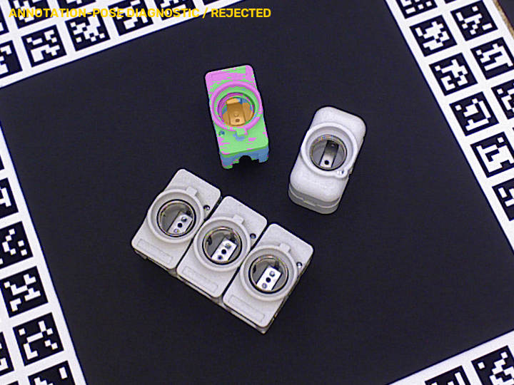

# Why the real pose-assisted cases still reject

`diagnostic.json` compares the existing four-neighbor sampled-CAD pose check to
a separate full-resolution triangle-render diagnostic. Both use the same
recorded raw depth, annotated object pose, original CAD geometry and unchanged
**3 mm** tolerance. The triangle method compares exact pixels rather than the
core's conservative four neighboring rays; its numbers are diagnostic rather
than replacements for the core decision.

| Frame | Core support / contradiction | Triangle diagnostic support / contradiction |
| --- | --- | --- |
| 3 | 25.10% / 34.93% | 36.64% / 50.45% |
| 13 | 28.96% / 22.10% | 41.05% / 33.54% |

Both methods reject both scenes. A sampling-only explanation is not established;
calibration, sensor/CAD agreement and uncertainty still need controlled study.
The separate CPU rasterizer is a development implementation, not independently
qualified against the native CUDA renderer. Shared source/calibration errors
could affect both checks. No acceptance or clearance gate was relaxed.



Green is supported, magenta contradicts free space, blue is occluded and orange
has missing measured depth. Annotated poses are explicit assistance here; this
is neither independent localization nor an accepted grasp demonstration.

Reproduce with the optional FoundationPose geometry utilities available:

```powershell
python diagnose_pose_support.py <known-jaw-folder> <object6-trained.sfp> <new-output>
```

This loads geometry only, without learned weights or inference. The input mesh
recipe SHA-256 is retained in the report. RGB/depth/CAD sources and these derived
overlays retain [T-LESS attribution and CC BY 4.0](../tless/ATTRIBUTION.md).
Code remains MIT. No endorsement is implied.
