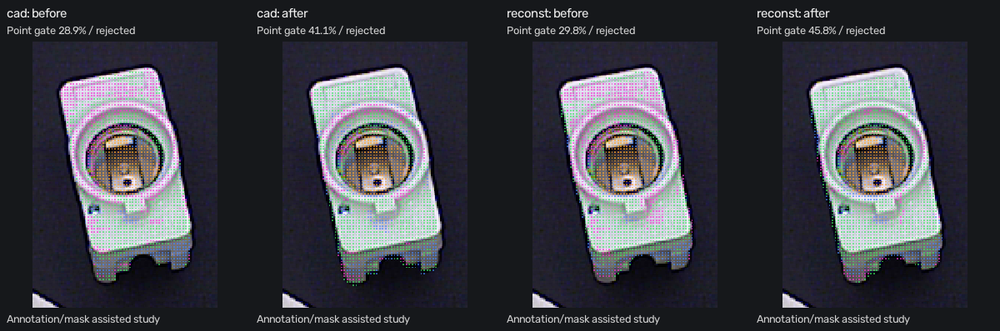

# CAD, reconstruction and bounded pose-refinement comparison

This frozen study compares publisher CAD and reconstructed geometry on **ten
real T-LESS captures of two industrial parts**, producing 20 model/capture cases.
It starts with published object poses and visible-instance masks. Those are
explicit assistance; this study does not measure independent object localization.

The same camera, original model origin, 40,000 area-weighted surface samples,
seed 27, fixed refinement settings and existing 3 mm pose tolerance apply across
all cases. Both geometry types share publisher coordinates/poses. Supplied depth
is already corrected and receives only the declared unit conversion. These
dataset conventions are documented in the [publisher paper](https://cmp.felk.cvut.cz/~hodanto2/data/hodan2017tless.pdf).

## Result

| Geometry | Current point gate coverage, before → after | Triangle expected-ray support, before → after |
| --- | --- | --- |
| CAD | 22.7% → 31.6% | 47.0% → 58.8% |
| Reconstructed | 28.3% → 39.3% | 53.9% → 70.8% |

Values are means of per-case ratios. The two metrics sample different populations
and use different weighting; triangle agreement is a diagnostic, not a replacement
gate. All **20 current point-gate results remain rejected**. Refined held-out
support improves in 18 cases and degrades in two, which are retained:

- Object 6, scene 2/frame 24, reconstructed: 58.3% → 43.9%.
- Object 8, scene 3/frame 493, CAD: 14.5% → 10.3%.

The held-out ratio uses only projected queries with four valid held-out neighbors;
its footprint and denominator can change under a pose update. All refinements
reach the 30-iteration budget, so convergence is not established. Reconstructed
geometry has higher baseline point coverage in eight of ten captures, with the
other two outcomes preserved. There is no universal geometry or refinement winner.

The model-visibility/weighting difference now deserves a controlled study using
retained triangle geometry and analytic occlusion controls. These results do not
establish a physical calibration/sensor/CAD root cause. The runtime plugin,
recipes, pose acceptance and gripper-clearance gates remain unchanged.



The four panels show CAD before/after and reconstruction before/after. Overlay
colors show exact triangle rays at a recorded two-pixel stride: green supported,
magenta contradiction, blue occluded and orange missing depth. Text reports the
unchanged point gate. Crops keep aspect ratio. Other captures and the combined
[overview](overview.png) retain the same order, including worse outcomes.

## Open the native 3D review

Open either saved project directly in OpenCVDataflowGUI:

- [Object 6/frame 13](review_object6/review.json).
- [Object 8/frame 261](review_object8/review.json).

Each has four built-in cloud file inputs and uses the native colored fly-around
thumbnail/popout. The files contain sampled **derived model queries**, not camera
returns. Their names retain the rejected pose-gate status. Successful graph runs
mean that the stored files loaded; no detection, pose refinement or motion runs.
Companion JSON files retain full ray counts, original model rows, colors and scope.
[Pose-fit meanings and display sampling](../JAW_POSE_FIT.md).

Move/copy this whole folder to relocate the reviews; paths are relative inside
each project. Built-in input.cloud Save As rebases references to existing original
assets rather than copying them into a new bundle. The verification receipt checks
those references and exact point/color replay, along with native thumbnail/popout
orbit and RGB preservation for all eight clouds.

## Method and reproduction

The visible mask is eroded by two pixels, then divided into disjoint 16-pixel
checkerboard tiles. Only training-tile depth constructs the ICP target cloud.
There are no held-out normals or depth samples in fitting. The other tiles are
used for the held-out known-ray statistic. This is a spatial split within a
capture, with correlated neighboring measurements; it is not an independent
acquisition/session or physical pose-accuracy test.

The fixed point-to-point ICP prototype trims to the closest 75% of bounded
correspondences. Updates are bounded in rotation and original-origin translation;
it fits neither depth scale nor camera calibration. A lower fit residual can still
move away from the physical pose, so proposals are never applied to runtime data.
The triangle comparison reuses the existing bounded Simple3DLocate renderer and
records its grid stride. Its development implementation has analytic controls;
native/GPU renderer equivalence is not asserted.

Load the parent plugin first when running the producer. From the parent folder,
with the host checkout available and its usual numerical dependencies:

```powershell
python compare_pose_agreement.py . pose_agreement/source C:\path\to\new-study
python verify_pose_agreement.py pose_agreement C:\path\to\new-native-checks --native
```

For unattended Qt checks set QT_QPA_PLATFORM=offscreen. Production packages remain
the parent's pinned BinPicking dev8 and Simple3DLocate dev20 wheels, with no
environment installation. Four analytic study tests cover the spatial split,
rigid fit, bounded/empty refinement and missing-depth triangle review. The full
BinPicking suite now has 104 passing checks against those wheels.

`comparison.json` preserves every before/after pose and metric; `summary.json`
aggregates them. `source/provenance.json` pins all selected original files and
`native-review-verification.json` records saved native replay. The
[relocated reproduction receipt](reproduction-verification.json) records exact
results, original-member hashes and eight cloud hashes from the host bundle. The code writes
fresh output folders and never changes the source images or trained recipes.

## License and attribution

Study code is [MIT](../LICENSE). T-LESS originals and derived models, clouds,
overlays and numerical results retain **CC BY 4.0**. Preserve this attribution,
the source manifest and the [license](https://creativecommons.org/licenses/by/4.0/).

T. Hodaň, P. Haluza, Š. Obdržálek, J. Matas, M. Lourakis and X. Zabulis,
*T-LESS: An RGB-D Dataset for 6D Pose Estimation of Texture-less Objects*,
IEEE WACV 2017. [Publisher and license](https://cmp.felk.cvut.cz/t-less/),
[BOP source mirror](https://huggingface.co/datasets/bop-benchmark/tless),
revision 5fd309a04476a842d93abfb584fba9ee7caecdf1.

Changes: mm-to-m conversion, equal surface sampling, disjoint tile selection,
research pose proposals, bounded sampled/raster diagnostics, derived colored
clouds and annotated image crops. Selected original members are byte-preserved.
No dataset-author endorsement is implied.
