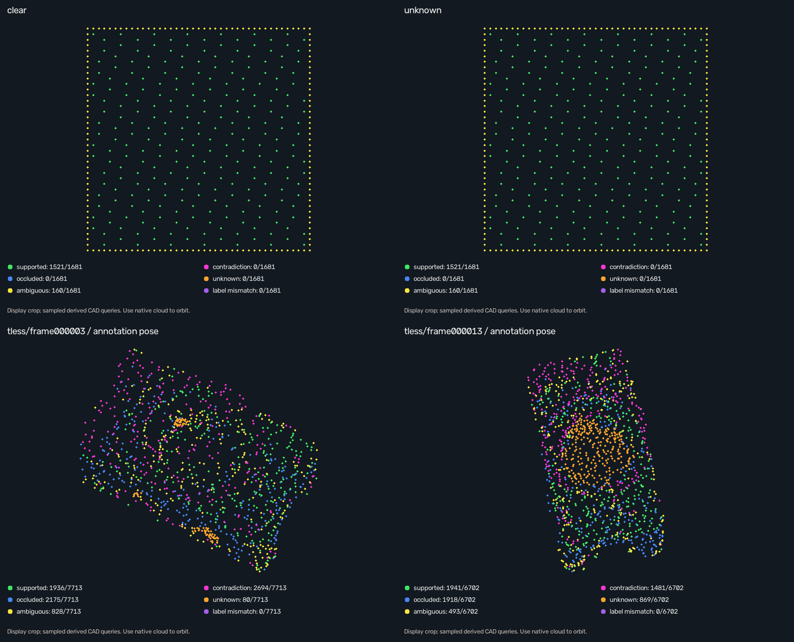

# Current pose-fit result review

Load the parent `plugin.py`, open any of the ten parent projects and run it.
Select **Cloud / pose_fit** for the native colored fly-around thumbnail/popout.
The usual **Cloud / graphics** supplies measured scene and gripper context.
In training, select a candidate and toggle **Pose fit** without running the
planner again. [State meanings, sampling and residual definitions](../JAW_POSE_FIT.md).



These are computed camera-oriented closeups of the saved metric clouds, not
desktop screenshots. Counts use every tested model ray; point densities are
bounded per state and are not percentages. No new acceptance threshold or
training setting is used. Source depth/recipes and all ten grasp reports are
unchanged.

The clear and unknown-clearance controls have the same supported part pose;
the second still rejects the gripper's unobserved sweep. This is why pose fit
and gripper clearance are separate checks. The two annotation-pose-assisted
T-LESS cases show substantial contradiction, occlusion and missing depth.
The real reconstructed-locator chain also retains its rejected grasp. CAD chain
input has no accepted instance and therefore no pose-fit cloud.

Every available case folder retains `pose_fit.ply`, `graphics.json` with full
counts/residual quantiles and `closeup.png`. `checks.json` records exact unchanged
grasp reports and cloud hashes. Source model queries, which carry color, remain
derived geometry; hidden CAD surfaces are not sensor returns or free space.

From the parent folder:

```powershell
python build_pose_fit_review.py . C:\path\to\new-review
python verify.py . C:\path\to\new-native-checks --native
```

MIT applies to example code and authored controls. Real T-LESS source and derived
clouds/images/statistics retain **CC BY 4.0**; preserve
[full attribution and provenance](../tless/ATTRIBUTION.md) and
[frame-255 sources](../locator_chain/README.md#source-changes-and-attribution).
T. Hodaň et al., *T-LESS: An RGB-D Dataset for 6D Pose Estimation of Texture-less
Objects*, WACV 2017. [Publisher](https://cmp.felk.cvut.cz/t-less/),
[license](https://creativecommons.org/licenses/by/4.0/). No endorsement is implied.
These are software geometric diagnostics, not independent pose accuracy or
physical grasp evidence.
