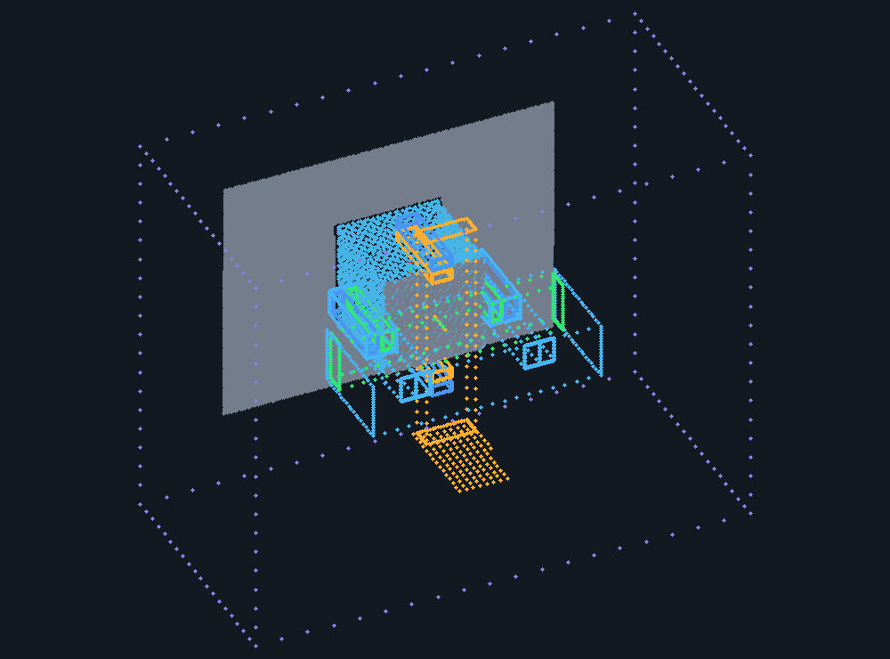

# CAD-taught jaw alternatives

Ten offline projects exercise **SimpleBinPicking Jaw** and native CAD-contact teaching. They
retain the CAD surface, two authored part-relative grasp frames, calibrated
depth/camera, gripper dimensions and TCP mounting in checksummed `.sbpj` files.
They use the same generic jaw settings. The clear control demonstrates a usable
geometric alternative; this is not a robot motion or physical grasp example.

## Open and run

Load this folder's `plugin.py` explicitly, then open one of these projects:

| Project | Retained outcome |
| --- | --- |
| [Clear first-return box](clear/project.json) | One eligible X-side grasp; the rotated Y alternative extends into unobserved view space and stays unknown. |
| [Observed obstacle](obstacle/project.json) | No eligible grasp. A foreign obstacle intersects the X-side palm sweep. |
| [Unknown clearance](unknown/project.json) | No eligible grasp. Missing rays under the palm remain unknown despite accepted part-pose evidence. |
| [Real T-LESS frame 3](tless/frame000003/project.json) | Both proposals rejected: only 25.10% current model support and 34.93% contradiction. |
| [Real T-LESS frame 13](tless/frame000013/project.json) | Both proposals rejected: 28.96% support and 22.10% contradiction. |

The supplied poses are assistance: analytic ground truth in controls and dataset
pose annotations in T-LESS. The real RGB-D captures are camera-visible first
returns, with their original missing samples. Their annotations do not bypass
the current-depth check. These cases do not measure independent localization,
grasp-label accuracy or physical pick success. Real-data pose verification and
useful CAD contact proposals need further work; thresholds were not relaxed to
make the examples pass.

The plugin loads both bundled wheels without installing or updating the app
environment. NumPy, SciPy and OpenCV must already be available.

| Package | Version | Wheel SHA-256 |
| --- | --- | --- |
| `opencv-simple-bin-picking` | `0.1.0.dev8` | `1cc60d7c9fe4ebd92f1446937e01e4396639ce48624e9d80a677b6aaf609251b` |
| `opencv-simple-3d-locate` | `0.1.0.dev20` | `c124a55e5105c087e1a849ad47d648d9801c4caeaa76ce4e8fcc0f77d846c2f9` |

Opening a project does not load Python code automatically. If a different
BinPicking or Simple3DLocate package is already imported, restart the app and
load this plugin first; the loader rejects mixed versions. The original suction
block remains available and is not replaced by this plugin.

## Assess the result

Run the graph and select **Cloud / graphics**. Its thumbnail and popout use the
native colored fly-around viewer. The `graphics` output contains:

- Gray measured scene and cyan derived CAD surface.
- Green eligible, red rejected and orange unknown closed-finger/palm frames.
- Blue open fingers and conservative approach/closure/retract envelopes.
- RGB TCP axes, approach segments, magenta collision witnesses and orange
  unknown query points.

Select **Cloud / pose_fit** for isolated color-coded model queries from the exact
depth check. [The result gallery](pose_fit_review/README.md) and
[pose-fit guide](JAW_POSE_FIT.md) explain support, contradiction, occlusion,
unknown, ambiguous depth and label mismatch. Counts cover every tested ray;
display points are a bounded subset per state. The trainer has a **Pose fit**
layer and a full-count summary, with cached export metadata. A good pose fit
still cannot override unknown gripper clearance, as the unknown control shows.

`graphics.json` identifies measured versus derived row ranges. Only measured
depth feeds scene clearance; graphics and hidden CAD surfaces never become
observed free space. `expected.json` preserves every candidate and reason,
including raw rejected poses. `tcp` and `pregrasp` are absent if no alternative
is eligible. Scores combine geometric contact and depth support, not probability.

The bin/world frame is Z-up. If the default view shows the floor from below,
set viewer yaw near **155 degrees**, then orbit to assess the jaws. The static
`result.png` uses that orientation; `result.ply` retains actual metric coordinates
and RGB. Initial-view metadata support has been requested from the app owner.



The initial tool checks finite sampled gripper approach, closure and retract.
It permits an explicit bounded CAD contact band and reports that separately
from measured free space. It does not test force closure, transported-part
volume, robot IK, continuous collision freedom or physical grasp success. The
proposals are alternatives, not a preapproved sequence of picks.

## Training and next work

Open **Teach CAD jaw grasps…** from the block's Configuration inspector.
The [native training guide](JAW_TRAINING.md) covers actual-row CAD point picking,
numeric contact/retract edits, named alternatives/undo, gripper/TCP controls,
frozen references, cancellable previews and Stage/inspector Apply/Cancel.
The original model origin and untouched stored values are preserved.

Three projects were trained through the actual inspector and retain their own
raw depth and explicit pose reference, so **Preview reference** works on reopen:

| Native teaching project | Result after preview, Stage, Apply and reopen |
| --- | --- |
| [Clear control](native_training/clear/project.json) | One eligible alternative. |
| [Observed obstacle](native_training/obstacle/project.json) | Zero; collision remains rejected. |
| [Real T-LESS frame 13](native_training/tless_frame000013/project.json) | Zero; annotated pose assistance does not override weak depth support. |

`native_training/checks.json` records actual connected capture, Cancel preserving
applied training, Stage editing only the draft, Apply, and retained-reference
preview after reopen. Existing legacy recipes show CAD/grasps immediately but
need a supplied pose reference once before they can preview independently.
Locator-instance conversion is available below. Better general real contact
proposals, symmetry handling and qualified robot handoff remain follow-ups.

## Locator integration and depth diagnostics

The [two real composed locator projects](locator_chain/README.md) run actual
Simple3DLocate reports through the new [part-instance adapter](POSE_INSTANCES.md)
and into the jaw planner, using the same measured frame and unchanged recipes.
The reconstructed locator finds one proposal, which the jaw tool rejects; the
CAD locator finds none and propagates an empty result. No annotated object pose
enters these chains. Their supplied visible mask is explicit segmentation
assistance. Both use the pinned locator wheel above and require embedded report
capture IDs. [Capture controls](capture_controls/README.md) demonstrate matching
metadata and rejection of a conflicting pair before model loading or matching.
The [capture contract](LOCATOR_CAPTURE.md) explains the declaration's limits.

The converter also checks GDRNPP detection and FoundationPose hypothesis report
contracts. One FoundationPose mask yields at most one part instance. Raw scores
never promote a rejected pose. Capture/frame mismatches reject input, with an
explicit opt-in source declaration for legacy reports lacking capture IDs.
Valid empty conversion means no accepted part, not a grasp inspection pass.

[Depth diagnostic overlays](depth_diagnostic/README.md) compare the existing
sampled-CAD check with a separate triangle renderer under the same 3 mm tolerance.
Both still reject the pose-assisted frames. This does not establish a root cause
or qualify the development renderer; no acceptance/clearance gates were relaxed.
The [source depth conversion audit](depth_conversion/README.md) independently
checks per-image intrinsics, declared depth scale and measured cloud rays.
Conversion agrees within float32 roundoff; physical CAD/depth agreement remains
unresolved.

## Geometry and refinement study

[The frozen comparison](pose_agreement/README.md) adds ten real captures of two
industrial parts, matched CAD/reconstructed sampling, a disjoint-tile refinement
experiment, exact triangle-ray diagnostics and two native 3D replay projects.
Held-out support improves in 18/20 model/capture cases and worsens in two; all
current pose gates still reject. It changes no runtime recipe or acceptance gate.

## Verification and reproduction

`verification.json` records saved-project reopen and graphics-off/cache parity.
`native-verification.json` records actual offscreen app thumbnail/popout orbit,
RGB preservation, review without replanning and portable Save As for all ten
projects. This is software acceptance, not hardware qualification. The bundled
BinPicking wheel passed 100 checks against the checkout host, including existing
suction and mocked simulation checks. The locator wheel passed 25 focused checks
for capture binding, block execution and separate-depth behavior. All 56 packaged
source modules and both MIT notices match the source publication after newline
normalization. Two additional capture controls preserve their outcomes and all
assets after portable Save As.

From an environment with the app, NumPy, SciPy and OpenCV:

```powershell
python build.py C:\path\to\new-output releases/opencv_simple_bin_picking-0.1.0.dev8-py3-none-any.whl --source tless/source
python build_native_training.py C:\path\to\new-output C:\path\to\new-output\native_training
python verify.py C:\path\to\new-output C:\path\to\new-checks
python build_capture_controls.py . C:\path\to\new-capture-checks --verify-existing
python audit_depth_conversion.py . C:\path\to\new-conversion-audit
```

Add `--native` to `verify.py` with Qt available to exercise native preview
widgets. For unattended checks set `QT_QPA_PLATFORM=offscreen`. The scripts
create new output folders and never connect to a simulator or robot.

## License and attribution

Example code and authored controls: [MIT](LICENSE). Real T-LESS source and
derived arrays, recipes and results: **CC BY 4.0**, independent of the code
license. Preserve [T-LESS attribution](tless/ATTRIBUTION.md) and provenance when
redistributing those assets. No endorsement by the dataset authors is implied.
