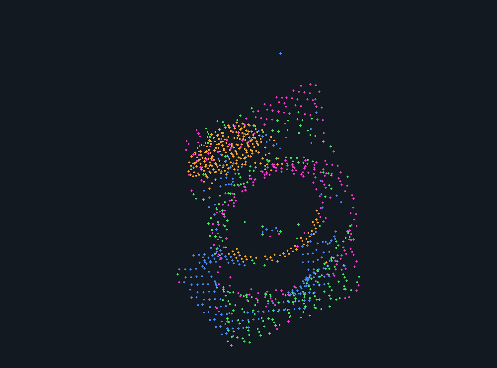

# Retained triangle CAD training

Load the parent plugin first, then open one of the actual-inspector training
projects:

| Project | Retained result |
| --- | --- |
| [Authored first-return box](clear/project.json) | One eligible jaw alternative. Twelve original triangles and 40,000 sampled contact/model points. |
| [Real T-LESS frame 13](tless_frame000013/project.json) | Zero eligible alternatives; its annotated pose remains assistance and the current point gate still rejects. Original 5,700-triangle CAD and sampled surface are retained. |

Both were created using **New from bin + triangle CAD…** in the actual native
inspector popup, including declared millimeter units, outward winding and the
original part-frame name. Import Cancel preserves applied parameters; connected
capture freezes the same depth/pose reference; Preview → Stage → inspector Apply
and reopen retain triangles, sampled contacts, frame and independent reference
preview. The initial envelope grasp is an authored seed needing contact review.
No application-specific acceptance settings were changed.

Open **Teach CAD jaw grasps…** to restore the mesh and references. The Mesh fit
layer and count summary compare the raster diagnostic with the existing Pose fit
layer. Select **Cloud / mesh_fit** after execution for the native RGB fly-around
thumbnail/popout; the dedicated output isolates predicted first-surface queries.
The combined graphics and measured Scene layer provide context.



[Triangle workflow and colors](../JAW_MESH.md) explains counts, bounded display
density, stride and unavailable states. `mesh_fit.json` contains full counts and
acceptance_applied=false; a fit color is diagnostic evidence. Pose and clearance
decisions still use the existing part samples. Hidden mesh surfaces never become
additional measurements or observed free space.

The new sealed .sbpj assets use archive version 2. Reference depth and explicit
poses, full metric triangles, sampled surface and gripper settings survive
reopen/Save As. `input/` holds the import files for reproduction. The copied old
point-only training is retained as a comparison source. Existing parent projects
keep their version-1 archives and exact reports.

`checks.json` records the training workflow. `corpus-audit.json` compares all 40
before/after poses from the fixed 20-case CAD/reconstruction study with the
existing bounded renderer: first-surface masks, depth values and classified counts
match exactly. This is shared-algorithm parity plus analytic occlusion/perspective
controls, not independent GPU rendering or physical calibration qualification.

From the parent folder, with the usual host numerical/Qt dependencies:

```powershell
python build_mesh_training.py . C:\path\to\new-training
python audit_mesh_visibility.py . C:\path\to\new-audit
python verify.py . C:\path\to\new-native-checks --native
```

For unattended checks set QT_QPA_PLATFORM=offscreen. The parent explicit plugin
pins BinPicking dev9 plus locator dev20 without modifying the app environment.
The core runtime mesh review is NumPy-only; explicit STL/PLY import uses the
companion geometry reader. No robot or simulator is contacted.

## License and attribution

Code and authored controls are MIT. Real T-LESS originals and derived recipes,
clouds, images and metrics retain **CC BY 4.0**. Preserve
[full T-LESS attribution and source hashes](../tless/ATTRIBUTION.md),
[the publisher/license](https://cmp.felk.cvut.cz/t-less/) and the
[CC BY 4.0 link](https://creativecommons.org/licenses/by/4.0/).
T. Hodaň, P. Haluza, Š. Obdržálek, J. Matas, M. Lourakis and X. Zabulis,
*T-LESS: An RGB-D Dataset for 6D Pose Estimation of Texture-less Objects*,
IEEE WACV 2017. Changes: declared mm-to-m import, area-weighted sampling,
authored grasp seed, retained reference capture and diagnostic graphics. The CAD
source bytes remain unchanged. No dataset-author endorsement is implied.
