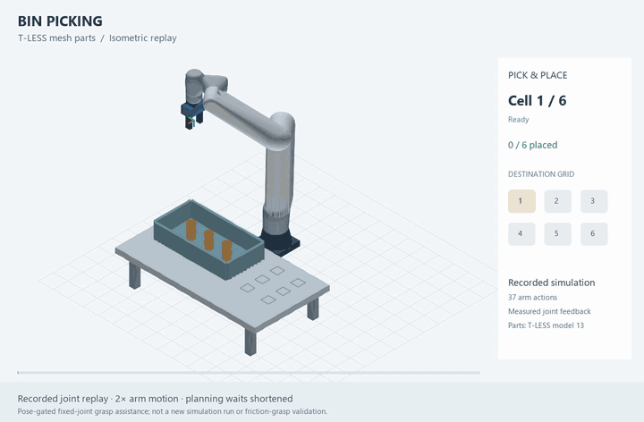

# T-LESS industrial mesh picking

A complete six-pick example using **T-LESS part 13 CAD geometry**, original
dataset pose/camera/visibility labels, and a new authored Gazebo bin arrangement.
The parts are full meshes with annular tops, rather than box visuals.

## Install

Install the included **opencv-simple-bin-picking 0.1.0.dev3** from the app root:

```powershell
.\.venv\Scripts\python.exe -m pip install --no-deps --no-build-isolation .\integrations\simple_plugins\bin_picking
```

Restart the app and explicitly load this folder's `plugin.py`. Use the matched
ROS environment for live simulation; do not install ROS binaries into the GUI
environment. No ROS installation is needed for recorded review.

## Usage

Open [review.json](review.json) and Run once. **Recorded bin-grid pick** uses
the native flyaround point-cloud thumbnail. Select **Cell** 1..6. Its **motion**
output shows phase-colored planned paths and pink measured-joint FK dots;
**motion_summary**, **before** and **after** are review images. Green/red expected
surface samples show found/missing trained geometry. Feedback FK uses the same
robot model; it is not independent TCP metrology.

The other blocks show the finished grid, summary and an **original real T-LESS
ground-truth view**. Its source cloud is in `tless_camera`, in metres; purple
points are the full target CAD at its labeled pose. They are not observed depth
samples or estimated poses. Do not merge that camera frame with the new
simulator's world frame without an explicit transform.

[project.json](project.json) is the live app graph, disabled by default:
GridTasks → Unbatch → serialized SimPickOne → Batch(6) → Summary. Its retained
surface template is copied with Save As. Opening/validation performs no motion.

Prepare a fresh fixture with the included mesh-capable ROS package and this
folder's `scene.json`; the preparation CLI resolves hashed `assets/*.stl`
relative to the scene and copies them into an owned overlay. Allocate domain
130 and a unique `opencv_bin_pick_` partition, as described in the
[parent simulation example](../bin_to_grid/README.md). Use the same runtime
profile/partition with its `run_project.py --project ... --execute-simulation`
runner or explicitly enable the app block. In-place reset remains disabled.

## Training and ground truth

The CAD is kept at its published size/origin, converting millimetres to metres.
The original mesh supplies camera appearance; an outward convex hull supplies
physics collision. MoveIt uses a separate conservative 40×40×46 mm oriented
bound. Mass, envelope inertia, material, layout and axial grasp frame are
authored simulation settings, not dataset physics or grasp labels.

The old filled-rectangle criterion correctly rejected the annular crown.
`prepare_scene.py` now derives expected surface samples from the upper 2 mm
CAD band at 1.5 mm pitch. The **same 60% support threshold** is applied against
measured depth points; training is fixed across all six picks. Runtime never
retrains or chooses parameters for a test image. The historical rejection is
retained in [rectangle-baseline-held.json](rectangle-baseline-held.json).
This is a taught top/grasp proposal, not an object-identity or general 6D matcher.

Only after proposing a candidate from the camera does the app read privileged
poses for unique object association, conservative collision setup, assistance
and evaluation. T-LESS declares continuous model-Z symmetry for this part;
yaw is unobservable. The recipe checks center position and uprightness without
claiming a yaw estimate.

The **original real source view** is scene 7, image 3, target index 2. Its
unmodified RGB, uint16 depth, masks, CameraInfo and BOP pose labels are retained
under `source/`. Projection of the model at the official pose agrees with the
published bounding box within **1.11 pixels**. This is a scale/frame consistency
check, not pose estimation accuracy. [source-review.json](source-review.json).
T-LESS provides pose ground truth; it supplies no ground-truth grasps.

## Native results



The isometric animation reconstructs recorded joint feedback and assisted part
transfers at 2× arm speed, with planning waits shortened. It is a replay, not
a new simulator run. [Replay provenance](isometric-replay.json).

- **6/6 placements**, **37 successful arm actions**, six observed releases.
- Camera-derived center error: maximum **1.261 mm**, against fresh simulator poses.
- Final placement error: maximum **1.048 mm**, against configured grid centers.
- Final audit: all detached, no MoveIt attachments, no remaining bin candidates.
- Original first-return source candidate counts: **3/3/3/3/2/1** as lower parts appear.
- Additional post-retiming checks sampled **2,775 whole-robot states**; these
  finite samples are not a continuous collision certificate.

[acceptance.json](acceptance.json), [final-evaluation.json](final-evaluation.json)
and per-cell archives retain the evidence. Original float32 depth is stored
losslessly in each `source-depths.npz` (`before`/`after` keys); source PNGs,
calibration, capture IDs and correlated motion/attachment receipts are retained.
The initial arm was already at the observation pose after earlier zero-pick
holds; the six mesh parts had not moved. Those holds are not successful picks.

The grasp is acknowledged, pose-gated **fixed-joint assistance**. Friction grasp,
arbitrary clutter and physical robot accuracy remain unqualified. This is a
new simulator scene using dataset geometry, not a replay of the original
dataset's physical scene or a published grasp benchmark score.

## Maintainers

The OpenCVDataflowGUI project maintainers.

## Contributing

Preserve original bytes/hashes, ground-truth/perception separation, fixed
training, symmetry semantics, uncertain-outcome holds and native cloud review.

## License

Code MIT; T-LESS assets and derivatives **CC BY 4.0** with author attribution.
Robot rendering retains BSD-3-Clause. See [ATTRIBUTION.md](ATTRIBUTION.md) and
the included UR description notice. [sha256.json](sha256.json) pins the example.
