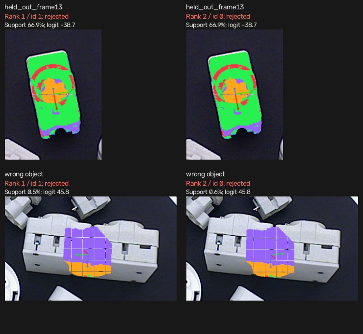

# SimpleFoundationPose completed-result review

These real T-LESS examples exercise independent completed-result review with
unchanged recipes, masks and coarse assistance. Both real inspections remain
rejected. The useful result is assessable evidence, not a newly accepted pose.

| Example | Assistance | Scored cohort | Accepted |
| --- | --- | ---: | ---: |
| `held_out_frame13` | Supplied visible mask and two prior network proposals | 2 | 0 |
| `different_object_negative` | Deliberately unrelated instance mask and two prior network proposals | 2 | 0 |

Absolute logits are not comparable across these captures/cohorts: the wrong-object
example has a higher logit while its measured-depth evidence still rejects it.

The two-seed route adds refinement to old network proposals and changes the
scoring cohort; it is explicitly assisted and does not establish global search
accuracy. No annotated pose is used as an inference input and no gate is tuned.
The separate full global replay retains all 252 hypotheses and matches the
existing saved baseline exactly. Its compact report/checks and representative
display projections are under `global_cohort/`; the runtime captured every fit
page, while the large full-cohort export is deliberately not shipped here.

## Open and assess

Load this folder's `plugin.py` explicitly, then open either
`*/run_project.json`. Use the native Runtime setup action to choose an isolated
compatible Python and the verified external NVIDIA ONNX files. Run in Debug,
open **Review completed poses and score cohort…**, then **Capture latest completed
run**. Source files are recorded acquisitions, not new camera exposures.

The table preserves rank, initialization ID, raw logit and original depth-fit
statistics. Select a hypothesis, shift-click a source pixel or use the native
sample picker. Inspect mask coverage, executed reference/settings, original
sample flags/residuals, complete cohort chart and native colored fly-around
cloud. Logits depend on the entire original cohort and are not probabilities.
New publications do not replace the frozen view. Background export needs no
worker and remains available after worker shutdown. Teaching drafts and
Stage/Apply/Cancel remain independent.

For immediate offline viewing, open `*/review_project.json`. Built-in file blocks
show four stored colored clouds and their sample images with native fly-around
thumbnails/popouts. File-read success does not assert pose acceptance. Green is
support, red contradiction, purple behind measured depth, blue outside the target
and orange unknown. Flags can overlap; denominators include unknown samples.
Each cloud combines stored measured scene, predicted first-surface fit samples
and derived 20 mm pose axes. Existing emitted graphics are retained separately;
their legacy CAD vertex views include hidden predictions.

## Retained evidence and checks

`frozen/` contains exact executed archives, consumed/reference RGB-D/masks/camera,
original connected packets and coarse matrices, centered initial cohort, complete
ranked reports, per-rank original fit arrays, original emitted graphics and
derived sample images/native PLY reviews. Raw coarse packets remain distinct from
the existing validated/orthonormalized input conversion. No new scoring, fit,
CAD rendering, registration or source/model reload is used to browse/export.

The dev4 wheel is checksum-pinned by the explicit plugin. `worker_environment/`
provides the exact hashed Windows x64 / CPython 3.13.9 validation dependencies.
Use a fresh dedicated worker, then install the wheel with `--no-deps`; do not
put this runtime into the host environment. Weights remain external.

`check_completed_review.py` runs in the host interpreter with explicit `--plugin`,
`--worker`, `--models` and a fresh `--output` folder. It uses this portable cohort
when placed here, or the original parent `worker_execution/` assets when run from
the parent plugin folder. For the full baseline control, add `--global-search
--case held_out_frame13 --summary-only --baseline ORIGINAL_WORKER_REVIEWS`.
`QT_QPA_PLATFORM=offscreen` permits native file/API checks without desktop input.
The checker captures through the actual Results window, validates every fit page,
checks unchanged candidates and emitted pixels/XYZ/RGB, transfers execution/display
ownership and continues review after worker exit. Stale read rejection also
preserves the newer cached worker. Original model/renderer/physical limitations
remain; software parity is not pose accuracy.

## Attribution and license

T. Hodaň, P. Haluza, Š. Obdržálek, J. Matas, M. Lourakis and X. Zabulis,
**T-LESS: An RGB-D Dataset for 6D Pose Estimation of Texture-less Objects**,
WACV 2017. The [publisher](https://cmp.felk.cvut.cz/t-less/) declares
[CC BY 4.0](https://creativecommons.org/licenses/by/4.0/).
RGB/depth/masks, CAD, calibration and pose annotations retain those terms.
`upstream/` preserves checked original calibration/pose metadata; pose truth stays
separate from inference. Metric depth, selected masks, prior network proposals,
sample-color overlays, crops and derived native graphics are modifications.
No endorsement is implied.

Original implementation uses the included MIT license. Adapted NVIDIA deployment
conventions retain their per-file MIT/Apache-2.0 notices. Separately published
ONNX assets have their own model terms; those do not relicense the NVlabs research
implementation, which is not shipped. All notices remain in `THIRD_PARTY.md` and
the wheel. No private implementation-repository attribution is included here.
