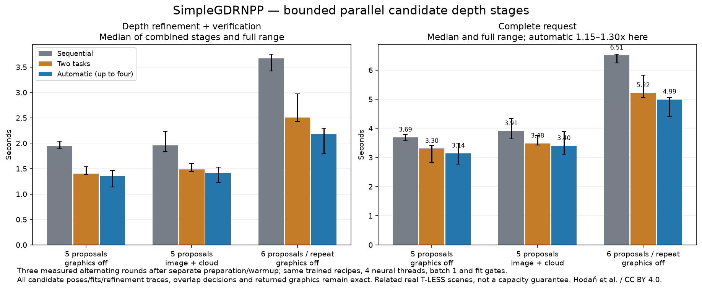

# Parallel candidate depth stages

SimpleGDRNPP now processes independent candidate depth tasks in a small,
call-local thread pool after neural inference. Existing recipes use the same
images, checkpoint, CPU-thread/batch settings and fit/ICP/overlap gates. No
retraining or new recipe parameter is needed, and saved archives keep their
original hashes.

## Automatic execution

For multiple proposals, the automatic planner uses at most four geometry
workers, bounded further by the existing CPU-thread setting and a conservative
memory estimate. Empty and single-candidate captures stay sequential. Neural
inference finishes before this pool starts; it is not duplicated per candidate.
All refinement tasks finish before final verification starts, and overlap
selection remains a separate ordered final step.

The planner estimates 96 bytes per image pixel plus 32 MiB per active task,
against a 512 MiB concurrency-planning budget. This is a scheduling estimate,
not a measured RSS ceiling. At the maximum two-million-pixel frame size,
the automatic/four-worker limit is reduced to two. Existing native OpenCV/BLAS
thread pools are unchanged: the setting is not a hard process-wide thread cap.

`report.candidate_execution` exposes the policy, effective worker count, CPU
budget, estimated active-task memory and per-stage task/peak-in-flight counts.
No more than the effective worker count is submitted at once, including at
the 64-proposal limit. There is no unbounded task queue or cross-capture pool.
The native image/cloud/gallery still select the same best accepted pose.

Each parallel task gets its own candidate/report state. Image, depth and model
data are immutable. Results are committed in original proposal order only after
the whole parallel stage succeeds; stable score ties keep the original order.
Failure/cancellation stops new submission, signals cooperative cancellation and
joins the pool before returning. No inspection result is published on failure.
Cancellation polls on the coordinator; native calls must return to a cooperative
check. Closing a successful request also retires its pool.

The direct Python `run_recipe(..., geometry_workers=1)` interface permits a
sequential comparison or fallback; explicit values 1..4 remain bounded by the
same CPU/memory planner. This developer control is not chosen by saved code or
silently tuned to an application. Normal GUI execution uses the automatic policy.

## Real-frame numerical check

The [all-frame audit](parity/parity.json) uses all
32 frozen real T-LESS RGB-D frames with their original cameras, CAD, rectangles
and previously predicted raw neural poses. Each rectangle is explicitly repeated
with another proposal ID to exercise two concurrent tasks. This does not invent
a second physical part, run a new detector or inject annotation poses.

All **64 candidate comparisons** preserve complete poses, fit dictionaries,
refinement iteration traces, accepted counts, best-pose tie behavior and input
ordering exactly. The original frozen acceptance counts remain unchanged after
accounting for the deliberate duplicate. All serial/parallel reports remain
available, including rejections. Per-frame component durations are diagnostic
single passes, not a repeated speed study or a new accuracy qualification.

Scheduler tests separately cover out-of-order completion, the 64-task queue
bound, CPU/memory planning, malformed task identities, failure, cancellation,
pool joining and fresh state. The actual worker checks also retain duplicate
suppression after parallel stages and after changing the network batch size.

## Complete worker measurements

The [whole-request study](worker_comparison.json)
uses actual pinned-checkpoint inference on the existing five-real-proposal
reference and the related six-proposal reference with an intentionally repeated
target. It compares explicit serial, explicit two-worker and automatic
four-worker depth stages. Neural threads remain four and batch size remains one.
Both recipes and all geometry gates are identical across execution modes.

Three persistent workers are prepared separately, followed by one warmup and
three alternating measured rounds per case/mode. The five-proposal capture runs
with graphics off and on; the six-proposal overlap case runs with graphics off.
All samples/ranges, owned-process snapshots and stage timings are retained.
Complete requests include normal packet IO, inference, depth work, requested
source-aligned image/native cloud and cleanup. Acquisition and GUI composition
are excluded; nested timing scopes overlap.

| Case | Sequential median (s) | Automatic median (s) | Ratio |
| --- | --- | --- | --- |
| Five proposals, graphics off | 3.690 | 3.141 | 1.17x |
| Five proposals, image + cloud | 3.911 | 3.401 | 1.15x |
| Six proposals with repeated target, graphics off | 6.505 | 4.994 | 1.30x |

The final automatic policy uses up to four tasks within the existing CPU/image
limits. The initial two-worker-policy pilot is also retained in
`initial_two_worker_policy.json`; the broader worker
comparison favored the bounded four-task policy. This is an execution-policy
choice for the generic tool, not per-image gate or training-parameter tuning.

All modes preserve every candidate's pose/fit/refinement data, overlap decisions,
best pose and accepted count. Returned overlay/XYZ/RGB bytes match exactly.
These are two related supplied-box arrangements on one shared workstation.
They do not establish general capacity, severe-occlusion accuracy, GPU performance
or picking qualification. The conservative default trades maximum concurrency
for limited temporary memory and native-thread contention.



## Use and reproduce

Update the separate worker package and reset/restart a loaded worker. Host report
and graphics ports already support this change; no new SDK or host ML dependency
is needed. Opening a setup still only restores retained data.

`run_project.json` uses the same sealed reference,
now with automatic depth stages. Its default output is the native colored
fly-around cloud. `review_project.json` opens the exact frozen fit cloud/overlay
and comparison chart without weights. Frozen graphics are reused after byte
checks; a file-source PASS means successful reading, not pose/picking approval.

From this folder, use the updated external worker, verified model folder and a fresh output:

```powershell
& $worker benchmark_candidate_execution.py .. $models new_candidate_timing.json
```

The full source distribution supplies source-acquisition instructions and the
parity helper modules. The timing benchmark explicitly selects the bounded
Python API override; saved recipes cannot load benchmark code. Broader payloads,
actual high-count scenes, platform/native-thread policies and controlled system
capacity remain future work, separately from new-object training/detection.

## Attribution

T. Hodaň et al., **T-LESS: An RGB-D Dataset for 6D Pose Estimation of Texture-less
Objects**, WACV 2017, [CC BY 4.0](https://cmp.felk.cvut.cz/t-less/). Existing real
first-return RGB-D/calibration and supplied visible rectangles are reused.
Repeated proposal IDs, derived profiles, reports, charts and fit graphics are
modifications. No annotation pose/class label enters inference, no weights are
bundled, and no endorsement is implied. [Model/source/dependency notices](../THIRD_PARTY.md).
