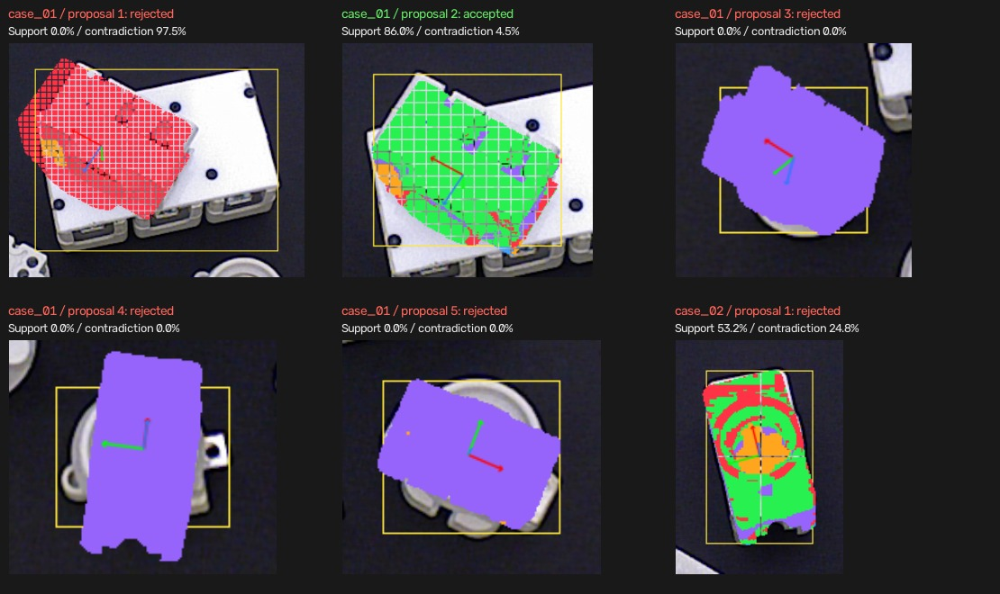

# SimpleGDRNPP completed pose review

Two real T-LESS RGB-D acquisitions demonstrate the read-only Results workflow.
These are retained-reference runs with supplied instance rectangles; published
pose truth is retained separately for evaluation and is not an inference input.
Settings are the existing recipes' settings, unchanged for this work.

| Example | Proposals | Retained poses | Review |
| --- | ---: | ---: | --- |
| `case_01` · scene 6, frame 2 | 5 | 1 | Proposal 2 passes; all four other proposals remain rejected. |
| `case_02` · scene 2, frame 13 | 1 | 0 | The original proposal remains rejected. |

The two recipes preserve their pre-existing refinement modes. This is a review
and retention comparison against each recipe's original behavior, not a shared
accuracy benchmark or per-image retuning.

## Open the examples

Load the parent directory's `plugin.py` explicitly in OpenCVDataflowGUI. Open
either `case_*/run_project.json`, choose an external verified model folder and
dedicated updated worker in Setup, and run in Debug. Then open **Review completed
poses and depth support…** and select **Capture latest completed run**.

Candidate selection links the source/box, pose marker, original support samples,
raw-depth residual histogram and native colored fly-around cloud. Shift-click a
source pixel or pick a stored verification point. The executed training reference
and exact settings remain inspectable. New publications do not replace the frozen
view. Training previews and Stage/Apply/Cancel remain independent.

For immediate offline viewing, open either `review_project.json`. These built-in
file blocks show the recorded native colored clouds and derived images without
the model or worker. File-read success does not assert pose acceptance.

`frozen/` contains exact executed archives, consumed/reference arrays, original
emitted graphics and per-candidate original verification samples, PNG projections
and native PLY reviews. The PLY mixes stored measured scene, predicted fit samples
and derived 20 mm pose axes; these components do not become new sensor evidence.
Flags can overlap. Fractions use every original verification sample, including
unknowns, rather than counts of colored display pixels. Machine-local model-folder
paths are explicitly redacted in the manifest; checkpoint identity remains.

## Worker and checks

`releases/` includes the GDRNPP dev1 worker wheel and FoundationPose dev3 geometry
helpers. Install both into a dedicated compatible Windows x64 / Python 3.13.9
worker using the hashed dependency locks supplied beside the plugin in
`runtime_environment/`. Keep the existing host environment separate. Model weights remain external and are not supplied.
The helper API change retains original fit arrays; it adds no FoundationPose
network inference or new dependency.

`check_completed_review.py` runs in the host interpreter. Select `--host-adapter`
for the published adapter, supply both `--recipes case_01/input.gdrnpp
case_02/input.gdrnpp`, `--worker-python`, `--models` and a new `--output` directory.
Optional `--connected` exercises explicitly connected image/depth/camera/boxes/ID
using the retained captures as transport controls, including float64 millimeter
depth and integer-coordinate boxes. It does not claim an independent acquisition.
Use `QT_QPA_PLATFORM=offscreen` for file/API-only native checks.

The checker runs actual inference, hands ownership from execution to display
graph, captures through the native window, browses all candidates, checks exact
same-settings numerical and emitted-graphics parity with retention off, retires
the worker and continues browsing/export. `validation.json` records those checks.
`release_provenance.json` pins worker module bytes and the dependency lock.
`artifact_manifest.json` pins this delivered bundle. The source/host bundle bytes
are compared during publication; no screen capture or desktop input is involved.

`kernel_benchmark.json` and `benchmark_completed_review.py` repeat the raw-depth
fit kernel on the frozen predicted sample population, with 100 alternating-order
repeats and five warm-ups. All original fit dictionaries match. This excludes
inference, rendering, IPC and GUI time and is not an end-to-end performance claim.

## Attribution and license

T. Hodaň, P. Haluza, Š. Obdržálek, J. Matas, M. Lourakis and X. Zabulis,
**T-LESS: An RGB-D Dataset for 6D Pose Estimation of Texture-less Objects**,
WACV 2017. The [publisher](https://cmp.felk.cvut.cz/t-less/) declares
[CC BY 4.0](https://creativecommons.org/licenses/by/4.0/). Source RGB/depth/CAD,
calibration and pose annotations retain those terms. `upstream/` retains four
unmodified publisher metadata files with verified original hashes. Archives use
metric depth conversion; supplied/reordered boxes, sample-color overlays, crops
and native review graphics are identified modifications. No endorsement is implied.

Original adapter code uses the included MIT license; adapted GDRNPP code retains
Apache-2.0 notices. `THIRD_PARTY.md` and the wheels preserve source, dependency and
external checkpoint terms. No custom-object training, automatic detection,
calibrated confidence, general pose accuracy or physical grasp success is claimed.
