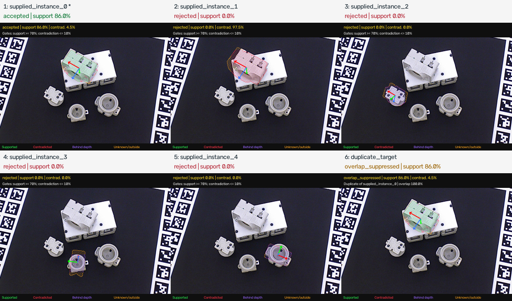

# Duplicate pose selection

SimpleGDRNPP can now reject overlapping proposals after measured-depth
verification, favoring the higher measured-support score. This is an optional
execution setting retained with the setup; it does not retrain the network.

## Setup and review

Open the setup popup, select **Execution / fit gates**, and set **Maximum overlap** below
100%. Preview the reference or another capture, inspect the candidate selector
and colored cloud, then Stage and Apply the setup. A value of 60% allows overlap
up to and including 60%; a larger overlap suppresses the weaker proposal.
100% disables selection and preserves older recipes' behavior.

The best retained pose drives `pose`, `poses`, `accepted_count`, the default
overlay and native fly-around cloud. The gallery marks suppressed proposals in
amber; their image header identifies the retained proposal and overlap.
`candidate_table` and `review` distinguish final `overlap_suppressed` from raw
`depth_status=accepted`. You can review a suppressed candidate without enabling
it as another output part. Cached popup review does not rerun inference.

Green surface points still mean agreement with the measured sensor depth. A
suppressed duplicate can have an excellent physical fit; suppression is a
separate final selection decision. Red/purple/orange fit colors retain their
existing meaning.

## Selection rule

Only depth-accepted candidates compete. Rank by measured support (`coverage`),
descending, with input order breaking ties. Compare each proposal against the
already retained proposals, starting with the strongest.

For each competitor, render its first-return CAD surface at the original sensor
resolution. Retain pixels with measured depth inside its supplied instance box
and input mask, whose axial prediction agrees within the existing depth
tolerance. Count shared supported pixels only when the two predicted depths
also agree within that tolerance. Divide by the smaller supported-pixel count.
If this ratio exceeds the limit, suppress the weaker proposal. Rectangle overlap
alone does not count; absent depth, disjoint support, or distinct predicted depth
layers do not establish duplicate support. Empty supported surfaces produce zero
overlap and remain unsuppressed.

`depth_fit` preserves the original measured evidence. `selection` records the
outcome, retained proposal identity and suppression overlap. The canonical
`fit.status` becomes `rejected` with reason `overlap_suppressed` for a suppressed
proposal, so adapters filtering accepted fits safely exclude it. The report
separates `depth_accepted_candidates` from final `accepted_candidates`.

Selection stores sparse int32 pixel indices and float32 depths only for retained
competitors, with a bounded 8-million-pixel cache (64 MB). Exceeding that budget
or cancelling fails without publishing a partial selection. It adds one
full-resolution surface render per depth-accepted competitor when two or more
compete. Disabled selection adds no surface work or report fields; zero or one
depth-accepted proposal needs no extra render. Overlap timing is reported
separately. This is not an execution-speed improvement.

Older archives load with selection disabled, and save back byte for byte with
the same SHA-256. Original recipes and earlier evidence remain intact. Update
the external worker and light host plugin together, then reset/restart an
already loaded worker. Automatic startup preparation still needs the separate
host lifecycle hook.

## Real RGB-D example

Load the parent `plugin.py`, then `run_project.json`. It uses the real T-LESS scene 6 / frame 2.
It supplies the same five visible rectangles as the earlier review plus an
**intentionally repeated target rectangle**, with a different proposal ID.
The 60% recipe returns one unique pose from two depth-accepted target proposals;
the other four proposals still fail depth gates. The duplicate has 100% shared
supported surface. The 100% recipe returns both original depth accepts.
All six poses and depth metrics, and the best pose, remain exactly equal.

`run_suppressed_review.json` displays proposal 6 while returning the same one
accepted numeric pose. `review_project.json` reads recorded colored clouds,
gallery and image without weights. Source/file PASS means successful reading.
The live projects require the separately verified external checkpoint folder.



This checks duplicate-proposal handling, not independent pose accuracy or a new
scene. It supplies rectangles, uses depth for refinement and verification, and
does not establish picking safety. Automatic detection, actual new-object
training, severe-occlusion qualification and multi-object routing remain open.

From this folder, choose a fresh output directory:

```powershell
& $worker check_overlap.py enabled.gdrnpp disabled.gdrnpp $models .local/new_overlap_review
```

## Attribution

T. Hodaň et al., **T-LESS: An RGB-D Dataset for 6D Pose Estimation of Texture-less
Objects**, WACV 2017, [CC BY 4.0](https://cmp.felk.cvut.cz/t-less/). This example
reuses the attributed original first-return RGB-D/calibration and visible-box
inputs. Repeating one rectangle, retaining a setup, overlays, gallery and
colored result clouds are modifications. No annotation pose or class label is
an inference input; no weights are bundled. No endorsement is implied.
[Model/source/dependency notices](../THIRD_PARTY.md) remain unchanged.
