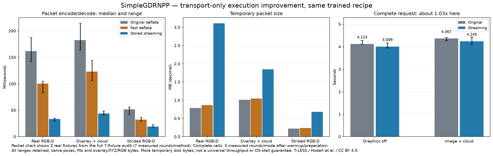

# Bounded streaming worker transport

SimpleGDRNPP now uses uncompressed standard NPZ packets for normal local
worker requests and results. The reader fills independent writable arrays in
bounded chunks. This removes routine compression and an intermediate full-member
byte buffer, without changing training, model inference, fit gates or graphics.

No recipe or app setting changes are needed. Update both the separate worker
package and the light host plugin, then reset/restart a loaded worker/app.
The format remains NPZ plus strict JSON: the new reader accepts older compressed
packets, and the unchanged reader accepts new packets. This is private local
file transport; it does not introduce a shared-memory or network service.

## Packet measurements

The [paired packet study](packet_timings.json) compares
the fixed original compressed writer/reader, streaming with fast deflate, and
streaming with stored entries. Seven fixtures have one warmup and seven
alternating measured rounds per method. Real T-LESS RGB-D, overlay/point-cloud
output and strided source arrays are supplemented by explicitly synthetic
entropy, zeros and Fortran-layout stress arrays. Synthetic arrays test transport
only, not vision accuracy or simulated sensor visibility.

Real RGB-D input encode/decode median: **161.6 → 33.3 ms (4.85x)**.
Real overlay/cloud output: **182.6 → 43.7 ms (4.18x)**. Values, shapes and dtypes
match exactly through the new and original readers. These phase timings exclude
model work, temporary-directory creation, correctness checks, cleanup,
acquisition and GUI composition. All samples, including ranges, remain available.

Stored packets use more temporary disk space: about 3.11 MB versus 0.79 MB for
the input, and 1.85 MB versus 1.01 MB for this result. Highly compressible zero
stress data grows much more. The packet limits and prompt private-file cleanup
remain; this exchanges compression work for local file bytes. It is not a
guarantee of improvement on slow or remote temporary storage.

## Complete worker comparison

The [actual worker replay](worker_transport.json)
swaps only the two transport endpoints against the pinned original implementation.
Both arms use the same current numerical code, real five-proposal capture,
sealed batch-one setup, checkpoint, four CPU threads and depth/ICP gates. A
trusted developer benchmark constructs its child entry point explicitly; saved
projects and recipes cannot choose code or executables.

Each graphics mode owns two separately prepared persistent workers, followed by
one warmup and three alternating measured rounds. Input arrays are in memory
before timing. Requests include private-packet IO, numerical work, requested
source-aligned overlay/native colored cloud and cleanup. Camera acquisition,
caller decoding and GUI composition are excluded. Nested timing scopes overlap.

| Graphics | Original median / range (s) | Streaming median / range (s) |
| --- | --- | --- |
| Off | 4.123 / 4.116–4.280 | 4.009 / 3.954–4.173 |
| Image + cloud | 4.367 / 4.274–4.410 | 4.245 / 4.097–4.436 |

Complete-request medians improve about 1.03x here, with overlapping sample
ranges. Graphics-on worker packet-writing median falls 82.5 to 13.7 ms; client
input writing falls 90.3 to 9.6 ms. No large end-to-end speedup is claimed.

All proposal poses, complete fit dictionaries and accepted counts match across
arms and repeats. Returned overlay/XYZ/RGB bytes match exactly. This remains one
assisted development scene, not accuracy, capacity, GPU or picking qualification.
The study does not establish that arbitrary OS/file stalls have been eliminated;
the earlier 27.8-second outlier remains in the batch evidence.



## Boundary checks

The same 128 MiB archive/uncompressed-member limits, 16-member maximum, 4 MiB
metadata limit, numeric dtype/shape checks and strict finite JSON apply. The
writer now rejects inputs the reader could never accept, such as unsupported
dtypes or too many members. Arrays have up to three dimensions, with each
dimension at most two million. Object/pickle/structured arrays, duplicate names,
path names, invalid sizes and corrupt CRC data are rejected.

The reader validates a member's header and declared byte length before array
allocation. It reads payload data in chunks of at most 4 MiB, checks completion/CRC, preserves
C/Fortran values and produces independent writable buffers. No ZIP member is
extracted to a selected path. Standard NPY v1/v2 and empty packets remain supported.
When ZIP framing alone would exceed the file limit near the legacy payload
boundary, the writer falls back to fast deflate while keeping the same caps.
The explicit fast-deflate option is an internal developer interface, not a
training parameter or per-application tuning choice.

## Corrected older profiling helpers

`benchmark_worker.py` and `benchmark_prepare.py` now use the same owned-process
sampler as the batch study. New receipts contain `owned_processes`, per-process
CPU/RSS/peak counters, completeness and summed current tree RSS. They no longer
label the idle Windows launcher peak as worker memory. Process churn/reused PIDs
and unavailable counters remain unknown. Individual peaks are cumulative; summed
RSS includes shared pages and does not measure exclusive physical RAM.

Old source images, recipes, performance receipts and their hashes remain intact.
Historical launcher-only memory fields retain the qualification documented in
[the batch study](../batch_execution/README.md); new profiling does not retroactively replace them.

## Reproduce

`run_project.json` runs the unchanged sealed reference
through the current installed worker. Explicitly load the trusted plugin and
select the verified external checkpoint folder. Its default thumbnail is the
native colored fly-around cloud. `review_project.json` opens the exact frozen
cloud/overlay and comparison chart without weights. The frozen graphics are
reused after byte-for-byte parity checks; file-source PASS means successful reading.

From this folder, use the updated external worker, verified model folder and new paths:

```powershell
& $worker benchmark_packets.py .. reference_wire.py new_packets.json new_jobs
& $worker benchmark_transport.py setup.gdrnpp ../preprocessing/capture.json $models reference_wire.py new_worker_transport.json
```

The fixed `reference_wire.py` is hash-checked and executed only by the explicit
developer benchmarks. Normal inspection always uses the installed worker code.
Existing live and recorded native-cloud projects still work; opening/validating
them does not run inference. No new host SDK or ML dependency is required.

## Attribution

T. Hodaň et al., **T-LESS: An RGB-D Dataset for 6D Pose Estimation of Texture-less
Objects**, WACV 2017, [CC BY 4.0](https://cmp.felk.cvut.cz/t-less/). Existing real
RGB-D/calibration and visible rectangles are reused. Derived overlays, colored
clouds, transport packets, profiles and charts are modifications. Annotation
poses/class labels do not enter inference; no weights are bundled or endorsement
implied. [Model/source/dependency notices](../THIRD_PARTY.md) remain unchanged.
