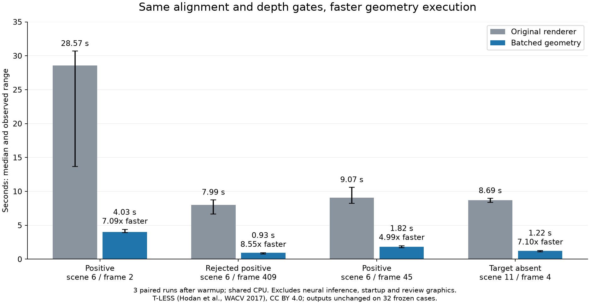

# Generic CPU geometry execution

2026-11-16: numerical geometry uses `numpy_batched_first_return_v1` automatically.
No retraining, recipe changes or new runtime dependencies are needed. Update the
separate worker package and reset/restart its worker to activate new code;
already running processes retain their loaded implementation.

The original profile spent 7.68 of 8.05 seconds in fourteen software renders
(about 95% of that profiled alignment). Those calls also computed RGB shading
that numerical geometry discarded. The new original NumPy implementation
vectorizes triangle preparation and streams triangle/pixel work in chunks of
at most 131,072 samples. A nearest-depth reduction with stable face-order ties
replaces thousands of Python raster loops. It computes only the required XYZ.

This execution path serves raw depth verification, median translation, local
ICP and predicted geometry for overlays/native clouds. It retains the same
first-return surfaces, perspective interpolation, near-plane abstention,
boundary tolerance and cropped sensor rays. It does not decimate the mesh,
complete missing scene depth, reduce iterations or tune image-specific settings.
Cancellation is checked between geometry chunks and alignment iterations.
Existing RGB neural inference is unchanged and remains in its isolated worker.

## Paired measurements

One warmup pair, then three measured pairs per case, alternating execution order.
Both arms use the same ICP code, inputs, gates and iteration budget. The reference
arm substitutes the original RGB software renderer; the optimized arm computes
batched geometry. Times include alignment and final depth assessment, excluding
neural inference, process/model startup, transport and optional review graphics.

| Frozen case | Original renderer median | Batched geometry median | Median speedup |
| --- | --- | --- | --- |
| Scene 6, frame 2: positive | 28.57 s | 4.03 s | 7.09x |
| Scene 6, frame 409: rejected positive | 7.99 s | 0.93 s | 8.55x |
| Scene 6, frame 45: positive | 9.07 s | 1.82 s | 4.99x |
| Scene 11, frame 4: target absent | 8.69 s | 1.22 s | 7.10x |

The workstation was shared with other development work. All individual samples
are retained; frame-2 reference samples range from 13.66 to 30.69 seconds.
These measurements show stage savings on the tested CPU, not a general machine
cycle or neural-inference speed claim. The geometry-only benchmark's peak
working set was about 261 MB decimal, including its 32 retained frames and
without a neural model; it is not the complete ML worker's memory footprint.

## Numerical and review evidence

- All **32 frozen final poses**, fit counts, acceptance decisions, refinement
  statuses and per-iteration ranks match the retained results. Poses are bit
  identical on this installation. All **96 raw-pose XYZ fields** at strides
  4/2/1 and their first-return masks are also bit identical to the original
  renderer on these cases.
- All **32 final overlays and native XYZ/RGB clouds** match original rendering
  bit for bit on the same inputs. Raw fit dictionaries also match between the
  renderers; the three legacy median-correction poses match their reference
  executions. The original saved example files remain untouched.
- Synthetic checks cover varied pose/intrinsics/crop grids, non-square images,
  reversed/coplanar equal-depth faces, triangles larger than a chunk, near-plane
  crossings, empty views, image bounds and cancellation. Different matrix
  batching produces cancellation-sized XY roundoff near zero in one synthetic
  setup (about 4.5e-18 m); that test uses a 1e-12 m absolute tolerance while
  requiring identical depth. General bit identity across all hardware/BLAS
  builds is not promised.
- The earliest raw pilot converted depth as `raw*scale/1000`, whereas retained
  captures use `raw*(scale/1000)`. Re-reading those captures gives tiny historic
  raw-RMSE differences, recorded separately. Renderer comparisons on identical
  inputs are exact; historic gates/counts and the frozen receipts are preserved.

The behavior remains experimental: the unchanged larger scene extension accepts
9/12 positives and 0/17 absent controls; severe occlusion and broad accuracy
remain unqualified. A performance improvement does not resolve geometric
ambiguity, sensor/model disagreement or pose/grasp qualification.

## Prepared rays and complete worker requests

The [worker cycle study](../worker_cycles/README.md) adds once-per-level measured-ray
preparation, sparse correspondence work and one shared render for combined
image/cloud review. Paired alignment improves a further 1.26-1.78x; all 32
frozen results remain unchanged. Separate sequential whole-worker observations
include inference, startup, transfer, optional graphics and cleanup. They do
not establish a consistent whole-call gain. Runtime profiles now separate
these costs, without changing recipes or judgment.

## Reproduce and activate

The source distribution supplies `examples/benchmark_geometry.py` and `examples/check_geometry_reviews.py`, with frozen source/image inputs and replay commands. This folder retains the full benchmark and graphics-parity receipts plus chart. It does not embed a neural model or launch a worker.

Update the separate worker package, then reset/restart that worker. No GUI dependency change, new training or recipe change is needed. Existing saved reviews and their historical timing receipts remain intact.

Next: per-level correspondence/model-projection work, bounded execution parallelism and complete cold/warm worker profiling.

## Attribution

The real cases are T-LESS: T. Hodaň, P. Haluza, Š. Obdržálek, J. Matas,
M. Lourakis and X. Zabulis, **T-LESS: An RGB-D Dataset for 6D Pose Estimation of
Texture-less Objects**, WACV 2017.
[Publisher and CC BY 4.0 license](https://cmp.felk.cvut.cz/t-less/).
Derived comparisons and timing/fit reviews are modifications; no endorsement is
implied. Existing source/model/dependency notices remain in `THIRD_PARTY.md`.
