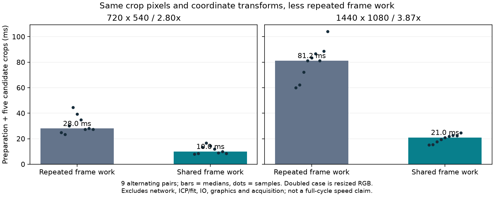
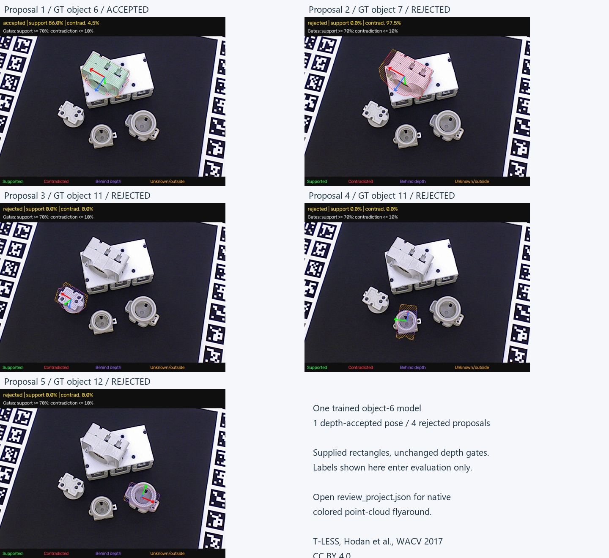

# Share image preparation across candidates

The estimator now converts/resizes the current image, adjusts its intrinsics and
builds its absolute coordinate grid **once per capture**, then makes each candidate
crop from those private buffers. Each crop retains its own image, coordinates and
camera data. Shared buffers are read-only and released before neural inference;
another capture always gets fresh preparation. Empty captures skip that work.

This is a generic execution change. It changes no training, ROI, checkpoint,
recipe, batch size, thread count, crop interpolation, coordinate rounding or fit
gate. `prepare_crop` remains compatible for single-candidate API users. The
multi-candidate estimator uses `prepare_frame` automatically; old recipes need no
retraining. Reset/restart a loaded worker after updating its package.

## Paired measurements

Five visible annotation rectangles from one real T-LESS RGB-D image are used as
external proposals to the same object-6 model. Nine alternating pairs each
measure twenty calls per arm. Both arms produce identical crop pixels, absolute
coordinates, camera matrices and source transforms. Timings include full-frame
preparation and all five crops, excluding neural inference, depth refinement/fit,
IO, graphics and acquisition.

| Image | Repeated preparation median | Shared preparation median | Phase speedup |
| --- | --- | --- | --- |
| Original 720 × 540 | 28.01 ms | 10.00 ms | 2.80× |
| Resized 1440 × 1080 copy | 81.24 ms | 20.99 ms | 3.87× |



These are phase measurements on a shared Windows CPU workstation, **not a
complete-cycle speedup or capacity guarantee**. The doubled image is a derived
resized copy with correspondingly scaled camera/boxes, not another acquisition.
One candidate has no repeated frame work to remove. Raw samples and exact input
hashes are retained beside the chart.

## Numerical and lifetime checks

All fifteen frozen crop fixtures match every array/dtype, scalar and transform
exactly: native, doubled, tall/wide odd dimensions, small images and boundary
boxes. Ownership checks cover source mutation, independent crops/cameras, fresh
captures and read-only shared buffers. Instrumented estimator checks confirm one
resize/grid build per capture, zero for an empty capture, and release of the
full-frame buffers before model execution.

All **32 frozen real cases** are replayed through the actual checkpoint using both
the original and shared preparation. Neural fields, raw heads, candidate poses,
complete fit decisions, acceptance counts, overlays and native XYZ/RGB arrays
match exactly between the pipelines. Frozen pose matrices agree within 1e-10
per entry, with exact counts/decisions; all historical RMSE deltas in this replay
are zero. Earlier receipts stay intact.

## Real five-proposal review

`review_project.json` loads five full colored native clouds
and five pose/fit overlays. Source-file PASS means successful reading, not pose
acceptance. All results remain visible: one object-6 target passes the unchanged
5 mm / ≥70% support / ≤10% contradiction gates, and four other-object proposals
are rejected. Its annotation error is 3.394 mm / 2.840 degrees. This is one
assisted development scene, not automatic detection, new-object training, broad
accuracy or grasp qualification. Depth is reused for fitting and verification.



`capture.json` contains only RGB-D/calibration and the five supplied rectangles;
`annotation_truth.json` is evaluation-only. The same sealed ICP recipe is used.
The model's retained reference and all older recipe/image files are unchanged.

Green predicted surfaces support the measured depth; red contradicts it, purple
is behind it, and orange is unknown/outside the candidate region. RGB axes mark
the proposed pose. Each saved cloud uses the app's native colored flyaround view.

## Reproduce

From this folder, use the separately installed updated CPU worker and external verified model directory, with fresh output paths:

```powershell
& $worker benchmark_preprocess.py capture.json reference_preprocess.py new_timing.json
& $worker -m opencv_simple_gdrnpp.cli run ../assets/tless6_icp.gdrnpp --capture capture.json --models $models --output new_candidates
```

The complete source distribution also supplies `check_preprocess_parity.py` and the 32-case fixture/source instructions. `parity.json` retains that full real checkpoint check here. The frozen `reference_preprocess.py` is used only by explicit developer benchmarks, never selected by a saved setup. Restart/reset an already loaded worker after upgrading. Automatic app resource preparation still needs the host lifecycle hook.

## Attribution

T. Hodaň et al., **T-LESS: An RGB-D Dataset for 6D Pose Estimation of Texture-less
Objects**, WACV 2017, [CC BY 4.0](https://cmp.felk.cvut.cz/t-less/). Source RGB,
first-return depth, calibration and separate labels retain their credits. Derived
rectangles, physical-unit conversion, resized benchmark copy, overlays and native
clouds are modifications. No endorsement is implied. Dataset poses enter
evaluation only. [Model/source licenses and notices](../THIRD_PARTY.md) are unchanged.
