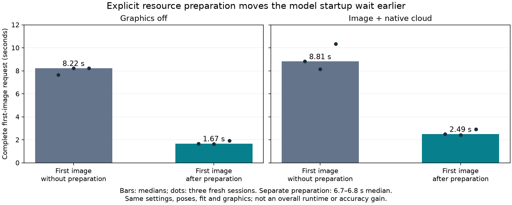

# Prepare resources before the first image

2026-11-16. The persistent worker has an explicit **prepare** operation. It
validates an applied, SHA-256-pinned setup archive and the matching external
checkpoint, then constructs the CPU model. Keep that same worker alive for
execution. Preparation neither reads a current capture nor runs a network
forward pass. It returns resource readiness, not an inspection result.

This moves startup into an explicit preparation stage. It does not eliminate
model loading, accelerate the neural network or qualify any pose. A network's
first real forward pass still occurs on the first inspection image.

## Measured first-image behavior

Three alternating pairs per graphics mode used twelve fresh worker processes
and 24 actual inspection requests on this shared Windows CPU workstation.

| Output mode | First image, unprepared | Separate preparation | First image, prepared | Preparation + first image |
| --- | --- | --- | --- | --- |
| Graphics off | 8.220 s | 6.727 s | 1.670 s | 8.397 s |
| Image and native cloud | 8.812 s | 6.811 s | 2.493 s | 9.240 s |

Values are medians, including the median of each prepared session's summed
startup and first-image durations. Preparation ranged from 6.056 to 11.104
seconds. These observations establish where the wait occurs, not a total-time
improvement, guaranteed cycle time or general capacity result.



All poses, measured fits and acceptance decisions match the eight prior frozen
worker samples of this independent capture. Overlay pixels and native XYZ/RGB
arrays also match its original saved PNG/PLY exactly. Every prepared session
had zero inspections at readiness, then one cached model load for both real
requests. All raw timings, counters and hashes are retained in
[the preparation evidence](.).

## Contract and lifetime

- Accept only `base={kind: "recipe", path, sha256}` and `models_dir`. Drafts,
  setup definitions, reference replacements, captures and image arrays are
  rejected. Apply configuration before preparing it.
- Validate the complete archive and selected checkpoint binding before publishing
  readiness. The returned archive/content hashes, pinned model binding, worker
  session and implementation fingerprint identify what was prepared.
- Return `prepared` and request timings, without pose, pass/fail judgment,
  preview token, result image or cloud. No inspection ticket/history is created.
  `inspection_performed` is false; `inference_request_count` stays unchanged.
- Repeated preparation reuses unchanged resources. The first actual inspection
  uses the same model on that worker, while validating its own fresh capture.
  Thread policy or model-file changes invalidate the model cache. Preparation
  verifies that model file signatures remain unchanged through loading.
- Cancellation, timeout and transport/error responses retire the owned process
  and delete its private request files. They return no ready status or old pose.
  A later request starts a new worker. Reset/close also releases the resources.
- Preparation expires any previous private preview token. It cannot make an old
  image or pose the result of a new inspection. Opening/inspecting a setup still
  does not load its model, and existing recipes need no migration.

Use the trusted installed worker environment. No weights, ML dependency,
executable path or automatic download is added to a saved project.

## Persistent client example

```python
from opencv_simple_gdrnpp.bridge import WorkerClient

resources = dict(
    base=dict(kind="recipe", path=applied_recipe_path, sha256=applied_archive_sha256),
    models_dir=verified_external_model_directory,
)
with WorkerClient() as client:
    readiness, arrays = client.call("prepare", resources, cancelled=stop_requested)
    assert readiness["prepared"]["ready"] and not arrays
    # Later, on acquisition: same live client; explicit new capture request.
    result, graphics = client.call(
        "preview",
        {**resources, "current": dict(kind="request", path=current_capture_request)},
        cancelled=stop_requested,
    )
```

A separate short-lived command or training-popup worker cannot warm the
execution worker. App startup integration needs to prepare the actual execution
instances, including graph copies and nested ToolBlocks, with separate resource
status and cancellable cleanup. That host lifecycle integration is being
coordinated separately; this operation does not silently run at project open.

## Reproduce

The paired replay starts fresh workers, alternates prepared/unprepared order and
processes two requests per session using a separate calibrated real T-LESS
capture. It compares poses, measured fit, decisions and returned image/cloud
array hashes across every request. It checks zero inspections at readiness and
one model load per session. Both graphics-off and image/cloud modes are covered.

```powershell
& $worker benchmark_prepare.py ../assets/tless6_icp.gdrnpp $models ../scene_extension .local/new_preparation.json --repeats 3
```

Input decoding occurs before timing. Measured requests include process/import
startup where applicable, packet IO, inference, ICP/fit, requested graphics and
cleanup; acquisition, GUI and robot work are excluded. Preparation timings and
first-image timings are distinct, non-overlapping operations. Nested request
profile fields overlap and must not be added together.

## Attribution

The unchanged capture is from T. Hodaň et al., **T-LESS: An RGB-D Dataset for 6D
Pose Estimation of Texture-less Objects**, WACV 2017,
[CC BY 4.0](https://cmp.felk.cvut.cz/t-less/). Derived metric inputs, boxes,
overlays and colored review clouds retain their original credits. The replay
does not feed ground-truth poses into inference. Model authors, pinned upstream
source, modifications and license terms remain in [THIRD_PARTY.md](../THIRD_PARTY.md).
