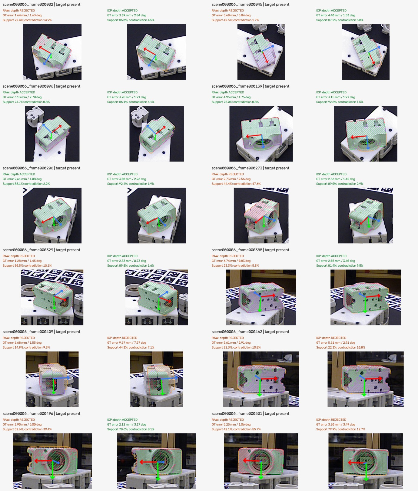

# Real scene extension: fixed raw and local-alignment settings

2026-11-16. Twelve views of object 6 in new scene 6 and seventeen target-absent
controls from other scenes. The original development scenes 2 and 3 are excluded.
Selection was frozen from publisher metadata before loading the network. Ten
evenly spaced eligible positive frames plus the least-visible and most
foreshortened eligible views are retained. Each absent scene contributes its
first eligible frame and lowest object ID. At least 100 visible pixels and
10 pixels per rectangle side are required; no predicted score selects images.

The same checkpoint and settings apply to every case: four CPU threads, single
instance batch, supplied visible bounding rectangle, 5 mm distance tolerance,
at least 70% measured support, at most 10% contradiction. The optional local
refiner uses the existing 4/2/1 strides, four iterations per level, robust
point-to-plane solve and 20 mm / 15 degree total motion bounds. No parameters
or model weights changed for this extension. Neither fine instance masks nor
pose labels enter inference, refinement or fit verification.

| Measurement | Raw RGB pose | Optional local ICP |
| --- | --- | --- |
| Positive poses passing depth gates | 3 / 12 | 9 / 12 |
| Positive poses within 5 mm / 5 degrees of annotation | 6 / 12 | 10 / 12 |
| Depth-accepted positive poses within that annotation criterion | 3 / 3 | 9 / 9 |
| Depth-accepted positive poses outside that annotation criterion | 0 | 0 |
| Target-absent controls passing depth gates | 0 / 17 | 0 / 17 |

The 5 mm / 5 degree criterion uses the publisher's discrete symmetries and the
**selected annotated instance**, not whichever target instance happens to be
closest. This is a development measure, not an official BOP leaderboard score.
Supplied rectangles bypass object detection; these counts are not full-scene
detection recall or a generally qualified false-accept rate.

## Review every result

Open [the filterable image gallery](gallery.html), [all positives](positive_overview.jpg)
or [all target-absent controls](negative_overview.jpg). Every preselected case
has raw/refined reports, fit/pose evaluation and a zoomed comparison in `cases/`.
Click gallery images for full-size comparisons. No rejected case is removed.

Four representative cases in `reviews/` additionally retain full source RGB,
original depth, a calibrated `capture.json`, full overlays and native-viewer
XYZ/RGB clouds for **both** poses. [Review selection](review_selection.json) is
explicitly post-run; the aggregate numbers above still include all 29 cases.
The four include an improved positive, the worst rejected positive, the worst
accepted-positive annotation error and the highest-support absent control.
Clouds contain measured scene, camera-visible predicted CAD and pose axes;
hidden CAD is not presented as a camera measurement.

These files can also be opened through the companion app's saved-review
projects. A file-source block passing means successful file reading, not pose
acceptance. Graph comments retain the recorded decisions and annotation errors.
No worker or model is needed to view saved results. To run independent RGB-D
inference, load the plugin and a matching retained setup; the popup's **Preview
another capture** accepts the retained `capture.json` files. Weights remain
external and worker dependencies stay outside the GUI environment.



## Remaining limits and failures

- Three positives remain depth-rejected: frames 409, 462 and 501. Frame 501 is
  within 5 mm / 5 degrees after alignment, but contradiction is still 12.68%.
  The gates were not loosened to accept it.
- The least-visible view, frame 409, gets worse from 6.68 mm / 1.55 degrees to
  9.67 mm / 7.57 degrees and remains rejected. A better sensor fit does not
  guarantee a better pose. Some accepted poses also get worse in one error.
- Object 5 in scene 11 is absent-target control with 78.29% support after
  alignment, but 12.15% contradiction rejects it. High support alone is not
  object identity or pick confidence.
- Seven of the twelve CAD-at-annotated-pose depth checks fail these same gates.
  These evaluation-only checks indicate sensor/model disagreement beyond
  network error, without establishing a specific calibration/CAD/sensor cause.
- All positives come from **one** new scene and are 91.4-99.6% visible. Different
  views of one physical arrangement are correlated. Severe occlusion, other
  trained objects, automatic detection, independent sensors and physical grasps
  are not qualified. The fitting and verification stages reuse the same depth.

One sequential CPU replay sampled positive refinement at 6.05-22.89 seconds
(median 11.57). Numeric work including frame decode, network, raw fit,
refinement and final fit took 7.76-28.51 seconds (median 13.85), excluding
overlays and annotation evaluation. OS peak working set was about 1.26 GB
decimal. These are sampled development timings, not repeatable cold/warm or
machine-cycle benchmarks. Repeated software rendering is a candidate for a
generic execution optimization; keep this frozen evidence for numerical parity.

## Reproduce

Use the separate worker environment described by the tool, with the original
sibling geometry utilities installed. From this example directory, choose new
ignored output paths and the external verified object-6 model directory:

```powershell
& $worker fetch_validation.py .local/validation_source
& $worker validate_tless.py .local/validation_source $models ../assets/tless6.gdrnpp .local/validation_results
& $worker curate_validation.py .local/validation_source .local/validation_results ../assets/tless6.gdrnpp .local/validation_review
```

The fetcher uses immutable mirror revision
`5fd309a04476a842d93abfb584fba9ee7caecdf1`, bounded HTTP ranges, exact member
sizes and ZIP CRC checks, then local SHA-256. It never downloads/re-hashes the
entire 825 MB archive. The archive SHA in `source_manifest.json` is the upstream
identity, not a claimed local full-file hash. Verified caches must also agree
with the remote ZIP directory size/CRC. Existing destinations are preserved.

`source_manifest.json` pins every selected source/metadata member and
`selection.json` records the frozen rule. The original downloaded source set
can be reproduced with the fetcher rather than duplicating it all here.
`provenance.json` seals the shipped derived evidence and review source bytes.

Next work: generic software-render/refinement profiling, additional near-match
controls and real occluded views, batch parity, repeated end-to-end capacity
measurements and independent sensor/model residual analysis. New-object network
training, GPU deployment and robot/grasp qualification remain separate.

## Attribution and license

T. Hodaň, P. Haluza, Š. Obdržálek, J. Matas, M. Lourakis and X. Zabulis,
**T-LESS: An RGB-D Dataset for 6D Pose Estimation of Texture-less Objects**,
WACV 2017. [Original publisher and CC BY 4.0 license](https://cmp.felk.cvut.cz/t-less/).
[Official BOP mirror](https://huggingface.co/datasets/bop-benchmark/tless).
Original source images/depth/calibration/labels and derived metric arrays,
rectangles, evaluations, cropped comparisons, overlays and colored fit clouds
retain CC BY 4.0. Modifications are identified above; no endorsement is implied.
GDRNPP source/model and dependency notices remain in the companion tool's
`THIRD_PARTY.md`. This data license is separate from the original code license.
