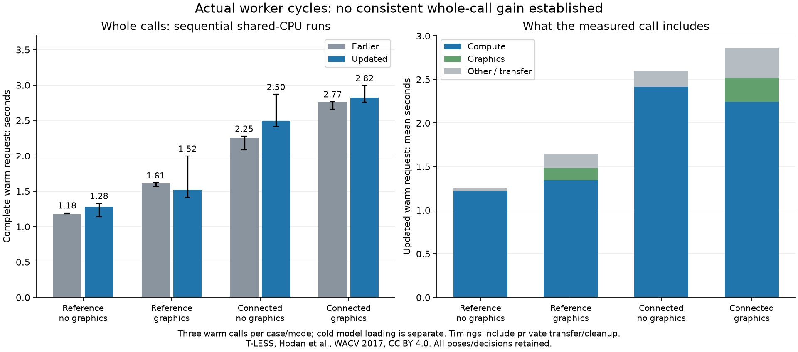

# Prepared geometry and complete worker-cycle measurements

2026-11-16. Measured sensor rays are now prepared once per instance/pyramid
level. Normals and correspondence distances are calculated only on the same
eligible rays that the dense implementation would retain. Values and ordering
are preserved. No rays are added, depth filled, iterations removed or recipe
parameters changed. Prepared data lives within one alignment call; it cannot
survive another capture or instance.

Overlay and cloud composition now share one call-local full-resolution CAD
surface. Both output types remain individually selectable. Rendering is skipped
when neither is requested, and different poses/captures get fresh surfaces.

## Paired alignment check

The reference is the explicitly pinned earlier implementation, using the same
batched renderer. One warmup pair and three measured pairs alternate execution
order. These measurements include alignment and its before/after fit checks,
excluding neural inference, transfer, optional graphics and the separate final
verification call.

| Fixed case | Earlier median | Prepared-ray median | Speedup |
| --- | --- | --- | --- |
| Scene 6, frame 2 | 1.906 s | 1.509 s | 1.26x |
| Scene 6, frame 409 | 1.052 s | 0.592 s | 1.78x |
| Scene 6, frame 45 | 2.195 s | 1.586 s | 1.38x |
| Scene 11, frame 4, target absent | 1.620 s | 0.934 s | 1.73x |

All 32 frozen final poses, fit counts/decisions and iteration ranks still match
exactly on this installation. Shared and separate composition of all 32
overlays/native XYZ-RGB clouds is bit identical. Dense-reference tests compare
the actual correspondence values and order at all three levels, with missing
depth and instance masks. Other tests cover preparation lifetime, single-render
composition, selective outputs, changed poses and stale-capture rejection.

## Complete isolated-worker calls

These are actual subprocess calls using the real checkpoint and the same sealed
recipe. Each mode starts a new process/model for one cold call, then performs
three warm calls with cached model/recipe. Connected input uses an independent
calibrated RGB-D snapshot; retained-reference mode intentionally reruns the
recipe's reference. Input snapshots are already in memory before timing starts.

Client times include worker launch/loading on cold calls, input serialization,
transfer/validation, neural inference, alignment/fit, requested graphics, result
transfer/decode and private-request cleanup. Camera acquisition, caller-side
file decoding, GUI composition and robot work are excluded.

| Input / graphics | Earlier warm median | Updated warm median | Updated cold call |
| --- | --- | --- | --- |
| Retained reference / off | 1.182 s | 1.280 s | 16.355 s |
| Retained reference / image and cloud | 1.612 s | 1.524 s | 11.498 s |
| Independent connected capture / off | 2.254 s | 2.497 s | 13.587 s |
| Independent connected capture / image and cloud | 2.768 s | 2.824 s | 13.289 s |



The earlier and updated whole-call runs were sequential on a shared workstation.
They **do not establish a consistent whole-request improvement**. Keep those
observations separate from the alternating paired alignment check. All samples
and overlapping ranges are retained. Cold model preparation sampled 9.3-14.3
seconds in the updated run; persistent model reuse avoids that cost on warm
requests. Warm connected input encoding sampled about 0.12 seconds, and graphics
result encoding about 0.11-0.12 seconds. These are two assisted development
captures, not general capacity or machine-cycle qualification.

Every repeated/graphics-mode pose is identical, model load count stays one per
session, and warm model/recipe hits are verified. The before/after poses also
match. The original measured receipts, recipes and saved reviews remain intact.

## Execution profiles in ordinary results

`report.execution_profile` now separates recipe lookup, current-capture
preparation, model preparation, numerical work and graphics inside the worker.
Model preparation includes model-specific imports on first use. The source
implementation fingerprint in `report.worker.implementation_sha256` identifies
the worker's fixed source files at process startup.

`request_timing` accompanies the response and its report: client lock wait,
process launch, packet write, reply wait, packet read and cleanup, plus server
packet-read/handler/write times. `client_total_seconds` includes cleanup.
Initial process/module startup before handling the request remains within
client reply wait. These nested durations overlap: do not add client wait to
worker handler time. Different operations have separate request timings.

Timings do not change pose/fit judgment or provide a confidence score. Update
the isolated worker package and reset/restart it for new numerical code;
restart the application after updating its host bridge to load the new client
timing support. Existing trained setups work without changes. No host ML
dependencies or new concurrency capability are required.

## Reproduce

With the isolated worker, verified external checkpoint folder and retained
example inputs, run from the source root into a fresh ignored receipt:

```powershell
& $worker benchmark_worker.py ../assets/tless6_icp.gdrnpp $models ../scene_extension .local/new_worker_cycles.json
```

The developer's `examples/benchmark_preparation.py` additionally compares the
fixed earlier Git implementation; it explicitly executes that pinned source
for benchmarking, never code selected by a recipe. All raw samples and parity
checks are retained in [the cycle evidence folder](.).

Next: controlled repeated end-to-end capacity/CPU-load checks, input/result
serialization cost, bounded per-instance parallel execution, stronger occlusion
and independent sensor/model evidence. New-object training, detection and
grasp qualification remain separate.

## Attribution

T. Hodaň, P. Haluza, Š. Obdržálek, J. Matas, M. Lourakis and X. Zabulis,
**T-LESS: An RGB-D Dataset for 6D Pose Estimation of Texture-less Objects**,
WACV 2017. [Publisher and CC BY 4.0 license](https://cmp.felk.cvut.cz/t-less/).
Derived metric arrays, supplied rectangles, comparisons, profiles and graphics
are modifications; no endorsement is implied. Existing source/model/dependency
notices remain in `THIRD_PARTY.md`.
