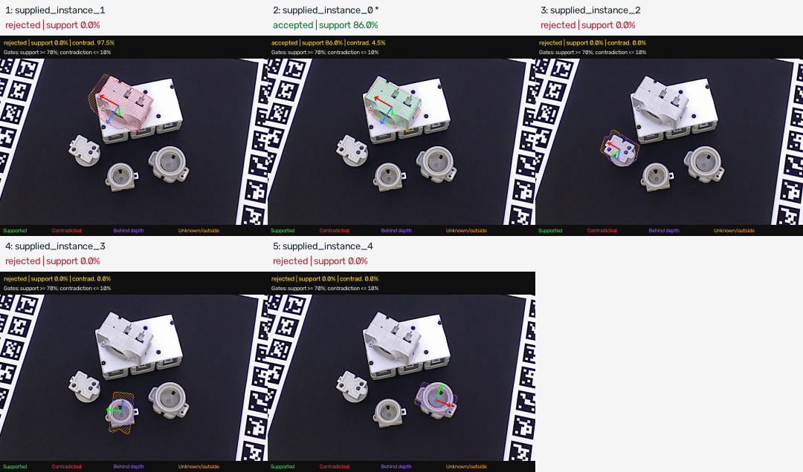

# Live candidate graphics and pose identity

The live image and cloud now default to the **same best depth-accepted proposal
as the numeric `pose` output**. Earlier code rendered the first proposal even if
a later proposal supplied the accepted pose. The change affects review selection;
network outputs, fitting, gates and accepted pose outputs stay unchanged.

## Review controls and outputs

- **Review candidate = 0** chooses the highest-support accepted pose. With none
  accepted, it shows the strongest rejected proposal and keeps `pose` absent.
  Equal support keeps the original candidate order. An empty capture shows no
  candidate and yields an empty table.
- **Review candidate = 1..64** displays that numbered proposal. This is a viewing
  choice: inspecting a rejected proposal never replaces the best accepted numeric
  `pose` or changes the inspection judgment. An unavailable number is an error.
- `review` identifies the displayed number, ID, measured-depth status, selection
  reason and whether it is the best accepted pose. The native colored cloud
  carries the same information in its metadata. The status message names it.
- `candidate_table` contains every proposal's number, full ID, depth status,
  support/contradiction percentages, RMS distance in mm and selection flag.
  These are measured fit diagnostics, not a scalar neural confidence.
- **Render gallery** optionally creates `gallery`, a numbered image of all
  proposals with the displayed one marked `*`. It uses a separate pixel grid;
  `overlay` remains aligned to the original input image. Gallery rendering is off
  by default and bounded to 64 proposals. All normal host graphics-off controls
  skip its rendering, even if the gallery option is enabled.

Gallery creation adds surface rendering for each candidate. The selected view's
surface is shared by its image/cloud/gallery rather than rendered twice. No
additional network pass or depth fitting is needed to compose a gallery.

In the native setup popup, the candidate selector starts on the best accepted
proposal. Choosing another entry re-renders the private cached result without
rerunning inference. Its cloud viewer carries that selected proposal's identity.
Changing the live inspector parameter and executing the graph is a normal new
inspection; it is distinct from switching the popup's cached view.

Update both the separate worker package and the host adapter, then reset/restart
an already loaded worker and reopen the app/plugin. The adapter detects graphics
returned for another proposal and reports the required worker update. Opening a
project still does not load weights or run inference. Existing recipes need no
retraining or acceptance-parameter changes.

## Real example: the best result is second

Load the parent folder's `plugin.py` explicitly before opening `run_project.json`. It uses a new retained-reference review asset
of the same real T-LESS RGB-D scene and five supplied boxes. Only their order is
changed: the first proposal is a rejected other-object proposal; the second is
the depth-accepted object-6 target. The original assets remain intact. This does
not retrain the model or change any fit settings. Select the separately verified
external checkpoint folder before running the project.

The live block defaults to proposal 2, returns the same accepted pose as before,
and exposes the gallery/table. Its thumbnail is the native colored cloud.
`run_rejected_review.json` views proposal 1 while retaining the same accepted
numeric pose and passing judgment. `review_project.json` opens the recorded best
and rejected colored clouds, gallery and source-aligned image without a model.
File-source PASS means successful reading, not pose acceptance.



The actual worker check processes the capture once, then renders all five cached
views with the same worker/model and one inspection-request count. Pose/fit and
acceptance remain unchanged. A subsequent graphics-off pass returns no arrays;
empty-capture and expired-token checks prevent old results being reused.
Unit checks include a rejected proposal with higher support than any accepted
one, stable ties, explicit rejection review, frame ownership and a 64-tile limit.

These are result-view/contract checks on an assisted development scene. The boxes
are supplied, fitting/verification share depth, and production pose/grasp
qualification and actual new-object training remain separate.

## Reproduce

From this folder, use the separately installed worker and
verified external model folder, choosing a new result directory:

```powershell
& $worker check_live_review.py GDRNPP/setup.gdrnpp $models .local/new_live_review
```

The new setup is a portable RGB-D/CAD/calibration/symmetry/reference asset; it
contains no weights or ground-truth poses. This result-view work needs no new
host SDK feature. Automatic startup resource preparation remains under the
separate pending host lifecycle work.

## Attribution

T. Hodaň et al., **T-LESS: An RGB-D Dataset for 6D Pose Estimation of Texture-less
Objects**, WACV 2017, [CC BY 4.0](https://cmp.felk.cvut.cz/t-less/). Same first-return
RGB-D/calibration and visible-box inputs as the prior five-proposal review;
reordered rectangles, retained metric asset, gallery, overlays and colored clouds
are modifications. Ground-truth poses/labels enter evaluation only. No endorsement
is implied. [Model/source/dependency notices](../THIRD_PARTY.md) remain unchanged.
