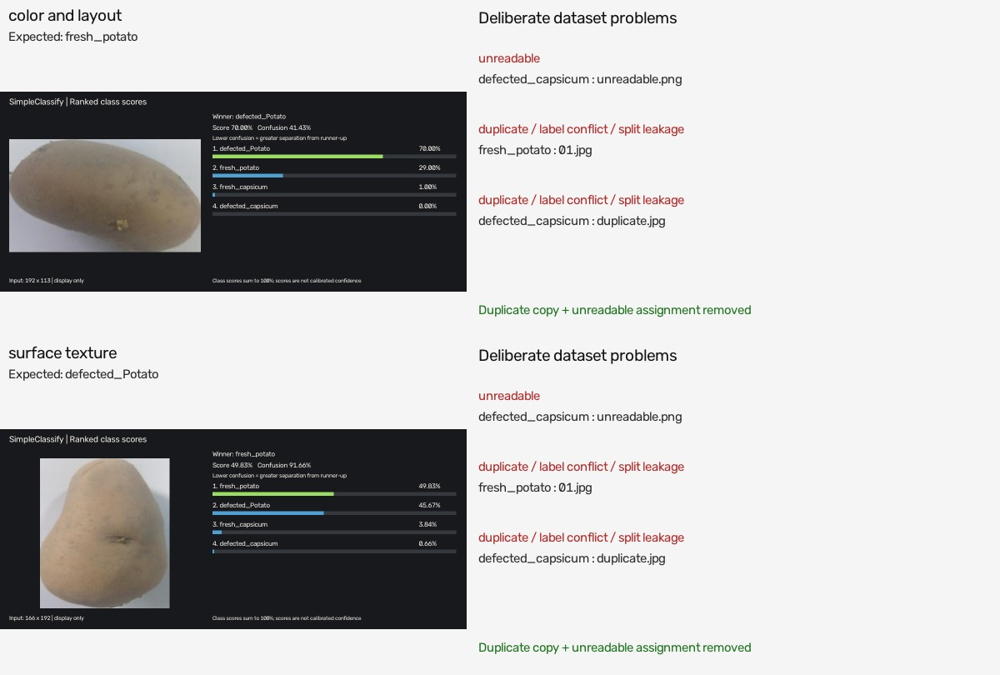

# SimpleClassify dataset checks and correction

Load this folder's `plugin.py` explicitly before opening a project. It verifies
the bundled 0.3.3 wheel without installing anything into the host. Restart first
if another classifier version has already been loaded.

This example explicitly selects the standalone disk-image trainer. The host's
built-in Capture from graph extension is maintained separately and has not been
modified. Preserve that extension when integrating these checks.

| Workflow on the same real VegQual images | Original model | Retrained workflow model |
| --- | --- | --- |
| Color and layout | [Open](vegqual/color_and_layout.json) | [Open](vegqual/retrained_color_and_layout.json) |
| Surface texture | [Open](vegqual/surface_texture.json) | [Open](vegqual/retrained_surface_texture.json) |

Both use the same four publisher classes, 96 training crops and 20 explicit
validation crops. The 16 test crops remain separate. These are two training
profiles on one dataset, not independent application benchmarks. Original
recipes remain unchanged alongside the new models.

## Check before training

Select **classifier → Train image classifier…**. Class filmstrips, saved health,
profile and assignments restore. The class count display remains visible before
and after edits. **Check dataset** reads the current files in the background and
opens **Dataset checks**. It performs no feature extraction, fitting or prediction.

The table reports all unreadable/unsupported images, exact duplicates, conflicting
labels, train/validation duplicate leakage and classes missing a split member.
Select or click a row to switch to the affected class and select its filmstrip
entry. Use **Remove selected**, **Move to class…** or **Toggle validation** as
appropriate, then recheck. Removing assignments keeps image files on disk.
Edits make old diagnostics stale and disable their links until refreshed.
Known blocking checks prevent staging or training until corrected.

The planned counts use the classifier's existing explicit or deterministic
automatic split rules. Counts are provisional when unreadable/duplicated files
remain. Exact duplicates use the existing normalized BGR pixel representation,
including the classifier's 16-to-8-bit conversion. This does not identify similar
views, shared physical specimens, blur or semantic labeling mistakes. Keep
related captures together yourself. Checks describe current assignments; they
do not establish historical training-image identity or model accuracy.

## Review and retain

Double-click an image or use **Review selected…** for its source and ranked
candidate scores; Fit, 100%, zoom and pan remain available. Original legacy
manifests may contain aggregate health without per-image held-out predictions.
The retrained projects retain those records, enabling held-out and misclassified
filmstrip filters after reopen.

Train, inspect held-out health/recall/confusion and individual scores, then
**Stage trained model → Apply configuration**. Staging changes the inspector
draft; the applied model remains active until Apply. Save As copies the exact
model and all referenced labeled images. Neither audit nor assignment correction
changes the inference algorithm, score normalization or confusion formula.
Scores sum to 100% but remain uncalibrated. Confusion is runner-up/winner × 100.



The example checker deliberately adds an unchanged training crop under a second
class as validation, plus an authored unreadable-file fixture. The three affected
entries are reported; the copied assignment and unreadable assignment are removed
before training. Files remain under `vegqual/audit_controls/` for reproduction,
and neither control appears in the final trained assignments. Real held-out
misclassifications are retained in the review images, not silently relabeled.

## Reproduce

Use the host interpreter with its existing OpenCV/ML and Qt installation. Choose
a new output folder:

```powershell
$env:QT_QPA_PLATFORM = "offscreen"
python check_training.py --output C:/path/to/new-classifier-training-review
```

The checker uses the actual inspector to audit, locate/remove assignments,
recheck, train, Stage, Apply, reopen and Save As both profiles. It verifies
original assets and copied model/image bytes. The source/wheel suites pass
33 checks; the earlier 33 inspection frames retain exact results and charts.
These are software/offscreen checks; hands-on operator acceptance remains open.

See [workflow receipts](validation_training.json),
[qualification](qualification.json), [wheel/source identity](wheel_verification.json),
[artifact pins](artifact_manifest.json), and [dataset attribution](SOURCES.md).
