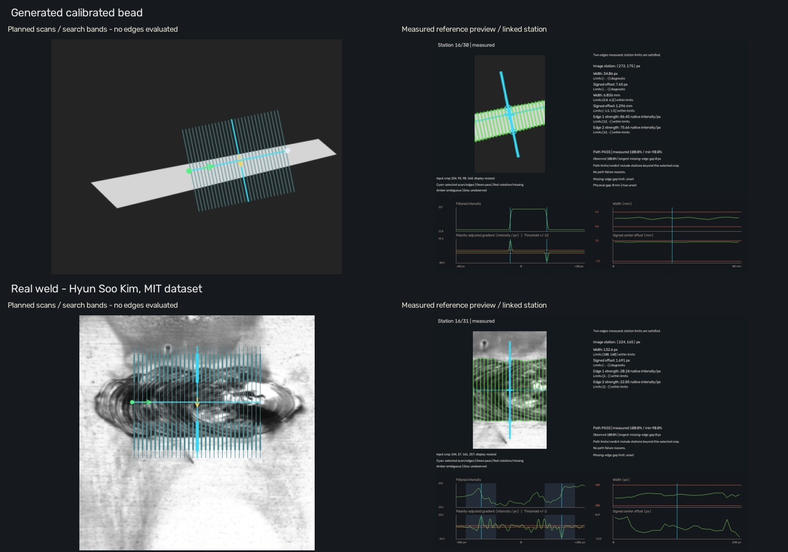

# SimplePathWidth guided setup

Load this folder's **plugin.py first**, then open a project below. The explicit
loader checks the bundled dev14 wheel without installing packages or changing the
host environment. Restart if another PathWidth package is already loaded.

| Example | Original setup | Reopened alignment control |
| --- | --- | --- |
| Generated calibrated bead | [Open](calibrated/project.json) | [Open](calibrated/staged_project.json) |
| Real weld photographs | [Open](weld/project.json) | [Open](weld/staged_project.json) |

The original replay includes nominal, narrow/off-path or failing weld images.
Original recipes and detector settings are unchanged. The staged projects use
the same reference path with a generated affine source-coordinate control; this
is a setup/relocation demonstration, not a measured camera/CAD alignment claim.
Real photographs retain their [MIT dataset attribution](SOURCES.md).

## Train and assess

1. Select the PathWidth block and **Train path width…**. The saved native-depth
   reference, editable path, alignment, direction and detector settings reopen.
   The summary explains reference-pixel coordinates, the source-to-reference
   matrix and retained DXF INSUNITS code when present. CAD source units alone
   do not calibrate inspection widths.
2. Import JSON/DXF and **Align path…** with a saved affine matrix or landmark
   pairs, trace an aligned binary mask, or edit points. Reverse changes path
   direction and the positive offset side. A closed path can start at its selected
   point. DXF/trace operations keep their existing optional dependencies.
3. **Show planned scans and search bands** displays geometry before inspection.
   Green arrow = path direction; yellow = positive scan offset; thick scan
   sections = configured search bands. The display samples at most 48 guide
   lines plus the selected scan; counts include every planned station. Corner
   exclusions and scans/bands outside the available image/span are reported.
   These guides have not evaluated intensities, edges, masks or coverage.
4. Use **Guide station**, or **Inspect planned scan** and click the image, to
   inspect a particular planned scan. **Focus planned scan**, **100%**, scroll
   zoom and Alt-drag pan help refine geometry. Detection, Limits, Physical and
   Advanced tabs keep the same settings/defaults in smaller groups. Invalid
   values disable Preview/Stage and explain what needs correction.
5. Attach a matching preview calibration for physical station spacing,
   plane-normal scans or physical band positions. Physical limits alone can
   still use an explicitly labeled pixel-only preview. They are not evaluated
   without calibration. A preview profile is temporary; runtime uses the wired
   profile. Reopen does not silently replace that runtime dependency.
6. **Preview on reference** measures the reference and opens the existing linked
   station/image/trend/native-profile review. Its measured edges and verdicts
   are separate from the planned guides. Setup changes mark the old preview
   stale and close it if still open. A reference pass is not held-out validation.
7. **Stage recipe** writes a new recipe into the inspector draft. **Apply** commits
   it. Cancel preserves the applied recipe. Save As copies the recipe/reference
   archive exactly; ordinary replay image inputs rebase to the original assets.



Full-size [real weld guides](weld/planned_guides.png) and
[measured station assessment](weld/preview/assessment.png) remain available.
The images compose the native foreground renderer onto reference pixels; they
are not desktop screenshots. The selected profile is sampled only during review.

## Reproduce

With the host's existing interpreter and SDK, choose a new output folder:

```powershell
$env:QT_QPA_PLATFORM = "offscreen"
python check_training.py --output C:/path/to/new-path-width-training-check
```

The checker uses the actual inspector: restore/cancel, import/align, reverse,
guide selection/focus, linked measured preview, invalid/stale edits, Stage without
Apply, Apply/reopen and exact recipe Save As. Original image/model assets remain
unchanged. [Native receipts](validation_training.json),
[wheel/source identity](wheel_verification.json), [qualification](qualification.json),
[earlier runtime comparison](runtime_parity.json) and
[artifact pins](artifact_manifest.json) document the checks.

Source and wheel-loaded suites each pass 58 checks, including the optional CAD
importer. Eight prior frames retain exact station/scalar/physical reports and
default result rasters; eleven frozen station exports verify. These are software
and native offscreen checks. Hands-on acceptance, interactive landmark editing,
path undo/history, background preview and independent dimensional qualification
remain future work.
