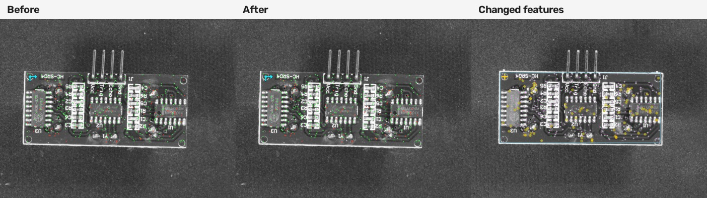

# SimplePatternMatch training and refinement

Load this folder's `plugin.py` explicitly before opening a project. It verifies
and loads the bundled dev3 wheel without installing a package into the host.
Restart first if another PatternMatch version is already loaded.

| Example | Images | Original project | Refined project |
| --- | --- | --- | --- |
| Asymmetric brackets | Generated multi-part tray and partial parts | [Open](brackets/project.json) | [Open](brackets/refined_project.json) |
| VisA PCB2 | Two real board photographs | [Open](visa_pcb2/project.json) | [Open](visa_pcb2/refined_project.json) |

Select the matcher and open **Train geometric recipe…**. The reference photo,
trained fine/coarse edges, ROI, datum, mask and saved settings are restored.
Weighted/refined models retain their geometry and photo; opening a new reference
starts replacement image training rather than discarding their weights implicitly.

The persistent **Model health** panel shows feature counts, resolved settings,
working scale, fine/coarse weak axes and weight range where available. These are
model diagnostics, not a confidence or accuracy percentage. Guidance above the
editor identifies the next capture, training, preview or staging step. Editing
the reference, ROI, datum, mask or feature settings makes the trained model stale
and disables staging until training succeeds. Search edits clear the preview and
prompt for a new one.

## Compare a refinement

Run the original project twice to publish its separate scene, choose that scene
output in the trainer's image picker, then **Capture scene** and **Run preview**.
Choose an individual accepted or
fine-measured rejected candidate, then **Refine selected match**.

The **Compare refinement** tab retains the actual before/after fixed-pose fits.
Switch **Before**, **After** and **Feature changes**; zoom/pan is preserved when
switching images of the same size. Views use recorded fits and do no new search
or refinement. Cyan marks the pose, green found edges, red missing edges and
amber unmeasured projections. Feature changes show old locations in magenta, new
locations in green and reduced weights in amber, on the original training
reference (or neutral geometry if its photo is unavailable). Before/After use
the captured refinement scene. Subpixel movement is drawn at its actual size.
The panel reports score, coverage, fit RMS and changed counts.

**Undo refinement** restores the preceding model exactly. Preview the candidate
model on separate images, then **Stage recipe**. Staging changes the inspector
draft; **Apply configuration** activates it. Close/Cancel leaves the applied
recipe unchanged. Save As copies the recipe plus its optional retained reference
and refinement PNGs. Legacy recipes without these PNGs still display saved edges.
The comparison itself is session-only; reopen restores the latest model and
images, not an invented history of earlier models.

| Recorded example | Fixed-pose score before | After | Moved / downweighted | Scene matches before / after |
| --- | ---: | ---: | ---: | ---: |
| Brackets | 0.972136 | 0.972866 | 348 / 0 | 4 / 4 |
| PCB2 | 0.664653 | 0.745001 | 389 / 90 | 1 / 1 |

These scores use the image being refined. They are not held-out improvement
claims. The underlying matcher, recipes' original settings and processing route
are unchanged. Original projects remain available alongside the staged/applied
refined copies. [Validation](validation.json) records the actual inspector
workflow, undo, original preservation, Apply/reopen and exact-recipe Save As.



## Reproduce the workflow

Use the application's interpreter with Qt and its existing OpenCV dependencies.
Choose a new output folder; no acquisition or physical equipment is involved.

```powershell
$env:QT_QPA_PLATFORM = "offscreen"
python check_training.py --output C:/path/to/new-training-review
```

The checker opens the actual inspector, previews/refines, undoes, stages, applies,
reopens and relocates both examples. Offscreen API checks do not replace a
hands-on operator acceptance pass. No source repository or model download is
required. [Artifact pins](artifact_manifest.json) cover the delivered files;
[wheel provenance](wheel_verification.json) records module checks and unchanged
execution logic. [Sources and licenses](SOURCES.md) cover both image sets.
