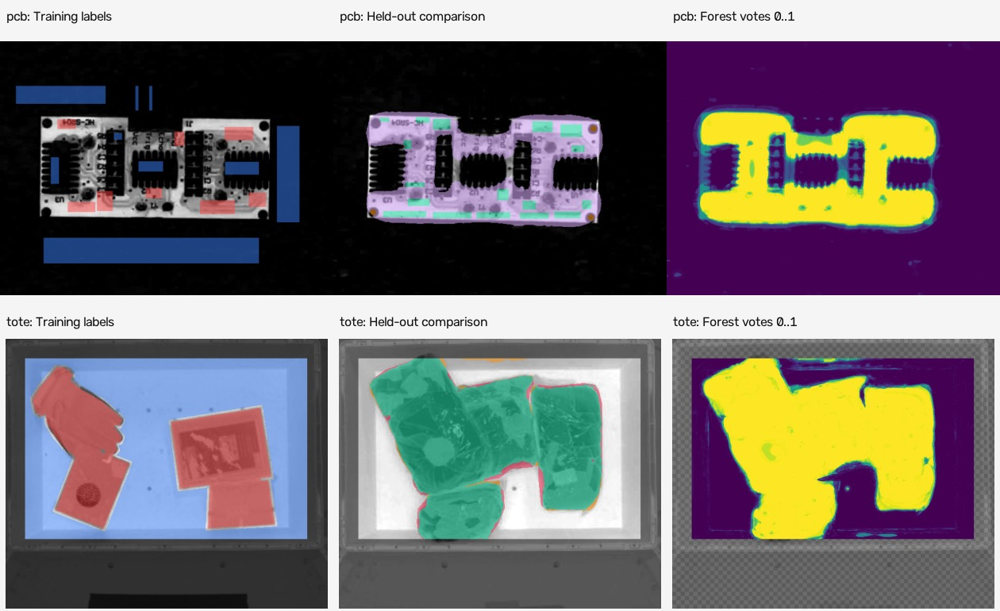

# SimpleSegmentation retained training

Load this folder's `plugin.py` explicitly before opening a project. It checks the
bundled dev3 wheel and uses the host's existing OpenCV/ML and Qt environment.
Restart first if another SimpleSegmentation version is already loaded. Nothing
is installed into the host by this example.

| Real-image example | Original project | Retained-training project | Training / validation images |
| --- | --- | --- | ---: |
| VisA PCB exposed laminate | [Open](pcb/project.json) | [Open](pcb/trained_project.json) | 1 / 1 |
| ARMBench tote inventory | [Open](tote/project.json) | [Open](tote/trained_project.json) | 2 / 2 |

Select **segment**, then **Train segmentation candidate…**. The trained projects
verify their retained inputs in the background, restore the training and
validation manifests into private editable copies, and immediately show the
first training image's annotations. Red is foreground, blue background and dim
pixels are excluded/unobserved. This first view makes no prediction. Counts show
the pixels and image splits actually used; they are not an accuracy score.

## Annotate, train and retain

**Open training labels** opens the native-grid editor with saved annotations,
original display names and native 8/16-bit values. The wand, editable polygon,
rectangle/circle/ellipse, aligned mask import, label import, zoom/pan and Undo
remain available. Full saved labels are retained before inspection-region
clipping, including annotations outside the current care region.

**Save mask** writes to the private draft. Train a new candidate, review it on
separate validation images, then **Stage candidate → Apply configuration** to
retain those annotation changes with a new model revision. Close/Cancel leaves
the applied model and its source record unchanged. Keeping a cutoff alone does
not create a new training record. Private drafts remain in the project's ignored
`.local/segmentation-drafts/` directory; reopening creates a fresh copy of the
applied record.

Staged candidates retain the exact decoded grayscale training/detail images,
categorical labels, optional validity masks and last evaluated validation split
as lossless PNGs. Manifests, counts, split fingerprints and source basenames are
stored alongside them. Each member has a SHA-256, and the record identifies its
model and region hashes. Original color/encoded camera files are not substituted
for the native grayscale pixels actually supplied to training. Unlabeled drafts
skipped by saved-mask-only training remain outside the trained snapshot.

Changing a candidate's validation manifest discards its old validation snapshot.
**Evaluate validation set** retains the new evaluated inputs without fitting the
model again. Training-pixel duplicates are rejected, including when reviewing a
reopened model that has a retained training record. Legacy models without one
continue to inspect and display explicit source-unavailable guidance in training.

Save As copies the model, region, receipt and all referenced training inputs.
It preserves their exact bytes; reopened projects do not depend on the old source
folder for annotation restoration. Retention and verification add training,
restoration and save-time storage/I/O; the inspection execution path is unchanged.

## Assess the score maps

Open validation labels before displaying predictions when labeling independently.
**Show prediction** computes the current frame once. **Cutoff**, **Min px** and
**Score heatmap** reuse its cached votes. A foreground vote fraction is an
uncalibrated forest score, not a calibrated probability. The saved NPZs preserve
native votes, inspected coverage and the corresponding labels; NaN marks
uninspected pixels in these native training-review scores.

The gallery shows retained training labels, held-out comparison and fixed 0..1
votes. In the comparison, green is hit, red missed foreground, amber extra
foreground and purple unlabeled prediction. The heatmap uses Viridis; checks
mark uninspected areas. These examples use the existing masks/settings and
example-drawn labels, not new publisher-provided segmentation truth.



## Reproduce

Use the application's interpreter and choose a fresh output folder:

```powershell
$env:QT_QPA_PLATFORM = "offscreen"
python check_training.py --output C:/path/to/new-segmentation-training-check
```

The checker exercises the actual inspector's Train/Stage/Apply/reopen flow,
native annotation edit/Undo/Save, initially hidden prediction, one-inference
score review and byte-exact Save As. The original model and applied sources stay
unchanged during private edits. Offscreen checks do not replace a hands-on
operator acceptance pass. Existing models' eight earlier replay frames retain
exact numerical reports and result rasters.

[Workflow receipts](validation_training.json), [source/wheel identity](wheel_verification.json),
[qualification](qualification.json) and [artifact pins](artifact_manifest.json)
record the checked scope. See [sources, licenses and changes](SOURCES.md).
