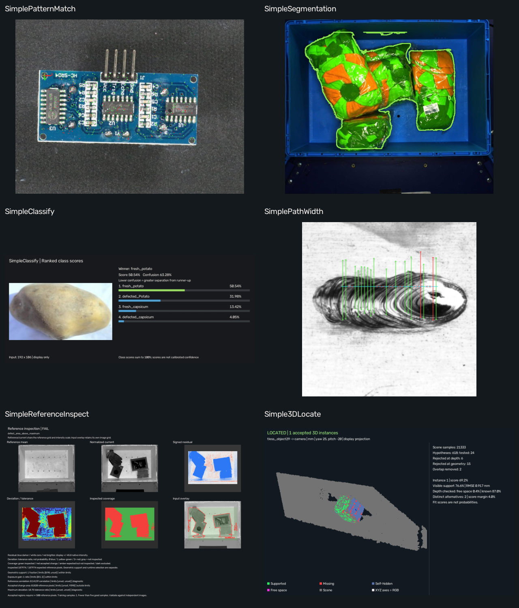

# Real-data examples for all six Simple Plugins

These projects use real photographs or measured RGB-D data. Install the
corresponding Simple Plugins, open a project and run once per frame.
Saved inputs, result images, measurements and 3D result clouds are included.
The generated examples elsewhere remain useful regression fixtures.

The 3D project opens its native **Cloud / fit** flyaround preview. The PNGs
on this documentation page are secondary static exports; native result
clouds remain available to orbit in the app and as PLY files.



| Tool | Runnable project | Data/license | Recorded scope |
| --- | --- | --- | --- |
| SimplePatternMatch | [VisA PCB localization](../pattern_matching/visa_pcb2/project.json) | [VisA, CC BY 4.0](../pattern_matching/visa_pcb2/SOURCES.md) | Two real photos; one match each, pose checks against approximate mounting-hole annotations. |
| SimpleSegmentation | [Tote inventory foreground](../pixel_segmentation/armbench_tote/project.json) | [ARMBench, CC BY 4.0](../pixel_segmentation/armbench_tote/SOURCES.md) | Separate loaded/empty captures; approximate example-authored polygons and inspected-region metrics. |
| SimpleClassify | [Produce quality classes](../image_classification/vegqual/project.json) | [VegQual v4, CC BY 4.0](../image_classification/vegqual/SOURCES.md) | Publisher labels/splits; 10/16 correct test predictions. All six mistakes remain in the gallery. |
| SimplePathWidth | [Weld bead widths](../path_width/weld_bead/project.json) | [Hyun Soo Kim, MIT](../path_width/weld_bead/SOURCES.md) | Three real weld photos; edge/width diagnostics, including a failing result. No claim of calibrated width ground truth. |
| SimpleReferenceInspect | [Clear versus occupied tote](../reference_inspect/armbench_tote/project.json) | [ARMBench, CC BY 4.0](../reference_inspect/armbench_tote/SOURCES.md) | Separate empty and three loaded captures; stated 5% cavity-change rule and fixed imaging assumptions. |
| Simple3DLocate | [Depth-verified clutter](../3d_locate/real_tless/depth_verified/project.json) | [T-LESS, CC BY 4.0](../3d_locate/real_tless/source/ATTRIBUTION.md) | Real first-surface RGB-D scene; one selected successful pose. Wider misses remain documented. |

Also open the new [posed VisA reference-inspection project](../reference_inspect/visa_pcb2/project.json).
It retains eight aligned good training images and eight publisher-held-out
normal/anomalous test images, with real defect masks used only for evaluation.
All four normal tests currently false-alarm, and one annotated defect has zero
pixel recall. This is an inspectable hard case rather than a qualified model.

## Assess the results

[samples/receipt.json](samples/receipt.json) records **28 actual graph replays**.
[samples/runtime.json](samples/runtime.json) records Python/OpenCV/NumPy,
installed tool versions and the host runtime source revision when available.
For each tool/frame, its folder contains:

- **input.png:** the real input photo, or the corresponding T-LESS RGB capture.
- **result.png:** the unmodified result image emitted by the saved project.
- **comparison.png:** a display page with input, result and scope.
- **result.json:** source-file hash, result-pixel hash and numeric outputs.
- **fit.ply / aligned_model.ply:** native 3D outputs for Simple3DLocate.

Open the linked project's trainer to review retained references, labels,
regions and settings. Open its README before changing the recipe: some
examples intentionally use upstream preprocessing or supplied segmentation.
The T-LESS showcase uses the full scene and depth verification without an
object mask; other T-LESS examples explicitly document supplied masks.

A block processing state of pass means processing succeeded. For classification,
compare the predicted label with the expected publisher label in result.json;
it does not mean the prediction is correct. Segmentation has no invented
defect verdict. Scores and tolerance ratios retain their tool-specific meaning.
The overview selects one declared frame per tool; all replay frames are retained.

## Rebuild and reproduce

From the host repository root, with all six tool integrations installed:

```powershell
python "examples/Simple Plugins/real_data/build_gallery.py" .local/new-real-data-gallery
```

The script reads the saved projects in [catalog.json](catalog.json) and refuses
an existing output directory. It runs the actual graphs, rather than painting
invented detections. Rendering and local execution timings are not a cycle-time
benchmark. Model or backend revisions may change results; keep the recipe/input
pins when comparing them.

Each linked example includes its own training/source builder and provenance.
The new tote builder uses the pinned five-photo archive. The posed PCB builder
downloads only 16 pinned original photos and four masks, preserving the
publisher's one-class train/test roles.

## License and attribution

The code is MIT. Data and all derived previews, retained training pixels,
annotations and clouds keep the licenses listed above. The publisher licenses
were rechecked on **2026-11-13**; see [license_audit.json](license_audit.json).
An online dataset's availability is not itself permission to redistribute it.

Credit the original creators when copying these examples or derived graphics:

- **VisA:** Yang Zou, Jongheon Jeong, Latha Pemula, Dongqing Zhang and Onkar
  Dabeer, *SPot-the-Difference*, ECCV 2022.
  [Publisher and license](https://registry.opendata.aws/visa/).
- **ARMBench:** Amazon.com, Inc.; Chaitanya Mitash, Fan Wang, Shiyang Lu,
  Vikedo Terhuja, Tyler Garaas, Felipe Polido and Manikantan Nambi, ICRA 2023.
  [Publisher and license](https://www.armbench.com/).
- **VegQual v4:** Tarek Rahman, Md Rahadul Islam Jishan, Robiul Islam,
  Md Rakibul Islam, Jannatul Tajrian, Md. Sakhawat Hossain, Suman Ahmmed and
  Ohidujjaman. [Dataset](https://doi.org/10.6084/m9.figshare.30596084.v4).
- **Weld bead images and masks:** Hyun Soo Kim (2024), Figshare v1.
  [Dataset](https://doi.org/10.6084/m9.figshare.25904014.v1).
- **T-LESS:** Tomáš Hodaň, Pavel Haluza, Štěpán Obdržálek, Jiří Matas,
  Manolis Lourakis and Xenophon Zabulis, WACV 2017.
  [Publisher and license](https://cmp.felk.cvut.cz/t-less/).

Changes include the documented resizing, crops, grayscale/color transforms,
example-authored labels, depth-to-cloud conversion, model training and result
annotations. No dataset-author endorsement is implied. These compact examples
demonstrate workflows and known failures; independent application qualification
remains necessary.
