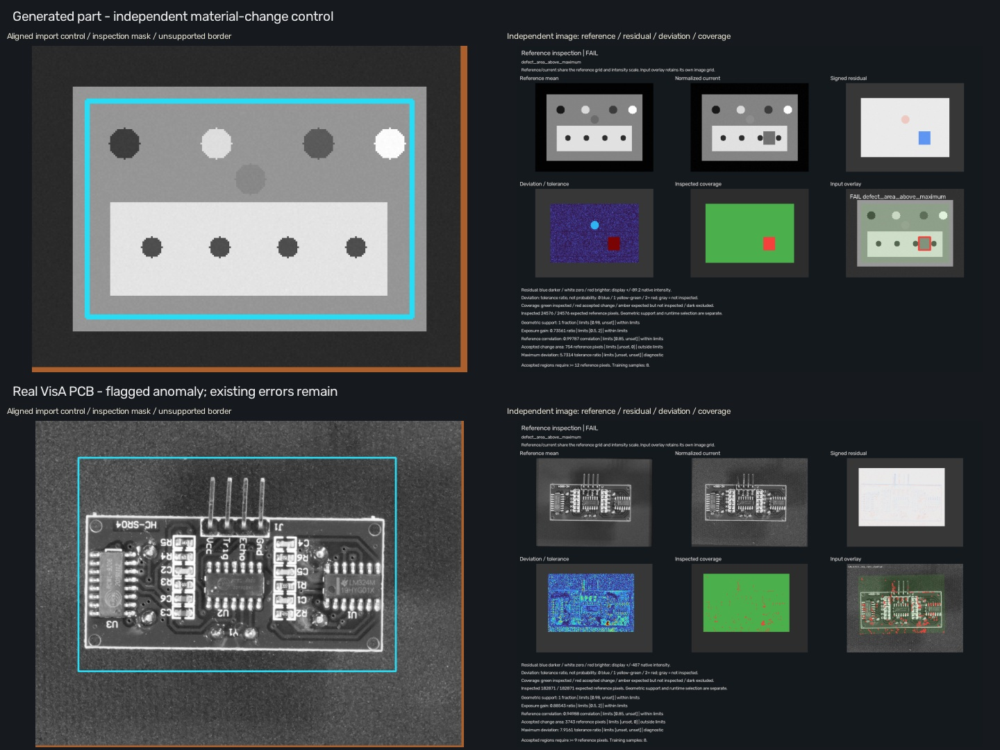

# SimpleReferenceInspect background training

Restart if either tool package is already loaded. Load **pattern_plugin.py**, then
**plugin.py**, before opening a project. The checksum-pinned PatternMatch dev2 and
ReferenceInspect dev5 wheels run without installing packages into the host.

| Example | Original | Trained workflow |
| --- | --- | --- |
| Generated material-change control | [Open](generated/project.json) | [Open](generated/staged_project.json) |
| Real VisA PCB hard case | [Open](visa_posed/project.json) | [Open](visa_posed/staged_project.json) |

The workflow models use the same eight good samples, masks and detector settings
as the originals. All trained arrays and original health values match exactly;
only the new source-description metadata is added. An authored shifted-image
import control is removed before fitting. No held-out image or defect annotation
is added to training. The real PCB's existing false alarms and incomplete defect
coverage remain errors, not qualified inspection results.

## Train a new reference set

1. Open **Train reference inspection…**. Saved aligned good samples, support maps,
   masks, settings, fixture and health reopen. **New reference set** starts a draft.
   Add the first reference image, then other already aligned good images. Names
   of newly taught samples persist after retraining. Legacy recipes without
   source descriptions use generic sample names.
2. For an unaligned disk image, use **Import image + alignment…**. Select the good
   source image and a JSON 2 × 3 affine matrix that maps **reference coordinates
   into source-image coordinates**. A raw matrix or
   `{"reference_to_image": [[1, 0, 4], [0, 1, 3]]}` is accepted. This is explicit
   alignment, not an automatic pose search. The original source file is unchanged.
   Paired wired image/fixture capture remains available with its existing frame
   and acquisition checks.
3. Inspect the aligned sample. Dim border pixels lack full interpolation support.
   The selected-sample description shows its name, import convention and matrix.
   The setup summary counts both masks and the pixels unsupported by any sample.
   **Common sample coverage** helps place both masks inside the available support.
   Unsupported masks, too few selected pixels, invalid settings or an exceeded
   sample budget prevent training before a job starts.
4. Edit/import inspection and stable normalization masks. Existing rectangle,
   circle, polygon, add/exclude, zoom and Undo controls remain available. Saved
   masks retain their exact raster pixels, holes and disconnected regions;
   original vector-shape handles are not retained. Cancel keeps the prior masks.
5. **Train references** fits a private snapshot on one bounded background worker.
   Editing and staging controls stay disabled while it runs; the filmstrip and
   image zoom remain usable. **Cancel training** stops between samples/statistics
   phases, after any running native array operation finishes. Cancelled, stale or
   closed-window jobs cannot publish a model or alter the applied recipe.
6. Review the persistent health/variation and inspect independent images. Reference
   health does not establish held-out accuracy. Disk tests must be aligned; use
   **Inspect wired image + pose** for source-frame images when a fixture is taught.
   **Review last inspection…** reuses cached results for synchronized maps/native
   exports, without another inspection or exposure fit.
7. **Stage recipe** writes a new archive into the inspector draft. **Apply** commits
   it. Reopen restores the samples/support/masks and saved descriptions. Save As
   copies the archive exactly; ordinary image inputs rebase to the original
   assets. Saved recipes keep aligned float32 native-intensity samples and support,
   not original encoded/pre-alignment acquisitions. Import matrix descriptions
   do not establish historical acquisition identity.



Full-size [PCB alignment/support control](visa_posed/alignment_support.png) and
[independent anomaly assessment](visa_posed/review/assessment.png) remain available.
These are programmatic result graphics, not desktop screenshots. Deviation is a
tolerance ratio, not a probability. Gray uninspected pixels are not a passing zero.

## Reproduce and scope

Use the host interpreter and a fresh output directory:

```powershell
$env:QT_QPA_PLATFORM = "offscreen"
python check_training.py --output C:/path/to/new-reference-training-check
```

The actual inspector exercises restore/cancel, mask edit/Undo, explicit affine
import, unsupported-mask diagnosis, cancellation, unchanged-input training, cached
independent review, Stage without Apply, Apply/reopen and exact archive Save As.
Source/wheel suites each pass 30 checks; 11 existing host checks cover fixture,
mask, training and review behavior. Three additional packaged checks verify pins
and both portable native workflows. Nine prior runtime frames and nine frozen
exports retain exact reports, maps and default result rasters.

See [native receipts](validation_training.json), [qualification](qualification.json),
[source/wheel identity](wheel_verification.json), [runtime parity](runtime_parity.json),
[artifact pins](artifact_manifest.json) and [dataset attribution](SOURCES.md).
These are native offscreen/software checks. Hands-on acceptance, graphical
landmark fitting, retained pre-alignment acquisitions, editable vector-region
history, background archive restoration and larger-corpus streaming remain open.
Independent inspection accuracy qualification remains separate.
