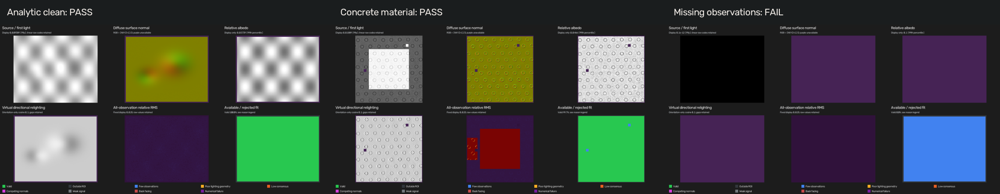

# SurfaceEnhance lighting and reference training

Load **plugin.py first**, then open a project below. The checksum-pinned dev5
wheel runs without installation. Restart if another SurfaceEnhance version is
already imported. Use a current host with independent Results and paired input
snapshots. Normal maps are directions; these examples emit no metric XYZ/height.

**Powered by Poly Haven.** The concrete material maps are *Anti Slip Concrete*
by **Charlotte Baglioni**, **CC0 1.0**. All light stacks here are **rendered diffuse
controls**, including the material-derived example. They are not acquired camera
stacks or measured physical accuracy evidence. See [sources and changes](SOURCES.md).

| Project | Independent execution outcome |
| --- | --- |
| [Analytic clean](../../training/analytic_clean.json) | 19,344 / 19,344 available pixels; pass. Explicit capture-manifest replay. |
| [Concrete material](../../training/connected_material.json) | 63,304 / 63,504; pass. Contaminated recorded stack connected separately from clean training. |
| [Missing observations](../../training/missing.json) | 0 / 19,344; fail. Good retained training cannot replace missing runtime observations. |

Finished staged versions retain the same reference/settings and add their
reference-fit record: [analytic](../../training/analytic_clean_trained.json),
[concrete](../../training/connected_material_trained.json),
[missing](../../training/missing_trained.json). Every numerical report, raw map and
default result raster matches the original outcome exactly. The shared execution
gate remains 95% available coverage, which does not measure accuracy or quality.

Select the SurfaceEnhance block, then **Set up lighting and reference** in
Configuration. The editor restores every source plane, full-precision light
direction/power/exposure, inspection mask, virtual light and fit settings.

1. Read the persistent setup summary: physical frame and pixel grid, light order,
   surface-to-light directions, camera axes, normal convention, black/ceiling,
   relative power and actual exposure seconds. Source codes are linearized by
   the caller. Normal direction and relative albedo are not physical height or
   calibrated reflectance. Labels alone do not establish registration/synchrony.
2. Choose **Audit source observations**. Its background worker reports available,
   nonfinite, at/below-black, at-ceiling and outside-ROI counts per light. It uses
   the same preparation contract as execution, without fitting normals or
   relighting. Enough available lights and a global light-rank ratio do not prove
   local conditioning, diffuse consensus or accuracy. Audit results are session-only.
3. Select a light in either table or the source selector; all three stay linked.
   Enable **Show unavailable source observations** for display-only flags: blue
   at/below black, red ceiling, magenta nonfinite, gray outside ROI. Cyan outlines
   show inspection boundaries. Zoom, pan, Fit and 100% help inspect native pixels.
4. Import a source-aligned mask, draw a rectangle or move/resize its handles.
   Imported arbitrary masks remain exact until explicitly replaced. Edits clear
   stale audit/fit evidence. Invalid settings disable Audit/Preview/Stage and show
   a reason. Only small definitions validate while typing; full stack validation
   and copying run in the preview worker.
5. **Preview reference fit**, then review normal/albedo, residual, unavailable
   reasons and virtual-light tabs. **Preview another capture** or **Preview
   connected capture** tests the frozen draft. Reference health remains separate
   from the last independent preview. Missing-data failures remain visible and
   never replace the retained reference.
6. **Stage recipe** changes only the inspector draft. **Apply configuration**
   activates it. Cancel preserves the applied model. Reopen and Save As preserve
   exact archive bytes, all native reference planes/mask and lighting/settings.

Controls scroll while Audit/Preview/Stage/Cancel remain in a fixed footer, checked
at 1024×768 and 800×600. Run in Debug and open **Review completed surface maps…** in
Results to inspect the frozen executed source/reference/light/map/pixel record
without another fit, relight, calibration or source/model reload.

Run `python check_training.py --output C:\path\to\new-output` with the host
Python. The output must be new. Three actual offscreen inspector workflows check
restore/cancel, invalid/stale edits, audit without fit, linked source selection,
zoom, reversible ROI editing, reference and independent previews, Stage without
Apply, Apply/reopen, cached completed review and byte-exact Save As. No desktop
input or window capture is used. [Evidence](evidence), [native receipts](validation_training.json)
and [qualification](qualification.json) retain the checks. The nine prior
completed-runtime cases and six exports also verify unchanged with this wheel.

Acquired calibrated stacks, dark/flat/light calibration, near-field/material
models, Undo/history, background file restoration and finer native-phase
cancellation remain future work. Publisher access prevented the small acquired
sphere candidate from being used; it is not included or claimed as validation.
Hands-on operator and independent physical qualification remain open.
