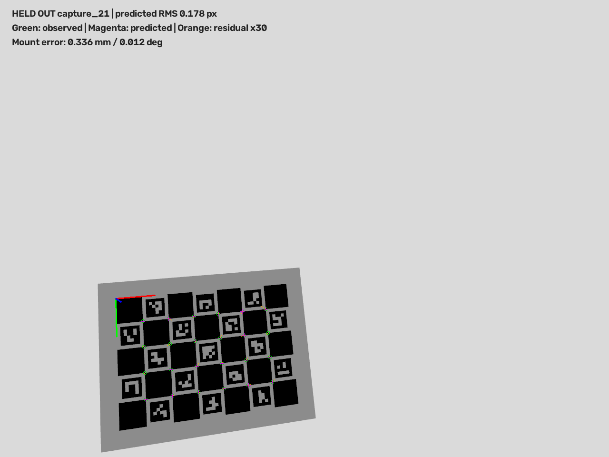
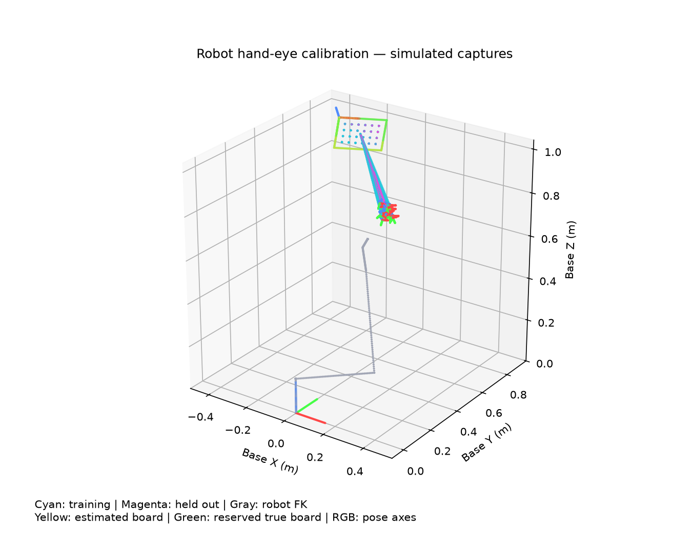

# ROS 2 robot hand-eye calibration

This example calibrates a camera mounted on a simulated UR5e from **rendered
ChArUco images and robot feedback**, then checks five unused views. The saved
project runs offline; the accompanying ROS package reproduces acquisition in
an isolated robot workcell.

## Open and run

Install the example's optional numerical dependency in the application
environment: `python -m pip install "scipy>=1.15,<2"`. Matplotlib is needed only
for the additional exported figure: `python -m pip install "matplotlib>=3.8,<4"`.
Use the app interpreter for these commands and preserve its existing OpenCV.

1. In OpenCVDataflowGUI, choose **File → Load Python plugin** and select
   [hand_eye_review.py](hand_eye_review.py).
2. Open [ros2_hand_eye_refined.json](ros2_hand_eye_refined.json) and **Run once**.
3. Double-click **Captured robot views** to inspect the 20 training and 5
   **HELD OUT** thumbnails. Each view contains the original image, matching
   CameraInfo/robot pose, built-in ChArUco detection and built-in PnP.
4. Review the initial **Fit camera mount**, the optional **Refine using training
   pixels only**, and the final **Check 5 unused views**.
5. The final block's **Cloud** output uses the native flyaround thumbnail/viewer.
   Its **Overlay** output shows observed/predicted corners, pose axes and
   magnified residual vectors; **Report** gives numerical results per view.

From the repository root, the equivalent offline check is:

```powershell
python -m opencv_dataflow.assistant_cli --plugin "examples/industrial integration/ros2_hand_eye_calibration/hand_eye_review.py" validate "examples/industrial integration/ros2_hand_eye_calibration/ros2_hand_eye_refined.json"
python -m opencv_dataflow.assistant_cli --plugin "examples/industrial integration/ros2_hand_eye_calibration/hand_eye_review.py" run "examples/industrial integration/ros2_hand_eye_calibration/ros2_hand_eye_refined.json" --summary
```

Run with the application's interpreter. This replay opens no ROS connections
and sends no robot commands. Save As copies the complete retained capture set,
motion records and evaluation asset; subsequent replay needs no simulator.

## Results and comparison cases

| Route | Mount translation / rotation error | Worst held-out reprojection RMS | Judgment |
| --- | --- | --- | --- |
| [Limited joint perturbations, Park only](ros2_hand_eye_calibration.json) | 4.682 mm / 0.500° | 0.998 px | Fails 2 mm mount gate |
| [Broader camera poses, Park only](ros2_hand_eye_diverse.json) | 2.522 mm / 0.184° | 1.621 px | Fails mount and pixel gates |
| [Broader poses + training-pixel refinement](ros2_hand_eye_refined.json) | **0.336 mm / 0.0119°** | **0.1785 px** | Passes frozen demo gates |

The first two projects intentionally retain failed baselines. Their run commands
return a failing judgment. Thresholds remain 2 mm / 1° mount error, 1 px worst
held-out RMS and 2 mm / 1° held-out board-consistency RMS. These are simulation
demonstration gates, not a physical accuracy specification.





The [assessment](results/assessment.json) contains every held-out result.
An independent fresh 25-view session also passed, with 0.364 mm / 0.0128° mount
error and 0.1585 px worst held-out RMS; its
[repeat assessment](results/repeat_assessment.json) is retained separately.
[Refinement details](results/refinement.json) record the fixed intrinsics,
training-only assignment, residual improvement and conditioning.
The [colored result cloud](results/calibration_review.ply) can also be opened
with **Load PLY / PCD point cloud**. Cyan marks training rays/corners, magenta
held-out rays/corners, yellow the estimated board, green reserved board truth,
gray the last measured-joint model-FK skeleton and RGB the pose axes.

## What is fitted

The stationary target has 7×5 squares, 30 mm square sides, 22 mm markers,
`DICT_4X4_50` and the nonlegacy layout. Its 24 inner corners have stable IDs.
The board origin is the upper-left **pattern** corner, excluding the 20 mm white
margin; +X runs right, +Y down and +Z into the plate. The full face is 250×190 mm.

All transforms use meters and map child coordinates into parent coordinates:

```text
G_i = base_link_from_tool0              exact image-time robot TF
C_i = camera_optical_from_charuco_board detected corners + PnP
X   = tool0_from_camera_optical         estimated camera mount
Y   = base_link_from_charuco_board      estimated stationary target
G_i @ X @ C_i = Y
```

The existing hand-eye block supplies the Park–Martin initialization. The
example-local refinement minimizes training corner reprojection errors over
the two rigid transforms X and Y, with camera K/D fixed, a bounded SciPy solve
and a robust pixel loss. It receives **only training observations**. The five
held-out captures and separate `evaluation_only.json` have no connection to
either fitting stage. The known simulator mount is used for scene/acquisition
design and later evaluation, never as an estimator seed.

Review predicts held-out corner positions from the fixed fitted X/Y and each
robot pose; it does not refit the board to each held-out image. Independent PnP
on those images also measures reconstructed-board consistency. The renderer's
CameraInfo is the supplied intrinsic model for this example. Physical use needs
an independently qualified lens profile, target geometry, timing and robot model.

## Reproduce robot acquisition

The reusable [opencv_hand_eye_demo ROS package](../../../integrations/ros2/packages/opencv_hand_eye_demo/README.md)
provides preparation, native launch, collision-checked pose sweep and exact-time
capture. Follow its commands with a new overlay and unique partition. It uses
the allocated locked native runtime read-only; generated robot descriptions,
world, state, logs and warehouse stay in the private overlay. No shared
bin-picking or other workcell is reset.

Use [assets_diverse/scene.json](assets_diverse/scene.json) for the recommended
capture protocol. It fixes the 20/5 assignment and reachable camera-pose targets.
MoveIt still plans and checks the actual robot/tool against the target plate;
offline IK in the scene generator is not a collision certificate.

After a complete native capture, export it into a **new** dataset/project name:

```powershell
python "examples/industrial integration/ros2_hand_eye_calibration/build_example.py" --native-captures C:/path/to/NEW_CAPTURES --scene "examples/industrial integration/ros2_hand_eye_calibration/assets_diverse/scene.json" --robot-description C:/path/to/OVERLAY/generated/ur5e.urdf --dataset captures_new --project hand_eye_new.json --build --refine
python "examples/industrial integration/ros2_hand_eye_calibration/build_example.py" --project hand_eye_new.json --replay-output C:/path/to/NEW_REVIEW
```

The exporter preserves original RGB pixels losslessly as PNG, verifies their
decoded bytes, retains CameraInfo, exact-time TF, joints, native trajectory/
execution receipts and identities. Canonical JSON digests tolerate checkout
line-ending conversion; original native record hashes remain recorded. Existing
datasets, programs and review directories are preserved.

The review export includes a measured mount, fitted board, colored PLY and a
JSON/YAML-compatible static-transform template. The template uses a distinct
`hand_eye_estimated_camera_optical_frame` so review never gives the real camera
frame a second parent. It is not automatically published.

## Validation and remaining work

The focused tests cover the full rendered replay, held failed baseline,
complete Save As, truth exclusion, held-out exclusion, wrong-time/missing/corrupt
captures, graphics-off equivalence and metric board/isolated-preparation rules.
[Native acceptance](native_acceptance.json) distinguishes acquisition evidence
from offline solve/review. Collision checks are sampled, not a continuous proof.

Follow-ups: promote the optional reprojection stage into a reusable calibration
tool, add guided live capture in the app, qualify lens/pixel-center conventions,
moving acquisition/time offsets, eye-to-hand mode, uncertain-input weighting
and physical reference measurements. Rendered synthetic scenes do not qualify
printer scale, physical optics, robot TCP accuracy or production operation.

## Attribution and licenses

Scene geometry, captures, adapters and example code are original MIT-licensed
work in this repository. The target is generated with OpenCV's ChArUco/ArUco
dictionary; no external dataset images are included. See the
[OpenCV ChArUco documentation](https://docs.opencv.org/4.13.0/df/d4a/tutorial_charuco_detection.html)
and [OpenCV license](https://github.com/opencv/opencv/blob/4.x/LICENSE) (Apache-2.0).
The Park–Martin method is described by
[Park and Martin, 1994](https://doi.org/10.1109/70.326576).
[SciPy](https://github.com/scipy/scipy/blob/main/LICENSE.txt) uses BSD-3-Clause;
[Matplotlib](https://matplotlib.org/stable/project/license.html) has its own
BSD-compatible license. Native simulation depends on separately installed
[UR5e descriptions](https://github.com/UniversalRobots/Universal_Robots_ROS2_Description#license)
(BSD-3-Clause; other UR models can have different mesh terms), ROS 2, MoveIt
and Gazebo; their licenses remain separate.
No robot meshes or modified vendor launch sources are redistributed by this example.
